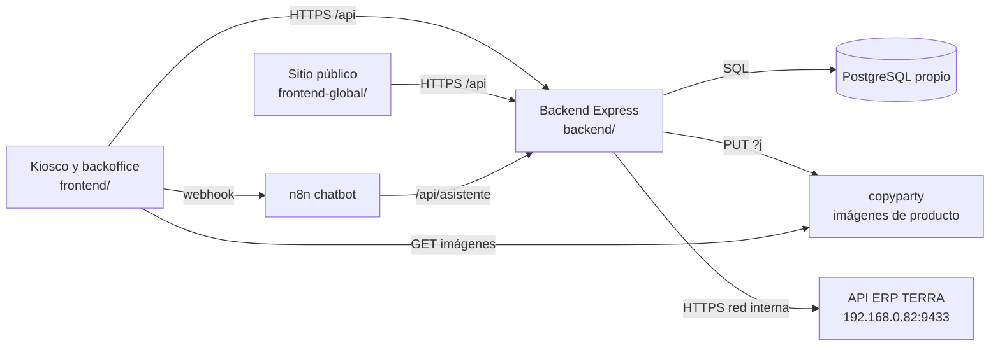

# Arquitectura

Visión de conjunto del sistema. Detalle por archivo en [[ANALISIS_PROYECTO]] (anterior a los cambios del 28/10). Estado del trabajo en [[00-roadmap]].

## Componentes

## Stack

| Parte | Tecnología |
|---|---|
| `frontend/` | React 19, Vite 8, Tailwind v4, react-router 7. Kiosco de autoservicio, backoffice (admin, vendedor, despacho) y portal mayorista. |
| `frontend-global/` | React 19 + Vite sin router. Sitio público; se despliega aparte. |
| `backend/` | Node 24, Express 5 (ESM), `pg` sin ORM, `bcryptjs`, `multer`. |
| Base de datos | PostgreSQL 18 propio. Conexión por `DATABASE_URL`; TLS solo con `DB_SSL=true` (hoy sin TLS, ver [[pendientes-terceros]]). |
| Pruebas | `node --test` en el backend (Postgres local desechable, servidores falsos de ERP y copyparty); vitest + `node --test` en el frontend. |

## Servidores y despliegue

- **Backend**: debe correr como proceso persistente (`node server.js` con PM2 o como servicio de Windows) **dentro de la red interna**, porque:
  - el ERP de TERRA solo es alcanzable en `192.168.0.82:9433`;
  - la caché del token del ERP (8 h) y el límite de intentos de login viven en memoria del proceso.
- Hoy `frontend/public/config.js` apunta a un backend en Vercel (`backend/vercel.json` lo publica como función serverless). Desde ahí el ERP no es alcanzable: queda como pendiente en [[00-roadmap]].
- **Frontend**: SPA estática en Vercel. `frontend/public/config.js` (`window.TERRA_CONFIG`) define en tiempo de ejecución la URL de la API, el webhook de n8n y el WhatsApp de atención; se edita sin recompilar.
- **n8n**: chatbot del kiosco. El webhook actual es un túnel efímero de Cloudflare (`*.trycloudflare.com`), así que cambia al reiniciar el túnel.

## Red interna

- La API del ERP exige HTTPS. El backend verifica el certificado con la CA de TERRA (`TERRA_ERP_CA_CERT_PATH`) y nunca desactiva la verificación TLS. El certificado tiene que incluir la IP `192.168.0.82` en el SAN; está pendiente ([[pendientes-terceros]]).
- Las credenciales del ERP viven solo en `backend/.env` (`TERRA_ERP_*`); nunca en el frontend ni en `config.js`.
- Detalle de la integración: [[erp-terra]].

## copyparty (imágenes de producto)

- Servidor de archivos propio en Easypanel. Las imágenes de producto están en la carpeta `imagens/` (9.856 archivos al 28/10, más las 52 migradas desde Supabase).
- El navegador nunca le escribe: sube al backend (`POST /api/archivos/productos`) y el backend hace `PUT {COPYPARTY_URL}/{carpeta}/{nombre}?j`, que responde JSON con la `fileurl` final.
- Autenticación opcional: si `COPYPARTY_PASSWORD` tiene valor se envía la cabecera `PW`. Hoy la cuenta anónima tiene permisos de lectura y escritura sobre el raíz e `imagens/`; borrar requiere cuenta ([[pendientes-terceros]]).
- copyparty **no sobrescribe**: si el nombre ya existe, guarda el archivo con un sufijo y devuelve esa URL en `fileurl`.
- Nomenclatura y reglas: [[imagenes-nomenclatura]]. Decisión: [[2026-10-28-imagenes-en-copyparty]].

## Autenticación

- Personal (`admin`, `vendedor`, `despacho`) contra `staff_accounts`; mayoristas contra `users`. Ambos con bcrypt y tokens HMAC propios de 8 h firmados con `ADMIN_TOKEN_SECRET` y `CLIENTE_TOKEN_SECRET`, obligatorios en `backend/.env`.
- No hay usuarios ni contraseñas en variables de entorno. Decisión: [[2026-10-28-login-solo-bd]].

## Datos principales

- Catálogo: `products` (precio público y stock reescritos por el ERP), `categories`, `wholesale_price_tiers`, `product_images`, `product_instructions`.
- Pedidos: `orders`, `order_items` (con `product_id` y `erp_codigo`), `payments`, `order_status_history` (lo llena un trigger que usa `auth.uid()`, que hoy devuelve NULL).
- ERP: `erp_quotations`, `erp_product_sync_state`, `erp_warehouse_stocks`, `erp_sync_runs` (reservada para la fase 2).
- Clientes y cuentas: `customers`, `users`, `staff_accounts`.
- Las columnas nuevas se agregan en tiempo de ejecución con `ADD COLUMN IF NOT EXISTS`; no hay migraciones formales.
