# Guía de Usuario · TERRA Autoservicio

| | |
|---|---|
| **Sistema** | TERRA Autoservicio (kiosco digital, portal mayorista y backoffice) |
| **Versión del sistema** | 2.0 |
| **Versión del documento** | 1.2 |
| **Fecha** | 23 de octubre de 2026 |
| **Organización** | TERRA Autoservicio · Grupo Terra SRL · Sucursal Equipetrol, Santa Cruz de la Sierra, Bolivia |
| **Dirigido a** | Clientes en tienda, clientes mayoristas, administradores, vendedores y personal de despacho |

---

## Índice

1. [Introducción](#1-introducción)
2. [Objetivos](#2-objetivos)
3. [Alcance](#3-alcance)
4. [Requisitos de uso](#4-requisitos-de-uso)
5. [Conceptos y glosario](#5-conceptos-y-glosario)
6. [Acceso al sistema](#6-acceso-al-sistema)
7. [Roles y permisos](#7-roles-y-permisos)
8. [Funciones comunes a todos los usuarios](#8-funciones-comunes-a-todos-los-usuarios)
9. [Guía para el Cliente en tienda](#9-guía-para-el-cliente-en-tienda)
10. [Guía para el Cliente mayorista](#10-guía-para-el-cliente-mayorista)
11. [Guía para el Administrador](#11-guía-para-el-administrador)
12. [Guía para el Vendedor](#12-guía-para-el-vendedor)
13. [Guía para el personal de Despacho](#13-guía-para-el-personal-de-despacho)
14. [Preguntas frecuentes (FAQ)](#14-preguntas-frecuentes-faq)
15. [Soporte y contacto](#15-soporte-y-contacto)
16. [Historial de versiones del documento](#16-historial-de-versiones-del-documento)

---

## 1. Introducción

**TERRA Autoservicio** es la plataforma digital de la tienda TERRA para consultar y comprar colchones, sommiers, almohadas, poltronas, sofás cama y otros productos para el descanso.

Funciona en una sola aplicación web con cuatro experiencias:

- **Kiosco en tienda**: una tablet táctil en el showroom donde cualquier cliente arma su pedido sin crear una cuenta y recibe un ticket para pagar en caja.
- **Portal mayorista**: clientes con cuenta comercial que ven precios mayoristas, piden envío a domicilio y consultan su historial.
- **Backoffice**: el panel del personal de TERRA para cobrar pedidos, administrar productos, stock, clientes, repartos y reportes.
- **Portal de ventas**: una versión reducida del backoffice para vendedores.

**Problema que resuelve**: ordena la atención en sala. El cliente elige solo, el pedido llega al instante a caja con un código único, el pago se registra una sola vez y el reparto a domicilio queda trazado paso a paso.

**A quién va dirigido este manual**: a las personas que usan el sistema día a día. No requiere conocimientos técnicos. Está organizado por tipo de usuario: lee la sección de tu rol y, si es la primera vez, también la sección de funciones comunes.

---

## 2. Objetivos

### Objetivo general

Permitir que clientes y personal de TERRA usen el sistema con autonomía, sin errores y aprovechando todas sus funciones.

### Objetivos específicos

**Del sistema**

- Que un cliente arme y confirme su pedido en la tablet en menos de cinco minutos.
- Que caja cobre cada pedido una sola vez, con el método de pago y el comprobante registrados.
- Que el stock, los precios y la visibilidad del catálogo se administren desde un solo lugar.
- Que los envíos a domicilio tengan repartidor asignado y etapa de entrega visible.
- Que el kiosco sea usable por personas con baja visión o movilidad reducida.

**De la guía**

- Explicar cada pantalla con sus nombres reales de botones y mensajes.
- Dar procedimientos paso a paso con el resultado esperado.
- Resolver los errores más comunes sin llamar a soporte.
- Dejar claro qué puede hacer cada rol y qué no.

---

## 3. Alcance

**Cubre**

- Compra en el kiosco: catálogo, carrito, escaneo QR, identificación, confirmación y ticket.
- Portal mayorista: inicio de sesión, precios B2B, envío a domicilio, perfil y pedidos.
- Backoffice: Dashboard, Despacho, Repartidores, Pedidos, Ventas directas, Productos, Categorías, Almacén, Clientes, Personal y Reportes.
- Portal de ventas del vendedor.
- Modo accesible, lectura por voz, comandos de voz, modo noche y asistente virtual.

**No cubre**

- Instalación, configuración de servidores, base de datos o despliegue.
- El contenido de las respuestas del asistente virtual (lo gestiona el equipo de TERRA fuera de esta aplicación).
- Procedimientos contables, facturación fiscal ni garantías comerciales.
- Dispositivos de pago (POS bancario, QR bancario): el sistema solo registra el método usado.

---

## 4. Requisitos de uso

| Requisito | Cliente en tienda | Cliente mayorista | Personal (admin, vendedor, despacho) |
|---|---|---|---|
| Dispositivo | Tablet del showroom (o celular / PC) | Celular, tablet o PC | PC o tablet; celular para Despacho |
| Navegador | Chrome o Edge actualizado | Chrome, Edge, Safari o Firefox | Chrome o Edge (necesarios para voz y cámara) |
| Conexión | Internet estable | Internet | Internet |
| Credenciales | Ninguna | Correo y contraseña entregados por TERRA | Correo corporativo y contraseña creada por un administrador |
| Cámara | Para escanear QR | Opcional | Almacén y Ventas directas usan la cámara para leer QR |
| Impresora | No | No | Impresora térmica de 80 mm para tickets (opcional) |
| Ventanas emergentes | No | No | Deben estar **permitidas** para imprimir tickets y generar PDF |

⚠️ Los comandos de voz y la lectura en voz alta solo funcionan en **Chrome o Edge**. Si usas otro navegador verás el aviso "Este navegador no soporta comandos de voz".

💡 En la tablet de tienda, deja el navegador en pantalla completa y con el volumen activo para que la lectura por voz se escuche.

---

## 5. Conceptos y glosario

| Término | Significado |
|---|---|
| **Kiosco** | La tablet táctil de la tienda donde el cliente arma su pedido. |
| **Catálogo** | Lista de productos visibles para los clientes, con precio, stock y fotos. |
| **Carrito** | Lista temporal de productos elegidos antes de confirmar el pedido. Se vacía al generar el pedido o al recargar la página. |
| **Pedido** | Compra confirmada por el cliente. Nace como "Pendiente de pago" y se cobra en caja. |
| **Ticket** | Comprobante del pedido con el **código de pedido** (formato `TER-XXXXXXXX`) que el cliente muestra en caja. |
| **Código de pedido** | Identificador único de cada pedido. Empieza con "TER-" seguido de 8 letras y números. |
| **Cobrar / Confirmar pago** | Acción de administración o ventas que marca como "Cobrado" un pago manual de efectivo o tarjeta. Los pagos QR se confirman automáticamente cuando la entidad de pago notifica al sistema. |
| **Comprobante de pago** | Foto o captura del pago (QR, voucher) que caja puede adjuntar al pedido. |
| **Anular venta** | Marcar como "Cancelado" un pedido que el cliente no va a pagar. Solo se puede anular un pedido pendiente. |
| **Venta directa** | Venta cobrada en el mostrador por el personal, sin pasar por el kiosco. |
| **Stock en sala / Showroom** | Unidades disponibles para venta inmediata en la tienda. |
| **Producto oculto** | Producto que existe en el sistema pero no se muestra a los clientes. |
| **Mayorista** | Cliente con cuenta comercial que accede a precios B2B y envío a domicilio. |
| **PVP** | Precio de venta al público (precio minorista). |
| **Precio por tramos** | Precio mayorista que baja según la cantidad comprada. |
| **Compra por QR** | Pedido armado escaneando con la cámara el código QR pegado en cada producto físico. |
| **Borrador QR** | Lista temporal de productos escaneados. Se guarda en el dispositivo y caduca a las 2 horas. |
| **Etapa de entrega** | Estado del reparto a domicilio: "Para entregar", "En camino" o "Entregado". Es independiente del pago. |
| **Repartidor** | Persona con rol Despacho que entrega los envíos a domicilio. |
| **Modo accesible** | Configuración del kiosco con texto grande, alto contraste, botones grandes y lectura en voz alta. |
| **Lectura por voz** | El sistema lee en voz alta lo que tocas o enfocas. |
| **Comando de voz** | Frase dicha al micrófono para navegar o buscar ("catálogo", "buscar colchón"). |
| **Modo noche** | Tema oscuro de la pantalla. |
| **Bs** | Bolivianos, la moneda del sistema. |

---

## 6. Acceso al sistema

### 6.1 Cliente en tienda

No necesitas iniciar sesión. Toca la pantalla del kiosco y empieza por **Comenzar compra**.

### 6.2 Cliente mayorista

1. En la parte superior de la tienda, toca **Iniciar sesión**.
2. Escribe tu **Correo electrónico** y tu **Contraseña** (mínimo 6 caracteres). El ícono de ojo muestra u oculta la contraseña.
3. Toca **Iniciar sesión**. Mientras valida verás "Validando…".
4. Resultado: el botón de la cabecera cambia por tus iniciales y tu nombre, y se habilita el menú de cuenta.

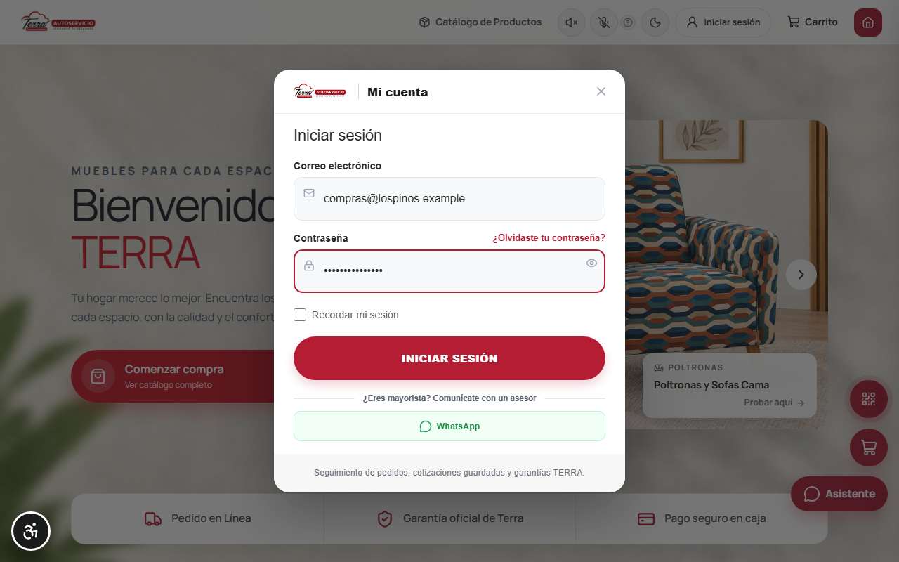

💡 Marca **Recordar mi sesión** para seguir conectado aunque recargues la página o cierres el navegador. La sesión recordada vence sola al caducar tu acceso; entonces el sistema te avisa y vuelve a pedir el inicio de sesión. Si no la marcas, la sesión dura solo mientras la página está abierta.

⚠️ **Recuperación de contraseña**: la opción **¿Olvidaste tu contraseña?** aún no está disponible. Comunícate con tu asesor TERRA por el botón **WhatsApp** del mismo formulario o escribe a soporte@terra.bo.

**Cerrar sesión**: abre el menú de cuenta (tus iniciales, arriba a la derecha) y toca **Cerrar sesión**. Vuelves a la página de inicio.

### 6.3 Administrador y personal de despacho

1. Escribe en el navegador la dirección de la tienda seguida de `/admin/login`. En la tablet del kiosco también puedes tocar el logo TERRA **5 veces seguidas** en menos de 2,5 segundos.
2. Completa **Correo corporativo** y **Contraseña**.
3. Toca **Iniciar sesión**. Mientras valida verás "Autenticando…".
4. Resultado: el administrador y el vendedor entran al **Dashboard**; el personal de despacho entra directamente a **Despacho**.

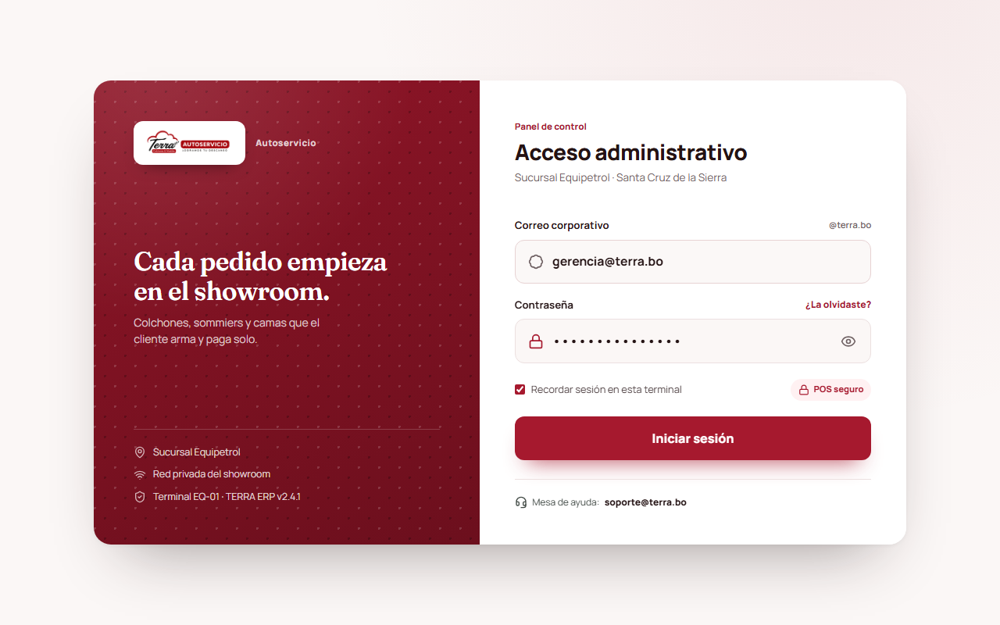

💡 La sesión dura **8 horas**. Con **Recordar sesión en esta terminal** marcada, se mantiene aunque cierres la pestaña o el navegador; al cumplirse las 8 horas se cierra sola y vuelves a la pantalla de acceso. Sin marcarla, la sesión se pierde al cerrar la pestaña.

⚠️ **Recuperación de contraseña**: el enlace **¿La olvidaste?** solo muestra el aviso "Contacte a soporte@terra.bo para recuperar el acceso". Un administrador no puede cambiar tu contraseña desde el sistema: pide a soporte que lo haga.

**Cerrar sesión**: al pie del menú lateral, toca **Cerrar sesión** (vuelves a la página de inicio pública). También está en el menú de tu nombre, arriba a la derecha (vuelves a la pantalla de acceso).

### 6.4 Vendedor

1. Escribe la dirección de la tienda seguida de `/vendedor/login`.
2. Completa **Correo corporativo** y **Contraseña**.
3. Toca **Ingresar al portal**. Verás "Validando...".
4. Resultado: entras al **Resumen operativo** del portal de ventas.

💡 Un vendedor también puede ingresar por `/admin/login`: verá el backoffice con solo sus cuatro secciones (Dashboard, Pedidos, Ventas directas y Clientes).

⚠️ Si una cuenta de administrador o de despacho intenta entrar por el portal de vendedor, aparece "Esta cuenta no corresponde al portal de vendedor".

### 6.5 Mensajes de acceso y su causa

| Mensaje | Causa | Qué hacer |
|---|---|---|
| "Credenciales inválidas" | Correo o contraseña incorrectos. | Revisa mayúsculas y espacios. Pide a un administrador que confirme tu correo. |
| "Esta cuenta de personal se encuentra desactivada." | Tu cuenta fue desactivada. | Habla con un administrador. Para repartidores, se reactiva en **Repartidores**. |
| "Esta cuenta no tiene un rol autorizado para ingresar al panel." | La cuenta no es de personal. | Usa el acceso mayorista o pide una cuenta de personal. |
| "Correo o contraseña incorrectos." (mayorista) | Datos incorrectos. | Reintenta o contacta a tu asesor. |
| "Esta cuenta no tiene acceso mayorista." | La cuenta existe pero no es mayorista. | Pide a TERRA que te habilite como mayorista. |
| "Sesión de administrador inválida o vencida" | Pasaron más de 8 horas o cerraste la pestaña. | Cierra sesión y vuelve a ingresar. |
| "No tienes permisos para esta operación." | Tu rol no puede hacer esa acción. | Consulta la tabla de permisos. |
| "No se pudo conectar al backend. Comprueba que esté encendido." | No hay conexión con el servidor. | Revisa internet. Si persiste, avisa a soporte. |

---

## 7. Roles y permisos

| Funcionalidad | Cliente en tienda | Mayorista | Administrador | Vendedor | Despacho |
|---|---|---|---|---|---|
| Ver catálogo y buscar productos | ✅ | ✅ | ✅ | ✅ | ✅ |
| Armar carrito y generar ticket | ✅ | ✅ | ❌ | ❌ | ❌ |
| Escanear QR para comprar | ✅ | ✅ | ❌ | ❌ | ❌ |
| Ver precios mayoristas y tramos | ❌ | ✅ | ❌ | ❌ | ❌ |
| Pedir envío a domicilio | ❌ | ✅ | ❌ | ❌ | ❌ |
| Editar perfil y dirección de entrega | ❌ | ✅ | ❌ | ❌ | ❌ |
| Ver historial de pedidos propio | ❌ | ✅ | ❌ | ❌ | ❌ |
| Dashboard (indicadores) | ❌ | ❌ | ✅ | ✅ | ❌ |
| Pedidos: cobrar, comprobante, imprimir ticket | ❌ | ❌ | ✅ | ✅ | ❌ |
| Pedidos: editar artículos de un pedido pendiente | ❌ | ❌ | ✅ | ✅ | ❌ |
| Pedidos: anular venta | ❌ | ❌ | ✅ | ✅ | ❌ |
| Pedidos: pestaña "En despacho" | ❌ | ❌ | ✅ | ❌ | ❌ |
| Ventas directas en mostrador | ❌ | ❌ | ✅ | ✅ | ❌ |
| Clientes: ver directorio, crear mayorista, eliminar | ❌ | ❌ | ✅ | ✅ | ❌ |
| Despacho: ver envíos y cambiar etapa | ❌ | ❌ | ✅ | ❌ | ✅ |
| Despacho: filtro "Solo mis envíos" | ❌ | ❌ | ❌ | ❌ | ✅ |
| Repartidores: vehículo, placa, asignar envíos | ❌ | ❌ | ✅ | ❌ | ❌ |
| Productos: crear, editar, stock, QR, ocultar, eliminar | ❌ | ❌ | ✅ | ❌ | ❌ |
| Categorías | ❌ | ❌ | ✅ | ❌ | ❌ |
| Almacén: ingreso de mercadería | ❌ | ❌ | ✅ | ❌ | ❌ |
| Personal: crear cuentas | ❌ | ❌ | ✅ | ❌ | ❌ |
| Reportes y exportaciones | ❌ | ❌ | ✅ | ❌ | ❌ |
| Modo accesible, voz y modo noche | ✅ | ✅ | ✅ | ✅ | ✅ |
| Asistente virtual (chat) | ✅ | ✅ | ❌ | ❌ | ❌ |

💡 El vendedor tiene su propio portal en `/vendedor` con Dashboard, Pedidos, Ventas directas y Clientes. Son las mismas pantallas del backoffice.

---

## 8. Funciones comunes a todos los usuarios

### 8.1 Modo día / noche

- Toca el botón con el ícono de **luna** (o **sol**) en la cabecera: "Cambiar a modo noche" / "Cambiar a modo día".
- Por voz: di **"modo noche"** o **"modo día"**.
- La elección queda guardada en ese dispositivo. Si nunca elegiste, el sistema sigue la configuración de tu celular o computadora.

### 8.2 Modo accesible

**Objetivo**: adaptar la pantalla a personas con baja visión, dificultad motriz o que prefieren que el sistema les lea.

1. Toca el botón **♿ Accesibilidad** (abajo a la izquierda) o presiona **Alt + A**.
2. Activa el interruptor **Activar modo accesible**.
3. Si quieres, elige el **Tamaño del texto**: **A** (normal), **A+** (125 %) o **A++** (150 %).
4. Toca **Cerrar**.
5. Resultado: la pantalla pasa a alto contraste, botones grandes, texto al 125 % y lectura en voz alta. Escucharás "Modo accesible activado…".

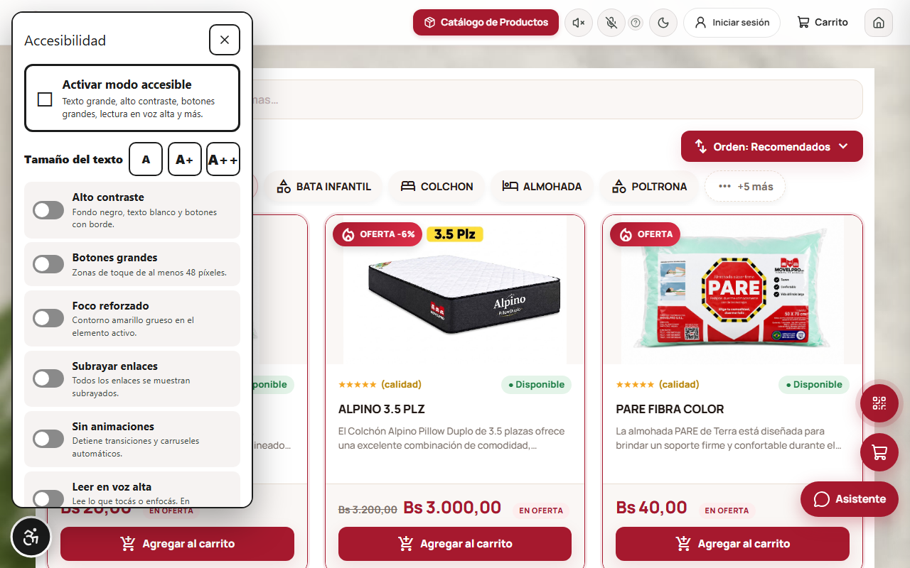

Opciones que se encienden con el modo accesible (puedes apagarlas una por una desde el mismo panel):

| Opción | Qué hace |
|---|---|
| Alto contraste | Fondo negro, texto blanco y botones con borde. |
| Botones grandes | Zonas de toque de al menos 48 píxeles. |
| Foco reforzado | Contorno amarillo grueso en el elemento activo. |
| Subrayar enlaces | Todos los enlaces se muestran subrayados. |
| Sin animaciones | Detiene transiciones y carruseles automáticos. |
| Leer en voz alta | Lee lo que tocas o enfocas. En productos: nombre, medida y precio. |
| Navegación por voz | Muestra los comandos del micrófono para moverte hablando. |
| Fuente legible | Tipografía Atkinson Hyperlegible con más espacio entre letras (apagada por defecto). |
| Más tiempo | Los avisos no se cierran solos y las esperas duran el doble. |

- **Restablecer** apaga todo y vuelve a los valores de fábrica.
- En el kiosco, con el modo accesible activo, si nadie toca la pantalla durante **5 minutos** (10 con "Más tiempo") aparece "¿Seguís ahí? La pantalla volverá al modo normal en 30 segundos" con el botón **Seguir aquí**. Si nadie responde, el modo accesible se apaga solo. El carrito no se borra.

💡 En el catálogo, con el modo accesible activo, el **primer toque** en una tarjeta de producto la lee en voz alta y el **segundo toque** (dentro de 6 segundos) la abre.

### 8.3 Lectura por voz

- Toca el botón del **altavoz** en la cabecera para activarla o desactivarla.
- Con la lectura activa, el sistema anuncia cada página al entrar y lee cada elemento que tocas o enfocas.
- Para que deje de hablar, di **"silencio"** o toca el altavoz.

### 8.4 Comandos de voz

1. Toca el botón del **micrófono** en la cabecera. Verás "Te escucho…" y un ejemplo de frase.
2. Di el comando en voz clara, por ejemplo **"catálogo"** o **"buscar colchón"**.
3. Resultado: el sistema ejecuta la acción y la confirma en voz alta ("Estás en Catálogo de productos").

Para ver qué puedes decir en la pantalla actual:

- Mantén apretado el micrófono medio segundo, o toca el botón **?** ("¿Qué puedo decir?").
- Se abre el panel **Podés decir…** con los comandos disponibles. **Tocar un comando lo ejecuta**; los que necesitan un dato ("Buscar un producto", "Agregar al carrito") abren el micrófono para que lo digas.
- Di **"ayuda"** para escuchar la lista completa de 6 en 6, y **"más"** para continuar.

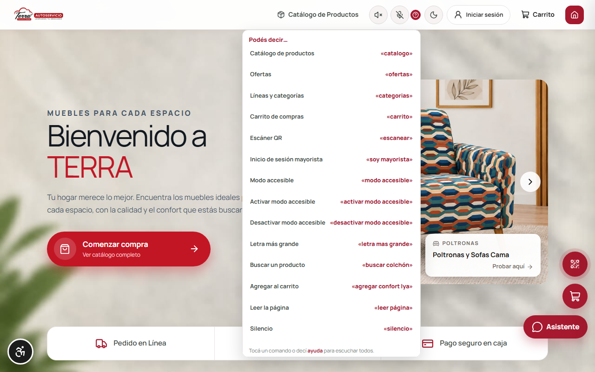

**Comandos principales** (no importan mayúsculas ni acentos):

| Quieres… | Di… |
|---|---|
| Ir al inicio | "inicio", "portada", "página principal" |
| Abrir el catálogo | "catálogo", "productos", "colchones", "camas" |
| Ver solo ofertas | "ofertas", "promociones", "descuentos" |
| Ver categorías | "categorías", "líneas" |
| Ir al carrito | "carrito", "mi compra", "finalizar compra", "pagar" |
| Abrir la cámara QR | "escanear", "qr", "cámara" |
| Buscar | "buscar colchón", "mostrar almohadas", "quiero sommier" |
| Buscar ofertas de algo | "ofertas de colchones", "almohadas en oferta" |
| Filtrar por categoría | "categoría poltrona", "línea almohada" |
| Cambiar de página | "siguiente", "anterior" |
| Quitar filtros | "limpiar búsqueda", "quitar filtros" |
| Agregar al carrito (en catálogo o detalle) | "agregar confort lya", "agregar el primero", "agregar" (el último leído) |
| Instrucciones de armado | "instrucciones de sommier", "cómo se arma la cama" |
| Leer la pantalla | "leer página", "dónde estoy", "repetir" |
| Volver atrás | "volver", "atrás" |
| Tema | "modo noche", "modo día" |
| Accesibilidad | "modo accesible", "letra más grande", "letra más pequeña", "alto contraste" |
| Iniciar sesión mayorista | "soy mayorista", "iniciar sesión" |
| Mi cuenta (mayorista) | "mi cuenta", "mi perfil", "mis pedidos" |
| Cerrar sesión | "cerrar sesión", "salir" (pide confirmar con "sí" o "no") |
| Silenciar | "silencio", "parar", "basta" |

**Mensajes del micrófono**

| Mensaje | Causa | Qué hacer |
|---|---|---|
| "Este navegador no soporta comandos de voz. Usá Chrome o Edge." | Navegador sin reconocimiento de voz. | Cambia de navegador. |
| "Permití el uso del micrófono en el navegador…" | Permiso denegado. | Acepta el permiso de micrófono cuando el navegador lo pida. |
| "No escuché nada. Tocá el micrófono y hablá." | No se detectó voz. | Toca el micrófono y habla de inmediato. |
| "No entendí "…". Decí "ayuda" para escuchar las opciones." | La frase no coincide con ningún comando. | Usa las frases de la tabla o toca **?** para ver las opciones. |

### 8.5 Asistente virtual (solo en la tienda y portal mayorista)

1. Toca el botón flotante **Asistente** (abajo a la derecha).
2. Escribe tu consulta en "Escribe o graba tu consulta..." y toca **Enviar**, o graba una nota de voz de hasta 1 minuto con el botón del micrófono y **Detener y enviar audio**.
3. Resultado: el Asistente TERRA responde en segundos y, si se lo pides, te lleva a la sección correspondiente (catálogo, ofertas, carrito, escáner, inicio de sesión, mi panel o mis pedidos).

⚠️ El asistente orienta, pero no confirma precios, stock, pagos ni garantías. Para eso consulta en caja o con un asesor.

### 8.6 Tutorial interactivo de la web

**Objetivo**: conocer paso a paso las zonas principales del catálogo sin salir de la pantalla.

1. En la cabecera, toca **Tutorial** (el botón con el signo **?**). En el celular aparece junto al menú.
2. La primera vez que entras al catálogo, el sistema te invita con el mensaje **"Tutorial: uso de la web"**. Toca **Comenzar tutorial** o **Ahora no**.
3. El tutorial oscurece la pantalla y resalta una zona por vez: buscador, categorías, ofertas, ordenar, producto, agregar al carrito, carrito e iniciar sesión. Cada paso explica para qué sirve.
4. Usa **Siguiente** y **Anterior** para moverte, **Salir** para cerrarlo o **Finalizar** en el último paso. También puedes presionar **Escape**.
5. Resultado: el recorrido se recuerda en ese dispositivo y no vuelve a aparecer solo. Puedes repetirlo cuando quieras con el botón **Tutorial**.

- Si abres el tutorial desde otra pantalla, primero te lleva al catálogo.
- En el celular, el último paso resalta el **menú** y explica que allí está **Iniciar sesión**.
- Si ya iniciaste sesión como mayorista, el tutorial omite el paso de iniciar sesión.

---

## 9. Guía para el Cliente en tienda

### 9.1 Descripción del rol

Cualquier persona que usa la tablet del showroom (o la tienda desde su celular). No necesita cuenta. Arma su pedido, lo confirma y recibe un ticket con un código para pagar en caja. **El kiosco no cobra**: el pago siempre se hace con el personal de caja.

### 9.2 Pantalla principal y menú

- **Inicio**: bienvenida con carrusel de fotos y el botón **Comenzar compra**.
- **Cabecera**: logo TERRA (vuelve al inicio), **Catálogo de Productos**, altavoz, micrófono, botón **?**, modo día/noche, **Tutorial** (ver 8.6), **Iniciar sesión** (solo mayoristas), **Carrito** con contador e **Inicio**.
- **Botones flotantes** a la derecha: **QR** (abre la cámara), **carrito flotante** (resumen rápido con **Ver Carrito** y **Vaciar carrito**) y **Asistente**.
- **Botón ♿** abajo a la izquierda: modo accesible.

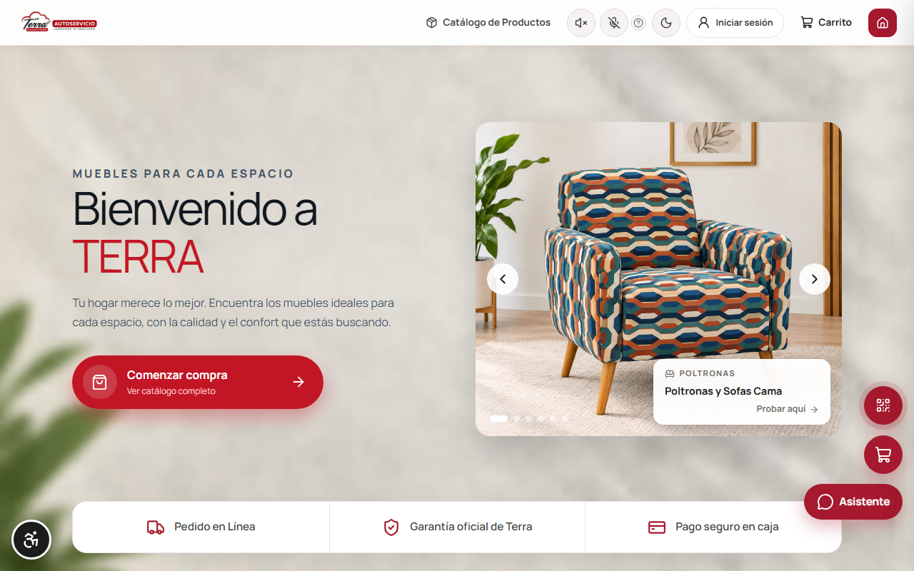

### 9.3 Procedimiento: buscar y elegir productos

**Objetivo**: encontrar el producto que quieres comprar.

1. Toca **Comenzar compra** o **Catálogo de Productos**.
2. Para buscar, toca el campo "Buscar colchones, sommiers, camas…" y escribe con el teclado en pantalla. Los resultados se filtran solos mientras escribes. La **x** borra la búsqueda.
3. Para filtrar por categoría, toca **Categorías** y elige una, o toca directamente uno de los botones de categoría. **+N más** muestra el resto.
4. Toca **Ofertas** para ver solo productos con descuento.
5. Toca **Orden:** para ordenar por "Recomendados", "En oferta", "Precio menor a mayor", "Precio mayor a menor" o "Nombre A-Z".
6. Usa **Anterior** / **Siguiente** o los números para cambiar de página (12 productos por página).
7. Resultado: la grilla muestra los productos con foto, medida, "● Disponible" u "○ Agotado", precio y el botón **Agregar al carrito**.

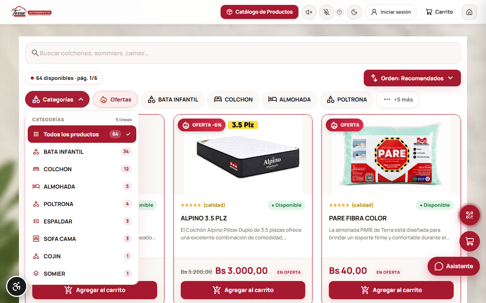

💡 Si escribes "oferta de colchón", el filtro **Ofertas** se activa solo.

💡 Elegir una categoría borra el texto de búsqueda.

### 9.4 Procedimiento: ver el detalle de un producto

1. Toca la tarjeta del producto.
2. Revisa las fotos (hasta 4 vistas), el video si existe, el precio, la **Ficha técnica y dimensiones** y la **Descripción completa**.
3. Elige la **Cantidad** con **−** y **+** (hasta el stock disponible).
4. Toca **Agregar al carrito**. El botón cambia a "Agregado al carrito".
5. Resultado: el contador del carrito aumenta. **Volver al catálogo** te regresa a la lista.

💡 **Comprar ahora** agrega la cantidad elegida al carrito y te lleva directo a él. Si el producto ya estaba en el carrito, se suma a la línea existente sin superar el stock.

### 9.5 Procedimiento: comprar escaneando códigos QR

**Objetivo**: armar el pedido escaneando el QR pegado en cada producto físico del showroom.

1. Toca el botón flotante **QR** (o di "escanear").
2. Acepta el permiso de cámara cuando el navegador lo pida. Verás "Apuntá la cámara al código QR del producto".
3. Apunta al código. Cuando se lee, la cámara se apaga y aparece "Código leído" con la ficha del producto: nombre, precio y stock.
4. Ajusta la cantidad con **Quitar una unidad** / **Agregar una unidad**.
5. Toca **Escanear otro** para sumar más productos, o **Confirmar compra** para ir al carrito.
6. Resultado: cada producto escaneado queda agregado al carrito.

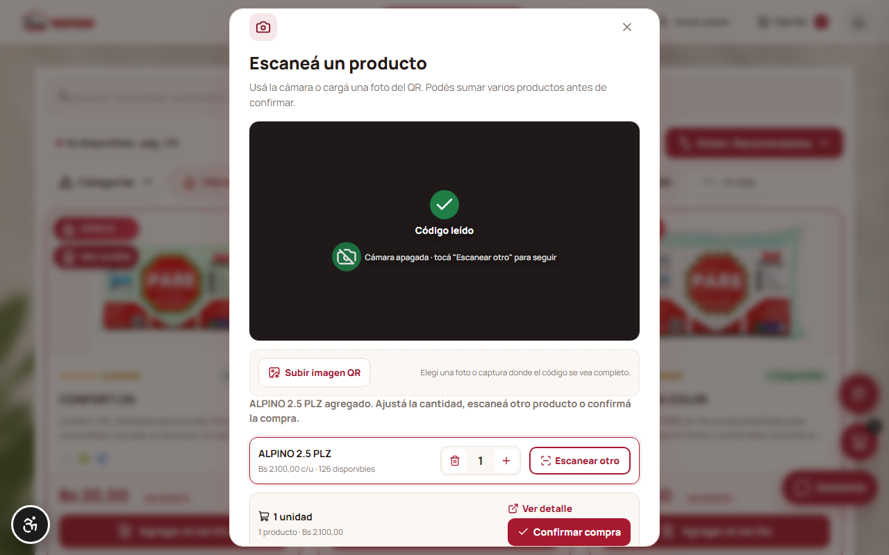

💡 Si no funciona la cámara, toca **Subir imagen QR** y elige una foto donde el código se vea completo.

💡 Si escaneas el QR con tu **propio celular**, se abre una ficha rápida del producto con el botón **Agregar a mi compra QR**. Tu compra se guarda en el celular durante **2 horas**; para terminarla, toca **Confirmar compra** o **Volver a comprar con cámara**.

**Mensajes posibles**

| Mensaje | Causa | Qué hacer |
|---|---|---|
| "Permite el acceso a la cámara en tu navegador…" | Permiso denegado. | Acepta el permiso o usa **Subir imagen QR**. |
| "No se encontró una cámara disponible en este dispositivo." | El equipo no tiene cámara. | Usa **Subir imagen QR** o busca el producto por nombre. |
| "El código no contiene un QR válido de producto TERRA." | Escaneaste otro QR. | Busca el QR de TERRA en la etiqueta del producto. |
| "Ya agregaste todas las unidades disponibles de…" | Llegaste al stock. | Consulta en caja por más unidades. |
| "No encontramos un QR legible en esa imagen." | Foto borrosa o recortada. | Toma otra foto más nítida. |

### 9.6 Procedimiento: revisar el carrito

1. Toca **Carrito** en la cabecera (o el carrito flotante y **Ver Carrito**).
2. En "Detalle de artículos" ajusta cantidades con **−** / **+** o elimina líneas con la papelera. **Vaciar carrito** borra todo.
3. Revisa la **Liquidación final**: subtotal y "Total a pagar en caja".
4. Toca **Continuar y generar pedido**. Para seguir eligiendo, toca **Seguir comprando**.

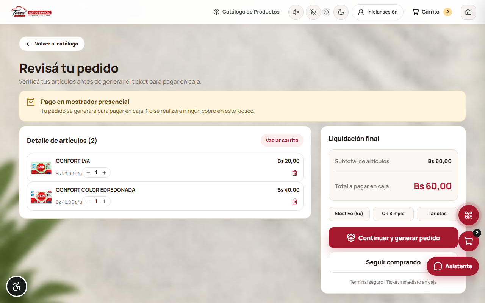

⚠️ El carrito vive solo mientras la página está abierta. Si recargas la pantalla, se vacía.

### 9.7 Procedimiento: identificarte para el ticket

**Objetivo**: asociar tu nombre al pedido para que te llamen en caja.

1. En "Datos para tu pedido en tienda" escribe **Nombre y apellidos** (obligatorio, 2 a 120 caracteres).
2. Opcionalmente escribe **Teléfono / WhatsApp** (prefijo +591) y **NIT** (5 a 20 dígitos).
3. Deja marcada la casilla **Deseo recibir mi comprobante por WhatsApp** si quieres pedirlo después.
4. Toca **Continuar a confirmación**.
5. Resultado: pasas a la pantalla de confirmación.

💡 Si no quieres dar tus datos, toca **Continuar como invitado**. El pedido se registra como "Compra como invitado".

🔒 Tus datos se usan solo para este pedido y no quedan guardados en la tablet.

**Errores de validación**

| Mensaje | Qué corregir |
|---|---|
| "Ingresa un nombre de 2 a 120 caracteres" | Escribe tu nombre completo. |
| "El teléfono no tiene un formato válido" | Usa solo números, por ejemplo 77012345. |
| "El NIT debe tener entre 5 y 20 dígitos" | Revisa el NIT. |

### 9.8 Procedimiento: confirmar el pedido y obtener el ticket

1. En "Revisá y confirmá tu pedido" verifica tus datos, los **Artículos seleccionados** y la **Liquidación final** (total a pagar en caja).
2. Si falta algo, toca **Modificar carrito**.
3. Toca **Confirmar y generar pedido**. Verás "Generando ticket…".
4. Resultado: aparece "¡Tu ticket está listo!" con el **Código de pedido** (TER-XXXXXXXX), la fecha, "Estado: Pendiente de pago" y el total. El ticket también se descarga como imagen en el dispositivo.

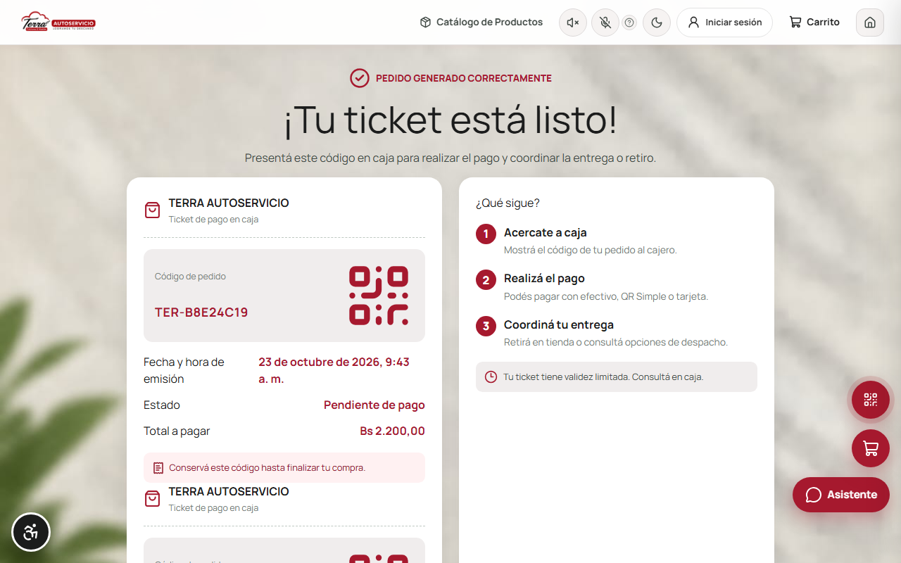

**¿Qué sigue?**

1. **Acercate a caja** y muestra el código de tu pedido.
2. **Realizá el pago** con efectivo, QR Simple o tarjeta. Si elegiste QR, el pedido queda pendiente hasta que la entidad de pago lo confirme.
3. **Coordiná tu entrega**: retiro en tienda o consulta opciones de despacho.

Botones disponibles: **Descargar ticket**, **Enviar ticket a WhatsApp TERRA** (solo si marcaste la casilla de WhatsApp; abre un mensaje listo para enviar al número oficial de TERRA), **Nueva compra** y **Seguir explorando**.

⚠️ Conserva el código hasta terminar la compra. El ticket tiene validez limitada: consulta en caja.

### 9.9 Errores comunes del cliente en tienda

| Problema | Causa probable | Solución |
|---|---|---|
| "No se pudo cargar el catálogo" / "No se pudo conectar al backend…" | Sin conexión con el servidor. | Toca **Reintentar**. Si persiste, avisa al personal. |
| "No encontramos productos" | Filtros o búsqueda sin resultados. | Toca **Restablecer filtros**. |
| El botón **Agregar al carrito** está gris | Producto agotado. | Consulta disponibilidad en caja. |
| "Stock insuficiente para …. Disponible: N." al confirmar | Pediste más unidades de las que quedan. | Vuelve al carrito y ajusta la cantidad al disponible indicado. |
| "MODO DEMOSTRACIÓN…" en la parte superior | La tablet está en modo exhibición. | Los pedidos no son reales. Avisa al personal. |
| El carrito se vació | Se recargó la página. | Vuelve a agregar los productos. |

---

## 10. Guía para el Cliente mayorista

### 10.1 Descripción del rol

Cliente con cuenta comercial creada por TERRA. Ve precios mayoristas y precios por tramo de cantidad, puede pedir **envío a domicilio** a la dirección de su perfil y consulta su historial. No crea su cuenta por sí mismo: la crea el personal de TERRA.

### 10.2 Menú de cuenta

Con sesión iniciada, el botón con tus iniciales abre:

- **Mi panel mayorista**
- **Catálogo mayorista con precios B2B**
- **Mis pedidos**
- **Mi perfil y datos de facturación**
- **Soporte por WhatsApp**
- **Mis cotizaciones y licitaciones** (próximamente, deshabilitado)
- **Cerrar sesión**

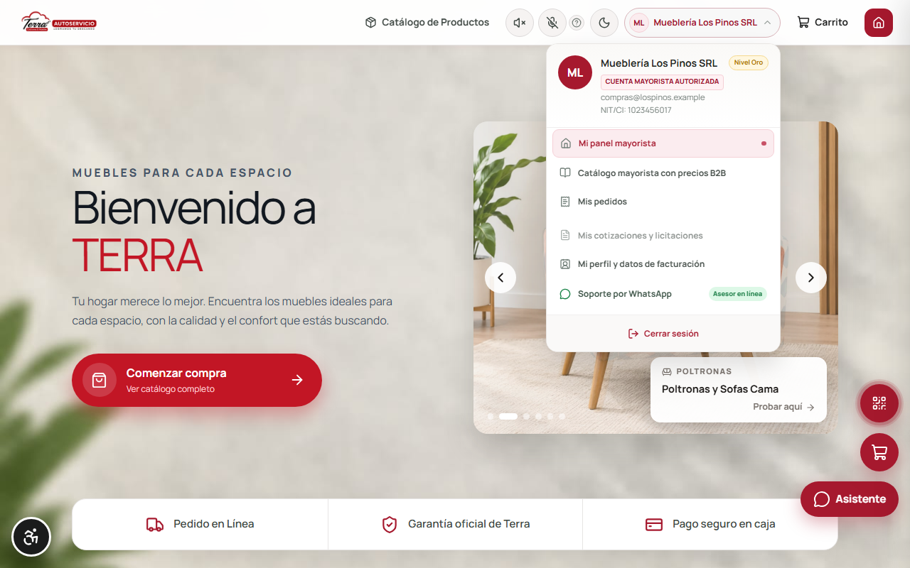

### 10.3 Procedimiento: completar tu perfil y dirección de entrega

**Objetivo**: registrar los datos de facturación y la dirección a la que TERRA enviará tus pedidos. Sin dirección no podrás pedir envío a domicilio.

1. Abre el menú de cuenta y toca **Mi perfil y datos de facturación**. Si estás en Mi panel, toca **Actualizar perfil, facturación y dirección** y luego entra al perfil.
2. En "Datos de Contacto y Representación Comercial" completa **Nombre completo del encargado / titular**, **Teléfono móvil / WhatsApp directo (Entrega)**, **Razón Social** y **NIT Comercial**. El correo es de solo lectura.
3. En "Dirección de Envío", fija tu ubicación en el mapa:
   - Toca **Usar mi ubicación GPS actual**, o
   - Toca **Fijar punto en el mapa** y luego toca el punto exacto, o arrastra el marcador.
4. La **Dirección de envío / Domicilio** se completa sola desde el mapa; puedes corregirla a mano. Agrega una **Referencia para ubicar tu domicilio**.
5. Toca **Guardar Cambios** (arriba) o **Guardar cambios de perfil y dirección** (abajo).
6. Resultado: "¡Datos de perfil comercial, facturación y dirección de envío actualizados correctamente!".

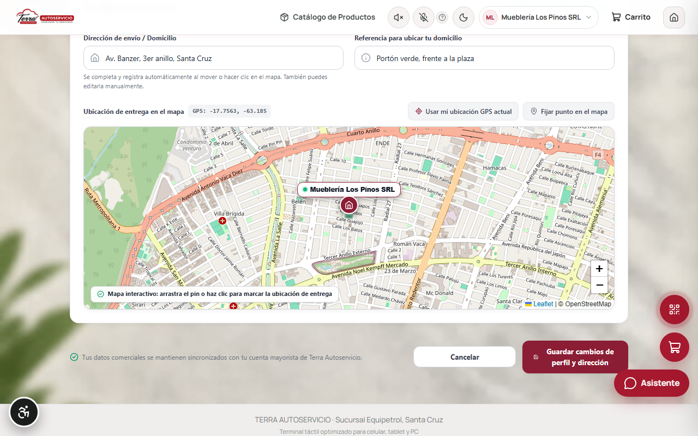

**Mensajes**

| Mensaje | Qué hacer |
|---|---|
| "Ingresá la dirección de envío antes de guardar." | Escribe la dirección o fija el punto en el mapa. |
| "No se pudo obtener la ubicación GPS…" | Acepta el permiso de ubicación o fija el punto a mano. |
| "La razón social debe tener entre 2 y 120 caracteres." / "NIT inválido…" | Corrige el campo indicado. |

### 10.4 Procedimiento: comprar con precio mayorista

1. Inicia sesión y abre el **Catálogo**.
2. Cada tarjeta muestra el **PVP** (precio público), el **precio mayorista** y el ahorro ("-N% Mayorista"). Elige la cantidad con **−** / **+**. La cantidad inicial es el mínimo del primer tramo de precio.
3. A la derecha aparece el panel **Pedido mayorista** con líneas, unidades y **Subtotal mayorista**. Toca **Revisar pedido mayorista**.
4. En el carrito, elige **¿Cómo querés recibir tu pedido?**:
   - **Retiro en tienda**: pagas y retiras en el mostrador.
   - **Envío a domicilio**: a la dirección de tu perfil. Si no tienes dirección, toca **Registrar dirección** y vuelve.
5. Toca **Continuar a confirmación** (el mayorista no pasa por Identificación).
6. Revisa el recuadro **Envío a domicilio** o **Retiro en tienda** y toca **Confirmar y generar pedido**.
7. Resultado: se genera el ticket con tu código de pedido. El pago se realiza en caja o según lo coordinado con tu asesor; si elegiste envío, el pedido pasa al equipo de despacho.

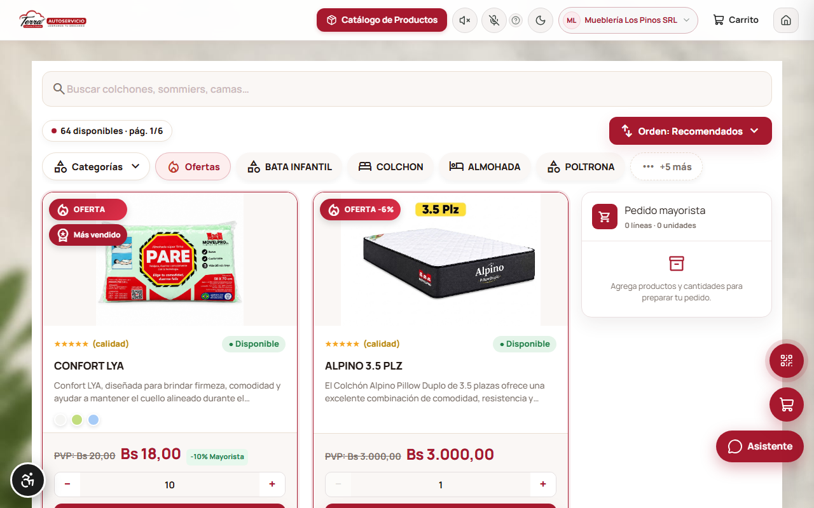

💡 El precio aplicado depende del tramo de cantidad: a mayor cantidad, menor precio unitario.

⚠️ Si el servidor responde "Registrá una dirección de entrega antes de solicitar el envío a domicilio", completa tu perfil (sección 10.3).

### 10.5 Procedimiento: consultar Mi panel y Mis pedidos

**Mi panel mayorista** muestra "Compras realizadas", "Pedidos activos", "Pedidos registrados", el historial de los últimos 6 meses, los pedidos recientes y productos frecuentes. Toca **Comprar con precio B2B** para ir al catálogo.

**Mis pedidos**:

1. Abre el menú de cuenta y toca **Mis pedidos**.
2. Filtra con las pestañas **Todos**, **En camino (N)** o **Completados**, o busca por número de pedido o artículo. **Limpiar** quita los filtros.
3. Toca **Ver detalle** en un pedido para ver sus ítems, el lugar de entrega y el **Seguimiento de Despacho** en cuatro pasos: "Confirmado" → "Pago OK" → "En camión" (o "En planta") → "Entregado".
4. Acciones del detalle: **Repetir compra** (carga los mismos artículos al carrito), **Descargar ticket** (descarga la imagen del ticket) y **Contactar asesor** por WhatsApp.
5. **Exportar Excel** descarga un archivo con todos tus pedidos.

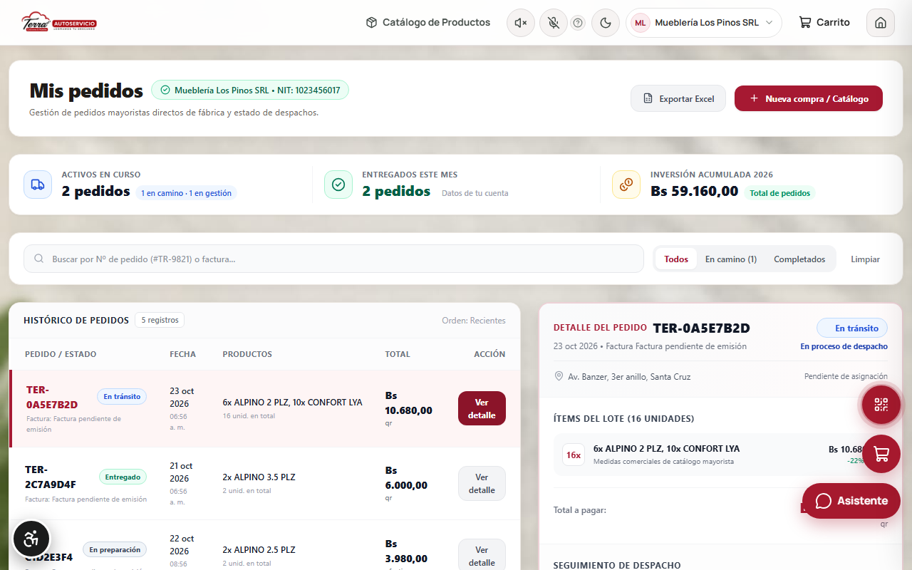

**Estados que verás**

| Estado | Significado |
|---|---|
| Pendiente pago | Pedido generado, aún no cobrado. |
| Cobrado | Pago registrado por TERRA. |
| En preparación | Se está preparando el envío. |
| En tránsito | El repartidor salió con tu pedido. |
| Entregado | Pedido completado. |
| Cancelado | Pedido anulado. |

⚠️ Desde el portal **no puedes cancelar ni modificar** un pedido. Comunícate con tu asesor.

### 10.6 Errores comunes del mayorista

| Problema | Causa | Solución |
|---|---|---|
| Perdí la sesión al recargar | No marcaste **Recordar mi sesión** al ingresar. | Vuelve a iniciar sesión y marca la casilla si quieres conservarla. |
| "Envío a domicilio" aparece deshabilitado | No tienes dirección registrada. | Completa tu perfil (10.3). |
| "La sesión mayorista no es válida." | La sesión venció. | Cierra sesión y vuelve a entrar. |
| "Stock insuficiente para …. Disponible: N." al confirmar | Pediste más unidades de las que quedan. | Ajusta la cantidad al disponible indicado. |
| "La cantidad mínima mayorista para … es N." al confirmar | La cantidad no llega al mínimo del precio mayorista. | Sube la cantidad al mínimo indicado o consulta a tu asesor. |
| Un producto aparece "Agotado" aunque elegiste cantidad | El stock no alcanza el mínimo mayorista. | Consulta disponibilidad con tu asesor. |

---

## 11. Guía para el Administrador

### 11.1 Descripción del rol

Responsable de la operación completa: cobra pedidos, administra catálogo, precios, stock, categorías, clientes, cuentas del personal, reparto y reportes. Es el único rol que puede crear cuentas y ver reportes.

### 11.2 Pantalla principal y menú

**Menú lateral** (en celular se abre con **Abrir menú lateral**): Dashboard, Despacho, Repartidores, Pedidos, Ventas directas, Productos, Categorías, Almacén, Clientes, Personal, Reportes y **Cerrar sesión**.

**Cabecera**: ruta "Backoffice › sección", botones de voz, modo noche, buscador "Buscar pedidos, productos, client..." (al presionar Enter lleva a Pedidos filtrando por lo escrito), la **campana de pedidos por cobrar** y tu nombre con el menú de perfil.

**Campana de pedidos**: consulta cada 15 segundos si hay pedidos nuevos pendientes de pago. Cuando entra uno, suena un timbre, aparece "¡Nuevo pedido!" con el código, el cliente y el total, y el botón **Cobrar**. Al tocar la campana se abre "Pedidos por cobrar" con hasta 6 pedidos y **Ver todos los pedidos**.

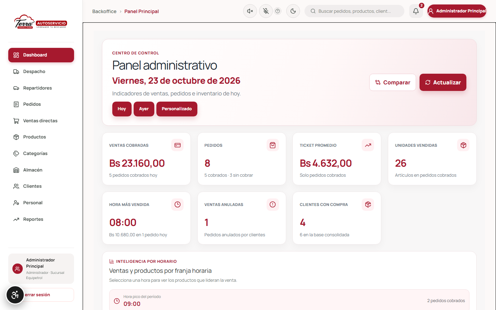

💡 La primera vez verás "Toca la campana para habilitar el sonido del timbre". Tócala una vez al iniciar el turno.

### 11.3 Dashboard

**Objetivo**: ver de un vistazo las ventas y pedidos del día.

- Elige el período con **Hoy**, **Ayer** o **Personalizado** (campos **Desde** y **Hasta**).
- Tarjetas: "Ventas cobradas", "Pedidos", "Ticket promedio", "Unidades vendidas", "Hora más vendida", "Ventas anuladas" y "Clientes con compra".
- **Comparar** muestra "Comparar períodos": "Hoy vs ayer", "Esta semana vs anterior", "Este mes vs anterior" o "Personalizado" (dos períodos y el botón **Comparar**). La tabla indica la variación en porcentaje.
- "Ventas y productos por franja horaria": toca una barra para ver los productos más vendidos en esa hora.
- "Últimos pedidos emitidos" y "Stock crítico" (productos con 2 unidades o menos) con el enlace **Gestionar inventario**.
- **Actualizar** recarga; además se actualiza solo cada minuto.

### 11.4 Procedimiento: cobrar un pedido en caja

**Objetivo**: registrar el pago de un pedido generado en el kiosco.

1. Entra a **Pedidos**. Usa la pestaña **Pendientes de pago** o busca por "Cliente, teléfono, NIT o ticket" y toca **Buscar**.
2. Localiza el pedido por su código (el cliente te muestra el ticket) y toca **Cobrar**.
3. En la ventana "Caja Equipetrol" verifica cliente, "Monto a liquidar" y "Artículos del pedido".
4. Para un cobro manual, elige **Efectivo** o **Tarjeta**. Si el cliente eligió QR, no lo confirmes manualmente: espera la notificación automática de la entidad de pago.
5. Opcional: toca **Cargar comprobante** y elige una foto del pago (JPG, PNG o WEBP, máximo 8 MB).
6. Toca **Confirmar cobro manual**. Verás "Guardando…".
7. Resultado: el pedido pasa a **Cobrado** y desaparece de "Pendientes de pago".
8. Toca **Imprimir ticket** para entregar el comprobante impreso.

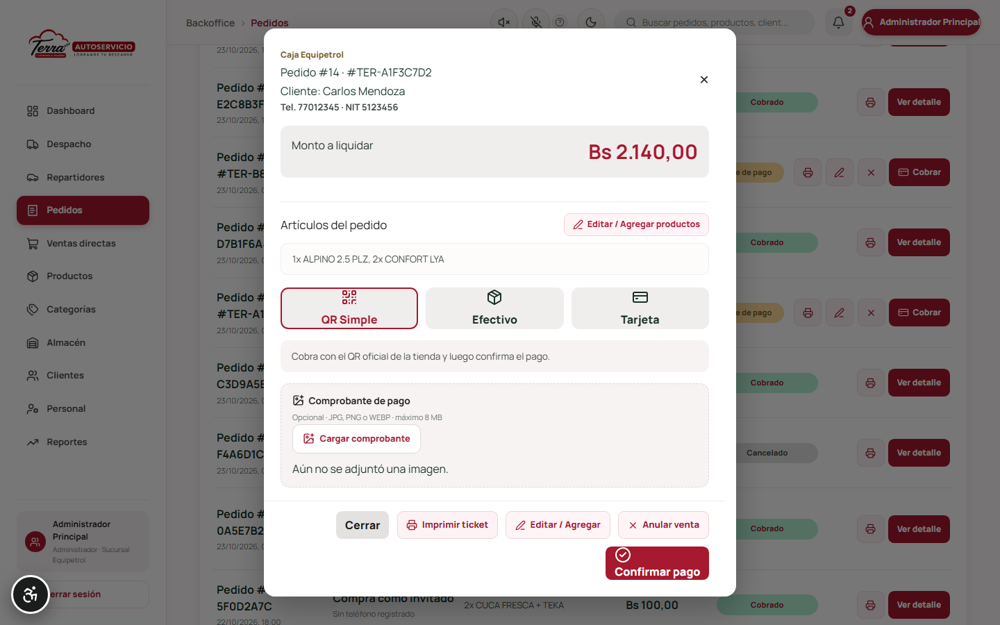

💡 Un pago QR pendiente conserva ese estado hasta que la entidad de pago lo confirme. Esta medida evita marcar como cobrado un pago que todavía no fue validado.

### 11.5 Procedimiento: editar los artículos de un pedido pendiente

1. En **Pedidos**, abre un pedido **Pendiente de pago** (botón **Cobrar** o el lápiz "Editar o agregar productos").
2. Toca **Editar / Agregar**.
3. Cambia cantidades con **−** / **+** (1 a 100) o elimina líneas con la papelera. Para sumar productos, busca en "Buscar por nombre o SKU..." y toca **Agregar**.
4. Revisa el **Nuevo total calculado** y toca **Guardar cambios**.
5. Resultado: "¡Productos y total del pedido actualizados con éxito!". Los precios se recalculan con los vigentes (mayorista si el cliente es mayorista).

⚠️ No se pueden editar pedidos ya cobrados o anulados. El pedido debe conservar al menos un producto.

### 11.6 Procedimiento: anular una venta

**Objetivo**: registrar que el cliente no va a pagar un pedido pendiente.

1. En **Pedidos**, abre el pedido pendiente y toca **Anular venta** (o la **X** de la fila).
2. Confirma el aviso "¿Anular el pedido #N? La venta quedará registrada como anulada y no se podrá cobrar."
3. Resultado: el pedido pasa a **Cancelado** y aparece en la pestaña **Anulados**.

⚠️ Solo se anulan pedidos pendientes. Un pedido cobrado o entregado no se puede anular ("No se puede anular un pedido ya cobrado o entregado"). Un pedido anulado no se puede cobrar: la ventana muestra "Esta venta fue anulada. No se puede cobrar ni guardar un comprobante" y oculta el botón de cobro.

### 11.7 Procedimiento: registrar una venta directa en mostrador

**Objetivo**: cobrar una venta que no pasó por el kiosco. La venta se registra **ya cobrada**.

1. Entra a **Ventas directas**.
2. Busca productos en "Buscar por nombre, código o SKU..." o toca **Escanear código** y apunta al QR del producto. Puedes filtrar por categoría, **Más vendidos**, **Nuevos**, **Filtrar promociones** o **Filtros** (precio, stock).
3. Toca **Agregar** en cada producto. En el panel derecho ajusta cantidades con **−** / **+**.
4. Elige el cliente en "Selecciona un cliente o busca por nombre o cédula..." o deja **Cliente nuevo / sin cuenta**.
5. Elige la **Tarifa / Precio**: **Precio minorista** o **Precio mayorista**. Si elegiste un cliente registrado, la tarifa se fija sola según su tipo.
6. Elige el **Método de pago**: Efectivo, QR o Tarjeta.
7. Revisa el **Total cobrado** y toca **Cobrar y registrar venta**.
8. Resultado: "Venta TER-… registrada por Bs …". El ticket se imprime automáticamente y queda el botón **Imprimir / Reimprimir ticket**.

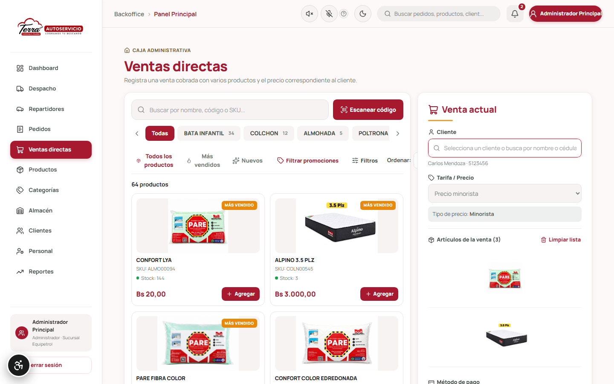

**Errores**

| Mensaje | Qué hacer |
|---|---|
| "Agrega al menos un producto." | Agrega productos antes de cobrar. |
| "El producto no tiene unidades disponibles." | Revisa el stock en Productos o Almacén. |
| "Stock insuficiente para …" | Reduce la cantidad. |
| "Cliente no encontrado." | Vuelve a seleccionar el cliente. |

### 11.8 Procedimiento: registrar un producto nuevo

**Objetivo**: publicar un producto en el catálogo del kiosco.

1. Entra a **Productos** y toca **Nuevo producto**.
2. **Información comercial**: completa **Nombre comercial**, **Código Terra (SKU)**, **Código interno**, **Categoría**, **Precio de venta (Bs)** y **Stock en sala** (obligatorios). Opcionales: **Precio mayorista**, **Precio de fábrica** (no se muestra al cliente), **Precio de oferta** con la casilla **En oferta**, **Medidas / Detalle**, **Descripción para catálogo** y **Video promocional** (enlace).
3. **Variantes y colores**: elige **Color único** o **Paleta multicolor**, escribe el nombre del color y toca **Agregar color**. También puedes usar los tonos rápidos (Blanco, Negro, Gris grafito…).
4. **Galería multimedia**: primero elige en "Estoy cargando fotos para:" el color de destino. Luego toca **Subir imágenes desde archivo** (máximo 8 MB cada una) o pega un enlace y toca **Agregar URL**. Usa la estrella para elegir la **portada principal** y las flechas para ordenar.
5. **Instrucciones** (opcional): pasos de armado, detalle, video e imagen de instrucciones. Las usa el asistente y la ficha del producto.
6. **Publicación**: deja marcadas **Publicar este producto en kioscos al guardarlo** y **Generar QR del producto al guardarlo**.
7. Toca **Guardar producto**.
8. Resultado: "¡Producto creado!" y se abre la ventana **QR del producto**.

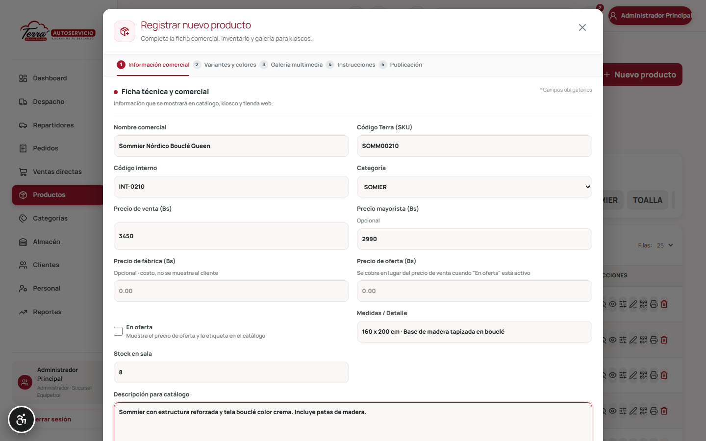

⚠️ Debes registrar **al menos un color** antes de poder subir fotos.

⚠️ Para activar **En oferta**, el precio de oferta debe ser mayor a 0 y menor al precio de venta.

**Mensajes**

| Mensaje | Qué hacer |
|---|---|
| "Nombre, categoría y precio son obligatorios" | Completa los campos marcados con *. |
| "Ya existe un producto con ese SKU / código." | Usa otro SKU o código interno. |
| "“archivo” supera el límite de 8 MB." | Reduce el tamaño de la foto. |
| "Permite las ventanas emergentes…" | Habilita ventanas emergentes en el navegador para imprimir. |

### 11.9 Procedimiento: imprimir el QR y la etiqueta de un producto

1. En **Productos**, toca el ícono **Generar QR de la ficha** del producto.
2. En "QR del producto" elige: **Copiar enlace**, **Imprimir QR** (hoja con el QR y el texto "Escaneá para ver la ficha del producto"), **Imprimir ticket de góndola** (etiqueta térmica de 80 mm con precio y código de barras) o **Descargar PNG**.
3. Pega el QR impreso en el producto físico del showroom.
4. Resultado: los clientes pueden escanearlo desde el kiosco o su celular para ver la ficha y agregarlo a su compra.

💡 El campo "Dominio público de la tienda" permite que el QR apunte a la dirección pública de la tienda; déjalo vacío para usar la actual.

### 11.10 Procedimiento: editar, ocultar o eliminar un producto

- **Editar**: ícono **Editar producto y fotos** → cambia lo necesario → **Guardar cambios y fotos**.
- **Ocultar / mostrar**: ícono de ojo o toca la etiqueta **Activo / Oculto**. Verás "¡Producto oculto!" o "¡Producto visible!". Un producto oculto no aparece a los clientes pero conserva su stock.
- **Ajustar stock**: ícono **Ajustar stock** → escribe el stock total → **Guardar y actualizar kioscos**. ⚠️ Este ajuste **reemplaza** el stock por el valor escrito.
- **Eliminar**: ícono **Eliminar producto** → confirma con **Sí, eliminar**. ⚠️ No se puede deshacer.
- **Excel** y **PDF** exportan la lista filtrada.

### 11.11 Procedimiento: administrar categorías

1. Entra a **Categorías**.
2. Para crear, toca **Nueva categoría**, escribe el **Nombre de la categoría** y toca **Guardar categoría**.
3. Para editar, toca **Editar** en la fila, cambia el nombre y guarda.
4. Para eliminar, toca **Eliminar** y confirma con **Sí, eliminar**.
5. Resultado: "¡Categoría creada!" / "¡Categoría actualizada!" / "Categoría … eliminada."

⚠️ "No puedes eliminar una categoría que tiene productos asociados": primero cambia la categoría de esos productos.

💡 En el kiosco solo se muestran las categorías que tienen **al menos un producto visible**. Una categoría nueva aparece al asignarle su primer producto.

### 11.12 Procedimiento: registrar ingreso de mercadería (Almacén)

**Objetivo**: sumar unidades al stock cuando llega mercadería. A diferencia del ajuste de Productos, aquí el stock **se suma**.

1. Entra a **Almacén**.
2. En "Ingreso por QR" toca **Abrir cámara** y apunta al QR del producto, o escribe el código en "Código Terra, SKU o id del producto" y toca **Buscar**.
3. Cuando aparece el producto con "Stock actual: N", escribe la **Cantidad que ingresa** (con **−** / **+**). Verás "Quedará en N unidades".
4. Toca **Registrar ingreso**.
5. Resultado: "Ingreso registrado / +N de … Stock actual: N". El movimiento queda en "Ingresos de esta sesión".
6. Toca **Escanear otro** para el siguiente producto.

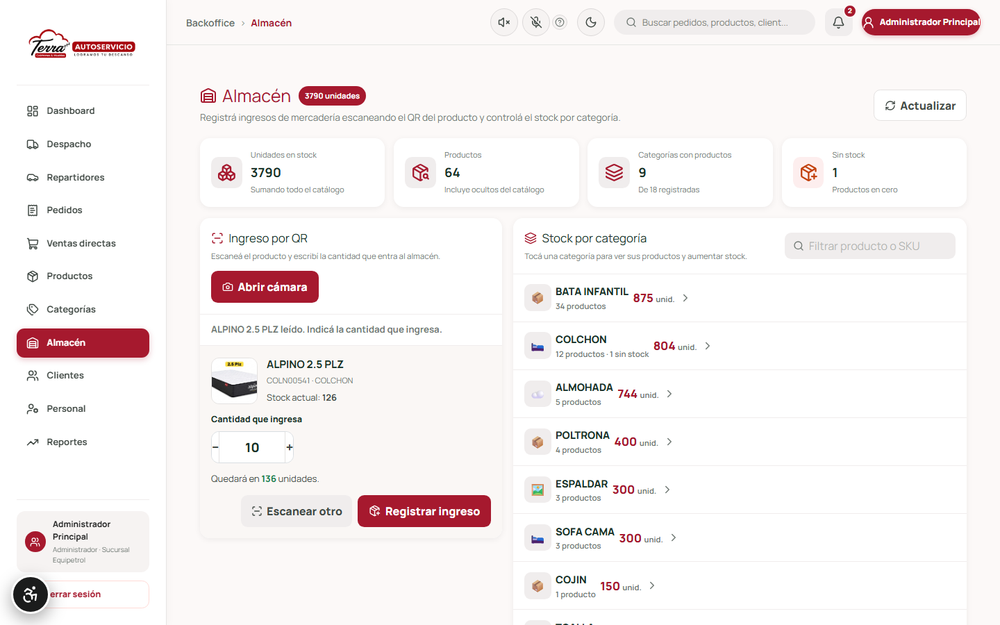

💡 También puedes sumar stock sin escanear: en "Stock por categoría" despliega la categoría, toca **+ Stock** en el producto, escribe la cantidad y confirma con ✓.

**Mensajes**

| Mensaje | Qué hacer |
|---|---|
| "El código no es un QR de producto TERRA." | Escanea el QR generado en Productos. |
| "No se encontró un producto con ese código." | Revisa el SKU en Productos. |
| "La cantidad debe ser un entero entre 1 y 100000." | Escribe un número válido. |

### 11.13 Procedimiento: crear una cuenta mayorista

1. Entra a **Clientes** y toca **Crear usuario mayorista**.
2. Completa **Nombre completo**, **Correo electrónico** (será su usuario), **Celular** (opcional), **NIT** (opcional, 5 a 20 dígitos) y **Contraseña temporal** (8 a 128 caracteres).
3. Toca **Crear usuario**.
4. Resultado: la ventana se cierra y el cliente aparece al inicio de la lista marcado como "Mayorista".
5. Entrega al cliente su correo y contraseña por un medio seguro y pídele que complete su dirección en **Mi perfil**.

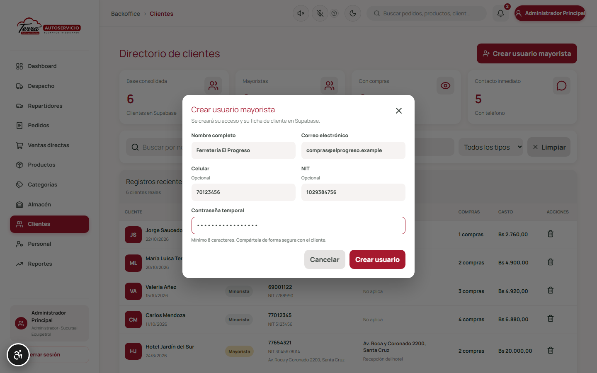

⚠️ La dirección de entrega no se carga aquí: la registra el propio mayorista desde su perfil.

**Eliminar un cliente**: toca la papelera y confirma. Si tenía compras, sus pedidos se conservan como "Compra como invitado".

### 11.14 Procedimiento: registrar personal (cuentas del equipo)

1. Entra a **Personal** y toca **Registrar personal**.
2. Completa **Nombre completo**, **Correo electrónico**, **Rol** (**Administrador**, **Vendedor** o **Despacho**) y **Contraseña temporal** (8 a 128 caracteres).
3. Si el rol es Despacho, agrega **Vehículo** y **Número de placa** (3 a 12 caracteres).
4. Toca **Crear cuenta**.
5. Resultado: la cuenta aparece en "Equipo registrado" como "Activo".

⚠️ Desde Personal **no** se puede editar, desactivar, cambiar de rol ni cambiar la contraseña. Para repartidores, el nombre, vehículo, placa y estado activo se cambian en **Repartidores**. Para cambios de contraseña de cualquier rol, contacta a soporte@terra.bo.

### 11.15 Procedimiento: asignar repartidor a un envío

**Objetivo**: indicar quién entrega cada pedido a domicilio.

1. Entra a **Repartidores**.
2. En "Equipo de reparto" verifica que el repartidor esté **Activo** y con vehículo y placa. Si falta, toca **Editar vehículo y placa**, completa y **Guardar cambios**.
3. En "Envíos de clientes mayoristas" filtra por **Sin asignar**.
4. En el envío, elige el repartidor en la lista **Repartidor** y toca **Asignar** (o **Cambiar**).
5. Resultado: "Envío #N asignado a …". El repartidor lo verá en **Despacho** con el filtro **Solo mis envíos**.

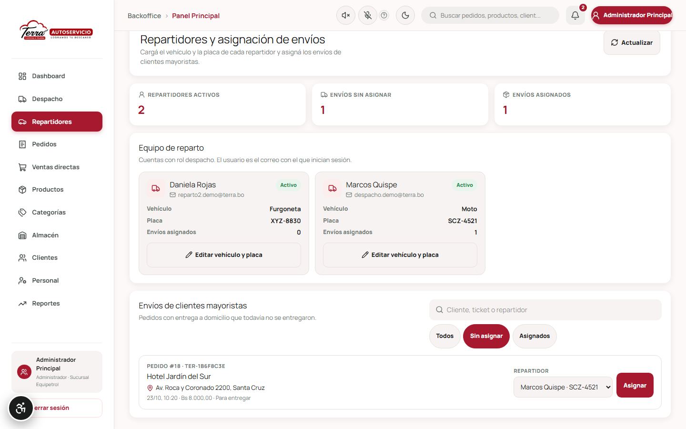

⚠️ Los repartidores se crean en **Personal** con rol Despacho, no aquí. Desmarcar **Disponible para asignar envíos** desactiva la cuenta y esa persona ya no podrá iniciar sesión.

### 11.16 Despacho (vista del administrador)

El administrador ve la misma pantalla **Despacho** que el personal de reparto (sección 13), con todos los envíos. Úsala para supervisar las etapas "Para entregar", "En camino" y "Entregados".

### 11.17 Procedimiento: generar reportes

1. Entra a **Reportes**.
2. Elige el **Rango rápido** (Hoy, Ayer, Últimos 7 días, Este mes, Mes anterior, Este año o Personalizado con **Fecha inicio** y **Fecha término**) y toca **Aplicar**.
3. Filtra por **Método de pago**, **Estado de pago** y **Línea de producto**.
4. Revisa los indicadores, los gráficos ("Evolución de ventas y pedidos", "Ventas por método de pago", "TOP 5 productos", "Ventas por categoría") y las pestañas **Ventas**, **Productos**, **Pedidos**, **Clientes** e **Inventario**.
5. Para exportar, toca **Exportar reporte** y elige **Excel (.xls)**, **PDF ejecutivo** o **CSV delimitado**. Cada pestaña también tiene **Exportar vista**.
6. Resultado: el archivo se descarga; para PDF se abre la impresión y eliges "Guardar como PDF".

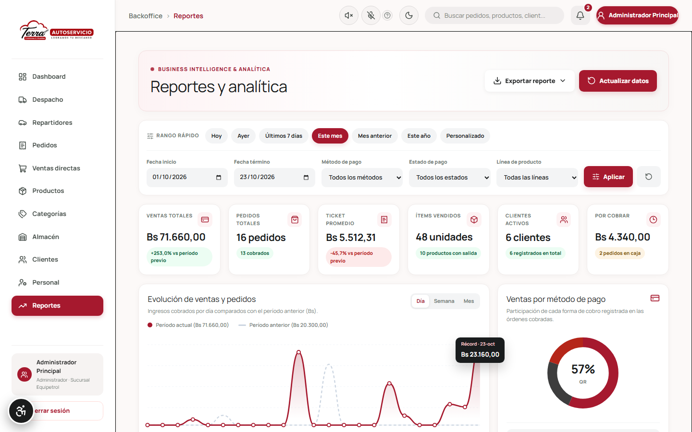

⚠️ Los reportes trabajan con los últimos 200 pedidos, 200 productos y 200 clientes. Para períodos largos, exporta por rangos.

### 11.18 Errores comunes del administrador

| Problema | Causa | Solución |
|---|---|---|
| "Permite las ventanas emergentes…" | El navegador bloquea la ventana de impresión o PDF. | Permite ventanas emergentes para el sitio de la tienda. |
| "Sesión de administrador inválida o vencida" | Pasaron 8 horas o se cerró la pestaña. | **Cerrar sesión** y volver a entrar. |
| El botón **Confirmar pago** no aparece | El pedido está anulado. | No se puede cobrar un pedido anulado. |
| "No se puede cobrar un pedido anulado." | Otro usuario anuló el pedido mientras lo tenías abierto. | La pantalla actualiza el estado; cierra la ventana. |
| "No se pudieron actualizar los indicadores. Verifica la conexión con la API." | Sin conexión con el servidor. | Revisa internet y toca **Actualizar**. |
| Una categoría no aparece en el kiosco | No tiene productos visibles. | Asigna al menos un producto visible con stock. |
| Stock distinto entre Productos y Almacén | Productos **reemplaza** el stock; Almacén lo **suma**. | Usa Almacén para ingresos y Productos para corregir el total. |

---

## 12. Guía para el Vendedor

### 12.1 Descripción del rol

Atiende ventas y pedidos en sucursal: cobra pedidos del kiosco, registra ventas directas, consulta y crea clientes. No administra productos, stock ni reportes generales.

### 12.2 Pantalla principal y menú

Ingresa por `/vendedor/login` (sección 6.4). El **Portal de ventas** tiene el menú: **Dashboard**, **Pedidos**, **Ventas directas**, **Clientes** y **Cerrar sesión**. La cabecera muestra "Hola, {tu nombre}", los botones de voz y la campana de pedidos.

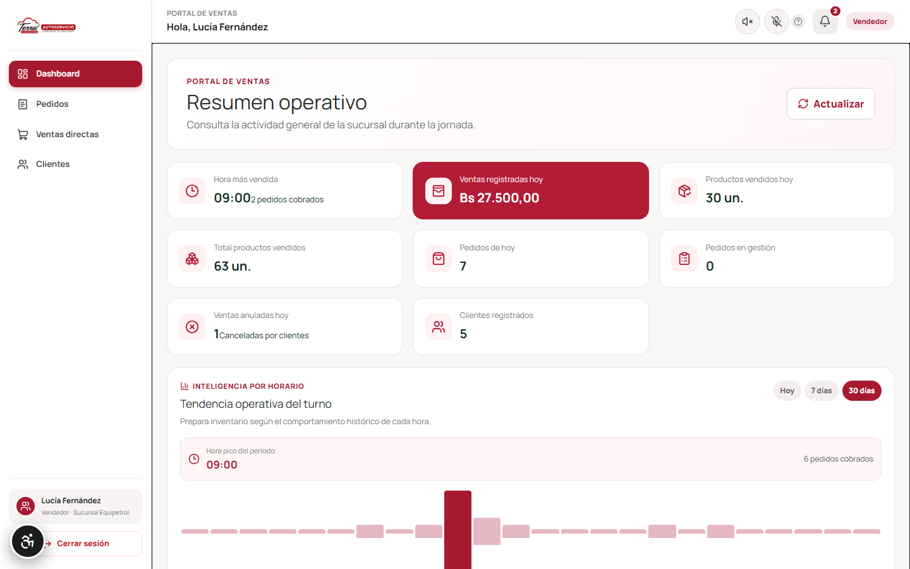

### 12.3 Resumen operativo (Dashboard)

Muestra "Hora más vendida", "Ventas registradas hoy", "Productos vendidos hoy", "Total productos vendidos", "Pedidos de hoy", "Pedidos en gestión", "Ventas anuladas hoy" y "Clientes registrados", un gráfico por hora y los **Últimos pedidos registrados** con el botón **Ticket** para imprimir. **Actualizar** recarga los datos.

⚠️ Las cifras corresponden a toda la sucursal, no a cada vendedor.

### 12.4 Procedimiento: cobrar un pedido

Sigue los mismos pasos que el administrador en la sección 11.4, desde **Pedidos** del portal de ventas. Diferencias:

- El título es "Pedidos" y no existe la pestaña **En despacho**.
- Puedes **Editar / Agregar** artículos (11.5) y **Anular venta** (11.6) en pedidos pendientes.

### 12.5 Procedimiento: registrar una venta directa

Igual que la sección 11.7, desde **Ventas directas**.

### 12.6 Procedimiento: crear un cliente mayorista

Igual que la sección 11.13, desde **Clientes**.

### 12.7 Procedimiento: exportar el reporte de pedidos

1. En **Pedidos**, toca **Reporte**.
2. Elige el filtro **Todos**, **Pagaron** o **Sin pagar**. Verás "Pedidos incluidos" y "Total registrado".
3. Toca **Descargar CSV** o **Exportar PDF**.
4. Resultado: se descarga el archivo `reporte-pedidos-…csv` o se abre el PDF "Reporte General de Pedidos" listo para imprimir o guardar.

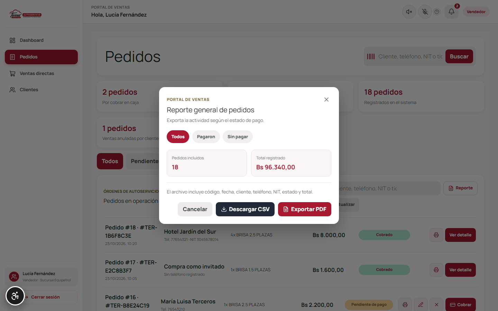

💡 El reporte usa los pedidos cargados en pantalla. Si buscaste o filtraste antes, el reporte respeta ese filtro.

### 12.8 Errores comunes del vendedor

| Problema | Causa | Solución |
|---|---|---|
| "Esta cuenta no corresponde al portal de vendedor." | Entraste con una cuenta de otro rol. | Usa `/admin/login`. |
| No veo Productos, Almacén ni Reportes | No corresponden a tu rol. | Pide a un administrador. |
| "Sesión de administrador inválida o vencida" | Sesión de 8 horas vencida. | Cierra sesión y vuelve a ingresar. |
| "Permite las ventanas emergentes para generar el PDF del reporte." | Bloqueo del navegador. | Habilita ventanas emergentes. |

---

## 13. Guía para el personal de Despacho

### 13.1 Descripción del rol

Repartidor que entrega los pedidos con envío a domicilio. Ve solo los envíos, actualiza la etapa de cada entrega y se comunica con el cliente. Un administrador le asigna los envíos desde **Repartidores**.

### 13.2 Pantalla principal y menú

Ingresa por `/admin/login` (sección 6.3). Entra directo a **Despacho**, el único punto del menú. En la cabecera tienes voz, modo noche, la campana y **Cerrar sesión**.

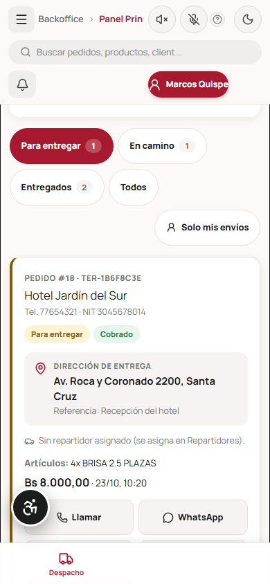

### 13.3 Procedimiento: entregar un pedido

**Objetivo**: registrar cada etapa del reparto para que la tienda y el cliente sepan dónde está el pedido.

1. En **Despacho**, toca **Solo mis envíos** para ver los asignados a ti. Usa las pestañas **Para entregar**, **En camino**, **Entregados** o **Todos**.
2. Abre la tarjeta del envío: muestra pedido, cliente, teléfono, **Dirección de entrega**, referencia, artículos, total y la etiqueta de pago ("Cobrado" o "Pago pendiente").
3. Antes de salir, toca **Llamar** o **WhatsApp** para avisar al cliente (el mensaje se arma solo).
4. Toca **Abrir Maps** para navegar hasta la dirección, o **Ver ruta** para ver la distancia y el tiempo estimado desde la tienda.
5. Al salir con el pedido, toca **Salir a entregar**. Verás "Salida registrada: el pedido quedó en camino" y pasa a **En camino**.
6. Al entregar, toca **Confirmar entrega**. Verás "Entrega confirmada" y pasa a **Entregados**.
7. Resultado: el cliente mayorista ve "En tránsito" y luego "Entregado" en su portal.

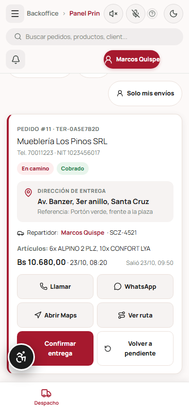

💡 Si saliste por error, toca **Volver a pendiente**. Si entregas sin haber marcado la salida, toca **Entregado** directamente desde "Para entregar".

⚠️ La etapa de entrega es **independiente del pago**. Si la tarjeta dice "Pago pendiente", coordina el cobro con la tienda antes de entregar.

⚠️ La pantalla se actualiza sola cada 60 segundos. Si no ves un envío nuevo, toca **Actualizar**.

### 13.4 Errores comunes de despacho

| Problema | Causa | Solución |
|---|---|---|
| "No hay envíos en esta etapa" | No tienes envíos asignados en esa pestaña. | Revisa **Todos** o pide al administrador que te asigne el envío. |
| "Sin repartidor asignado (se asigna en Repartidores)." | El envío aún no tiene repartidor. | Pide al administrador que lo asigne. |
| "El pedido está cancelado." | El pedido fue anulado. | No lo entregues; consulta en tienda. |
| "No se pudo calcular la ruta." | Sin conexión al servicio de mapas. | Usa **Abrir Maps**. |
| "Esta cuenta se encuentra desactivada." | Tu cuenta fue desactivada. | Habla con el administrador (se reactiva en Repartidores). |
| "No se pudo actualizar el envío." | Sin conexión. | Revisa internet y reintenta. |

---

## 14. Preguntas frecuentes (FAQ)

**¿El kiosco cobra el pedido?**
No. El kiosco genera un ticket con un código. El pago siempre se hace en caja con el personal, en efectivo, QR Simple o tarjeta.

**¿Cuánto tiempo vale el ticket?**
Tiene validez limitada. Si pasó mucho tiempo, consulta en caja: el pedido puede seguir "Pendiente de pago" o haber sido anulado.

**Cerré la página del kiosco y perdí mi carrito. ¿Puedo recuperarlo?**
No. El carrito vive solo mientras la página está abierta. La excepción es la compra por QR desde tu celular, que se guarda 2 horas.

**¿Cómo consigo una cuenta mayorista?**
La crea el personal de TERRA desde Clientes. Usa el botón **WhatsApp** del formulario de inicio de sesión para pedirla.

**Olvidé mi contraseña. ¿Qué hago?**
Hoy no hay recuperación automática. Mayoristas: contacten a su asesor. Personal: escriban a soporte@terra.bo.

**¿Por qué una categoría no aparece en el catálogo del kiosco?**
Solo se muestran categorías con al menos un producto visible. Asigna un producto o quita la marca "oculto".

**¿Qué diferencia hay entre "Ajustar stock" en Productos y "Registrar ingreso" en Almacén?**
Productos **reemplaza** el stock por el número escrito. Almacén **suma** la cantidad ingresada al stock actual.

**¿Puedo cobrar un pedido anulado?**
No. El sistema lo rechaza y muestra "Esta venta fue anulada". Si el cliente finalmente quiere comprar, registra una venta directa o un pedido nuevo.

**¿Puedo anular un pedido ya cobrado?**
No desde el sistema. Contacta a soporte para revisar el caso.

**¿Cómo imprimo tickets?**
Permite las ventanas emergentes en el navegador y usa una impresora térmica de 80 mm configurada como predeterminada.

**¿Se puede usar el sistema sin conexión a internet?**
No. Si aparece "No se pudo conectar al backend", revisa la red.

**¿Los comandos de voz funcionan en cualquier navegador?**
Solo en Chrome y Edge. En otros navegadores el micrófono no aparece o avisa que no es compatible.

**¿La tablet guarda mis datos personales?**
No. El nombre, teléfono y NIT se usan solo para ese pedido y se borran al generar el ticket.

---

## 15. Soporte y contacto

| Canal | Para quién | Dato |
|---|---|---|
| Mesa de ayuda (correo) | Personal de TERRA | soporte@terra.bo |
| WhatsApp TERRA (comprobantes y asesoría) | Clientes y mayoristas | Botón **WhatsApp** en el inicio de sesión mayorista y **Enviar ticket a WhatsApp TERRA** en el ticket |
| Asistente virtual | Clientes en tienda y mayoristas | Botón **Asistente** en la tienda |
| Sucursal | Todos | TERRA Autoservicio · Sucursal Equipetrol, Santa Cruz de la Sierra |

Al reportar un problema, indica: tu rol, la pantalla, el **código de pedido** si aplica, el mensaje exacto que viste y la hora.

---

## 16. Historial de versiones del documento

| Versión | Fecha | Autor | Cambios |
|---|---|---|---|
| 1.0 | 23/10/2026 | Equipo TERRA Autoservicio | Primera versión. Cubre kiosco, portal mayorista, backoffice (administrador), portal de ventas (vendedor) y despacho. |
| 1.1 | 23/10/2026 | Equipo TERRA Autoservicio | "Recordar sesión" funciona en los accesos mayorista y administrativo (6.2, 6.3, 10.6). "Comprar ahora" agrega el producto al carrito (9.4). Mensajes claros de stock insuficiente y mínimo mayorista (9.9, 10.6). Se quitó el QR de prueba del cobro (11.4) y la carga de logo del perfil mayorista (10.3). El botón "Factura PDF" pasa a llamarse "Descargar ticket" (10.5). El acceso administrativo muestra "Sucursal Equipetrol". |
| 1.2 | 23/10/2026 | Equipo TERRA Autoservicio | Nuevo tutorial interactivo del catálogo: invitación en la primera visita, botón **Tutorial** en la cabecera y recorrido de 8 pasos adaptado a celular y mayoristas (8.6, 9.2). |
