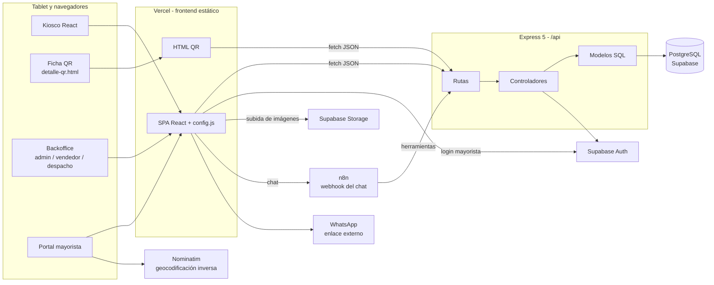
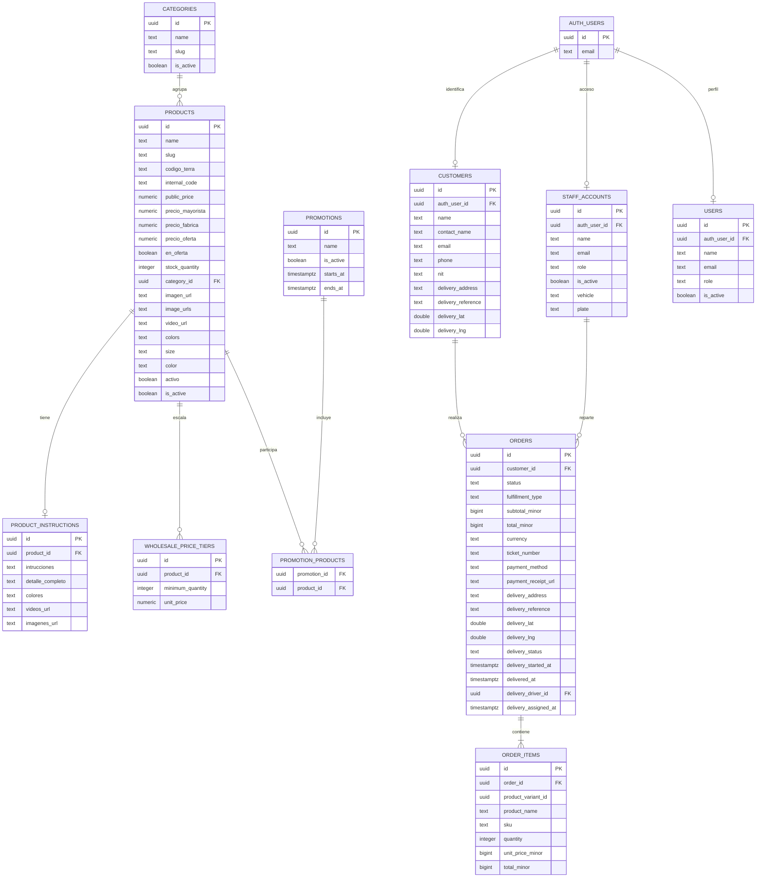
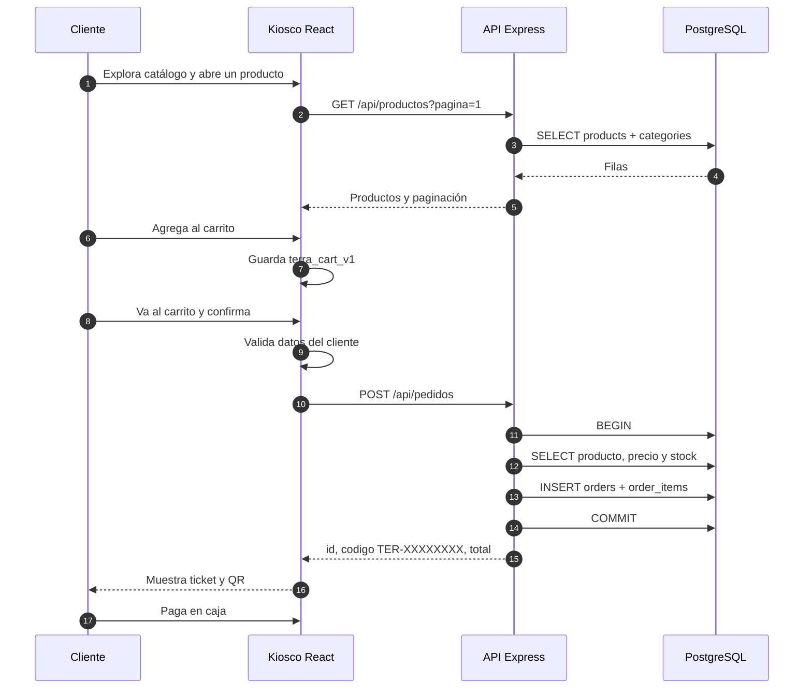
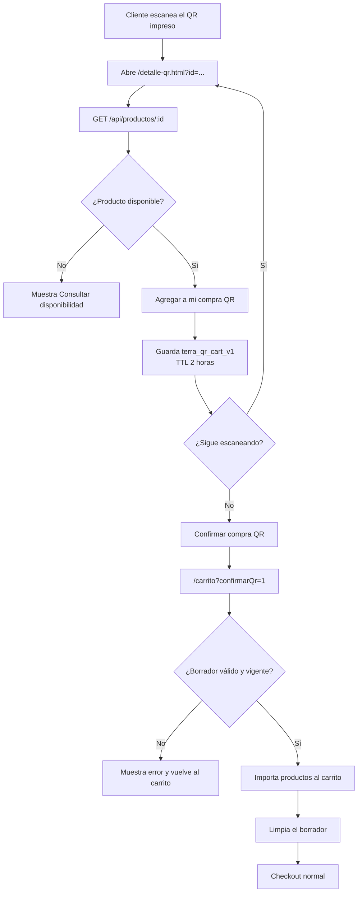
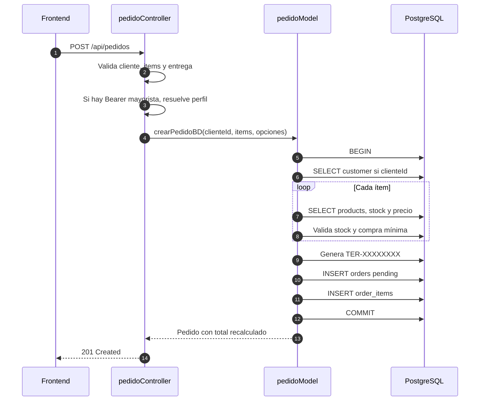
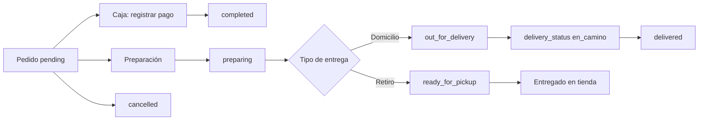
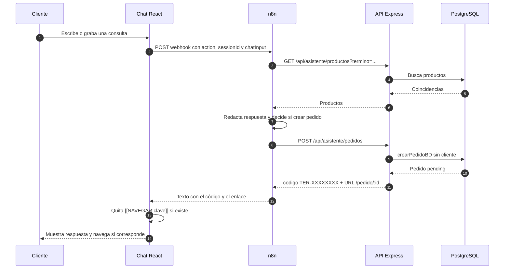
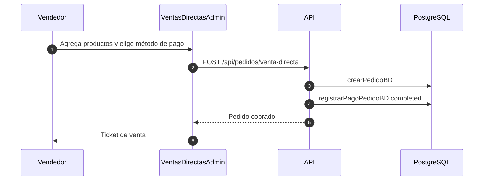

# TERRA Autoservicio — Documentación del proyecto

> Documento técnico y funcional generado leyendo el repositorio el **22 de octubre de 2026**. Todo lo que aparece aquí sale del código, los documentos del repo o los `package.json`; lo que no se pudo verificar está marcado en la sección **17. Problemas conocidos, deuda y pendientes**.
>
> No contiene credenciales, cadenas de conexión, tokens ni correos. Solo se nombran las variables de entorno.

## Índice

1. [Resumen](#1-resumen)
2. [Qué hace](#2-qué-hace)
3. [Arquitectura](#3-arquitectura)
4. [Stack tecnológico](#4-stack-tecnológico)
5. [Estructura de carpetas](#5-estructura-de-carpetas)
6. [Requisitos, instalación y configuración](#6-requisitos-instalación-y-configuración)
7. [Base de datos](#7-base-de-datos)
8. [API por módulo](#8-api-por-módulo)
9. [Frontend](#9-frontend)
10. [Flujos principales](#10-flujos-principales)
11. [Roles, autenticación y seguridad](#11-roles-autenticación-y-seguridad)
12. [Accesibilidad y voz](#12-accesibilidad-y-voz)
13. [Estilos y rendimiento](#13-estilos-y-rendimiento)
14. [Pruebas](#14-pruebas)
15. [Despliegue y Git](#15-despliegue-y-git)
16. [Recetas de cambios comunes](#16-recetas-de-cambios-comunes)
17. [Problemas conocidos, deuda y pendientes](#17-problemas-conocidos-deuda-y-pendientes)
18. [Glosario](#18-glosario)

---

## 1. Resumen

TERRA Autoservicio es una aplicación web para una tienda de muebles, colchones y productos de descanso. Nació como un **kiosco de autoservicio** para una tablet en el showroom y hoy reúne cuatro experiencias en un solo frontend:

1. **Kiosco público**: el cliente explora el catálogo, escanea códigos QR, arma un carrito y genera un **ticket de pedido** que paga en caja. No hay pasarela de pago.
2. **Ficha rápida por QR**: una página HTML independiente, pensada para el celular del cliente, que muestra un producto y lo agrega a un borrador de compra.
3. **Portal mayorista**: clientes B2B inician sesión con Supabase, ven precios por mayor, administran su perfil y dirección, y consultan sus pedidos.
4. **Backoffice**: administración, vendedores y despacho gestionan productos, stock, categorías, clientes, personal, ventas directas, pedidos, envíos y reportes.

El backend Express concentra las reglas que no deben vivir en el navegador: **recalcula precios y totales desde la base de datos**, valida stock y compras mínimas, genera el código del ticket y aplica los permisos del backoffice.

**En una frase:** el kiosco toma el pedido y emite un ticket; la caja cobra; el backoffice despacha; el backend es la única autoridad sobre precios, stock y estados.

---

## 2. Qué hace

### 2.1 Kiosco y cliente final

| Pantalla / capacidad | Qué permite |
|---|---|
| Inicio (`/`) | Presentación de la marca, accesos a catálogo, categorías y ofertas. |
| Categorías (`/categorias`) | Líneas de producto, categorías más compradas y promociones. |
| Catálogo (`/catalogo`) | Listado paginado, búsqueda, filtro por categoría, orden (recomendados, precio, nombre), filtro de ofertas y productos con stock. |
| Detalle (`/productos/:id`) | Imágenes, video, ficha técnica, medidas, colores, stock, productos relacionados y agregado al carrito. |
| Carrito (`/carrito`) | Cambio de cantidades, eliminación, subtotal, elección de retiro en tienda o envío a domicilio (solo mayoristas con dirección). |
| Identificación (`/identificacion`) | Nombre, teléfono y NIT opcional para asociar el pedido a un cliente. |
| Confirmación (`/confirmacion`) | Revisión final, creación del pedido y salto al ticket. |
| Ticket (`/pedido` y `/pedido/:id`) | Código `TER-XXXXXXXX`, QR, detalle, total y descarga/impresión del comprobante. |

Comportamientos relevantes:

- El **carrito se guarda en `localStorage`** (`terra_cart_v1`) con vencimiento de **2 horas**. Si el carrito está vacío, las rutas de confirmación redirigen.
- Los **datos personales viven solo en memoria** de React (`ClienteContext`). No se escriben en `localStorage` porque la tablet es compartida.
- El pedido nace en estado `pending`; **no se cobra nada desde el kiosco**. El pago se registra después en caja o en ventas directas.
- El ticket se puede abrir desde otro dispositivo con el enlace `/pedido/:id`, porque `GET /api/pedidos/:id` es público.

### 2.2 Compra por QR

Hay dos caminos que comparten el mismo borrador:

| Camino | Descripción |
|---|---|
| Cámara dentro del catálogo | El botón de escaneo abre la cámara con ZXing, lee el QR de la ficha del producto y lo agrega al borrador. Se abre con `/catalogo?abrirQr=1`. |
| Ficha externa `detalle-qr.html` | Página independiente que se abre al escanear el QR impreso del producto. Consulta `GET /api/productos/:id`, muestra la ficha y permite agregar al borrador. |

El borrador se guarda en `localStorage` con la clave `terra_qr_cart_v1` y **vence a las 2 horas**. Solo contiene líneas de producto (id, nombre, precio, stock, categoría, imagen, color y cantidad), nunca datos del cliente.

Flujo resumido: escanear → agregar al borrador → “Confirmar compra QR” → `/carrito?confirmarQr=1` → el carrito importa el borrador, lo limpia y sigue el checkout normal.

La ficha QR permite **volver a comprar con cámara**: enlace a `/catalogo?abrirQr=1` conservando el borrador.

### 2.3 Portal mayorista

| Capacidad | Detalle |
|---|---|
| Inicio de sesión | Supabase Auth con correo y contraseña; la sesión se guarda en memoria (`SesionClienteContext`) y el token se usa como `Bearer`. |
| Precios B2B | El backend detecta la sesión mayorista y aplica `precio_mayorista` o la escala por cantidad. |
| Perfil | Nombre, titular, teléfono, NIT, dirección, referencia y coordenadas. |
| Mapa | Leaflet en `PanelMayorista`; geocodificación inversa con Nominatim a través de `GET /api/geocodificacion/reverse`. |
| Pedidos | Historial (`/mi-cuenta/pedidos`), detalle y repetición de compra. |
| Envío | Solo si el perfil tiene dirección; el pedido se crea como `home_delivery`. |

La creación de cuentas mayoristas se hace desde administración (`ClientesAdmin`), no hay autorregistro desde el kiosco.

### 2.4 Backoffice

| Rol | Pantallas | Acciones principales |
|---|---|---|
| **admin** | Dashboard, productos, categorías, almacén, pedidos, ventas directas, clientes, personal, reportes, despacho, repartidores | CRUD de catálogo, stock, categorías, clientes, cuentas de personal, reportes, asignación de envíos. |
| **vendedor** | Dashboard, pedidos, ventas directas, clientes | Cobrar, cambiar estado de pedido, modificar ítems, crear ventas directas, consultar clientes. |
| **despacho** | Despacho | Ver solo pedidos a domicilio, marcar “en camino” o “entregado”. |

Detalle por pantalla:

- **Dashboard**: últimos pedidos, stock crítico, KPIs y comparativa de ventas contra el período anterior.
- **Productos**: alta/edición, precios minorista/mayorista/fábrica/oferta, escalas mayoristas, imágenes, video, colores, visibilidad, stock y generación de QR imprimible.
- **Categorías**: alta, edición y borrado; no permite borrar categorías con productos.
- **Almacén**: ingreso de stock por QR o código manual, vista de stock por categoría.
- **Pedidos**: búsqueda por ticket, número, cliente, teléfono o NIT; filtro por estado y tipo de entrega; cambio de estado; cobro; edición de ítems; datos de envío.
- **Ventas directas**: carrito de mostrador, método de pago (`qr`, `efectivo`, `tarjeta`), precio mayorista manual o detectado por cliente.
- **Clientes**: directorio, creación de usuario mayorista, datos de contacto y compras.
- **Personal**: cuentas de admin, vendedor y despacho; vehículo y placa para repartidores.
- **Reportes**: ventas por período, métodos de pago, productos, categorías y horarios; exportación a un archivo `.xls` que en realidad es una tabla HTML.
- **Despacho**: pedidos a domicilio, chip de estado de entrega, asignación de repartidor y transición “en camino” / “entregado”.
- **Repartidores**: equipo de reparto, alta/edición, vehículo, placa, estado activo y asignación de envíos.

### 2.5 Asistente conversacional

- Chat flotante con texto y **notas de voz** (se convierten a WAV antes de enviarse).
- El frontend habla con un **webhook de n8n** (`N8N_CHAT_URL` en `frontend/public/config.js`); n8n orquesta el modelo y las herramientas.
- n8n puede consultar el backend: `GET|POST /api/asistente/productos`, `GET|POST /api/asistente/instrucciones` y `POST /api/asistente/pedidos`.
- La respuesta puede terminar con `[[NAVEGAR:clave]]`: el frontend lo interpreta y navega a la pantalla correspondiente (catálogo, ofertas, carrito, escáner, cuenta mayorista, etc.). Las claves válidas están en `frontend/src/navegacion/registroNavegacion.js` y `CLAVES_CHAT`.
- El pedido creado desde el chat no lleva datos del cliente, se genera con `crearPedidoBD` y responde con `codigo` (`TER-XXXXXXXX`) y una URL de ticket para codificar en un QR.

### 2.6 Lo que el sistema no hace

- No cobra en línea ni integra pasarela de pago.
- No descuenta stock al crear un pedido (solo valida disponibilidad).
- No envía correos ni notificaciones automáticas.
- No calcula costo de envío (`delivery_fee_minor` se guarda en 0).
- No emite factura fiscal ni nota tributaria.
- No tiene multi-sucursal ni multi-almacén real.
- No tiene autorregistro de mayoristas ni recuperación de contraseña desde la interfaz.
- No tiene RLS de Supabase configurado para las tablas propias: el control de acceso vive en Express.

---

## 3. Arquitectura

### 3.1 Vista general



### 3.2 Capas del backend

| Capa | Carpeta | Responsabilidad |
|---|---|---|
| Entrada | `backend/server.js` | Carga `.env`, verifica la conexión a PostgreSQL y escucha en `PORT`. Si no hay base, termina con código 1. |
| Aplicación | `backend/src/app.js` | CORS, JSON, montaje de routers, `/api/health`, `/openapi`, `/docs`, 404 y manejador de errores. |
| Rutas | `backend/src/routes/*.js` | Declaran endpoints y middlewares de autenticación/rol. |
| Controladores | `backend/src/controllers/*.js` | Validan entradas, traducen errores de negocio a códigos HTTP y arman la respuesta. |
| Modelos | `backend/src/models/*.js` | SQL, transacciones y reglas de datos. |
| Servicios | `backend/src/services/*.js` | Supabase Auth, sesión mayorista y creación directa de usuarios en el esquema `auth`. |
| Middlewares | `backend/src/middlewares/*.js` | Token HMAC, roles y errores. |

### 3.3 Capas del frontend

| Capa | Carpeta | Responsabilidad |
|---|---|---|
| Entrada | `frontend/src/main.jsx`, `App.jsx` | Providers globales y montaje de rutas. |
| Rutas | `frontend/src/routes/AppRoutes.jsx` | Rutas públicas, backoffice, layouts y `React.lazy`. |
| Páginas | `frontend/src/pages/` | Pantallas del kiosco, mayorista, admin y vendedor. |
| Componentes | `frontend/src/components/` | Layout, administración, chat, accesibilidad y modales. |
| Estado | `frontend/src/context/` | Tema, accesibilidad, cliente, sesión, carrito y catálogo. |
| Servicios | `frontend/src/services/` | `fetch` a la API, Supabase Storage y borrador QR. |
| Utilidades | `frontend/src/utils/` | Moneda, validaciones, imágenes, tickets, audio y video. |
| Navegación | `frontend/src/navegacion/` | Registro de destinos, intérprete de voz/chat y contexto. |

### 3.4 Comunicación

- **HTTP JSON** entre frontend y backend, con prefijo `/api`.
- Envelope habitual: `{ "success": true, "data": ... }` o `{ "success": false, "mensaje": "..." }`.
- El frontend toma la URL base de `VITE_API_URL`, pero `frontend/public/config.js` (`window.TERRA_CONFIG.API_URL`) tiene prioridad en tiempo de ejecución. Así se puede cambiar la URL sin recompilar.
- CORS está abierto (`app.use(cors())`), no restringido a `FRONTEND_URL`.
- El límite de JSON es **12 MB** (`express.json({ limit: '12mb' })`) para permitir imágenes en base64 desde administración.
- El chat usa `fetch` directo al webhook de n8n, no pasa por el backend.

---

## 4. Stack tecnológico

| Tecnología | Versión declarada | Uso |
|---|---:|---|
| React | 19.2.8 | Interfaz del kiosco y backoffice. |
| React DOM | 19.2.8 | Render en navegador. |
| Vite | 8.3.0 | Desarrollo, build y code splitting. |
| React Router | 7.18.4 | Rutas de la SPA. |
| Tailwind CSS | 4.3.3 | Utilidades CSS mediante `@tailwindcss/vite`. No hay archivo de configuración de Tailwind. |
| Lucide React | 1.56.0 | Iconografía. |
| ZXing Browser | 0.2.1 | Lectura de QR con cámara. |
| Leaflet | 1.9.4 | Mapa de dirección del mayorista. |
| react-qr-code | 2.2.0 | QR del ticket y de productos. |
| SweetAlert2 | 11.26.25 | Diálogos y avisos. |
| html-to-image | 1.11.13 | Generación de imágenes del ticket. |
| Express | 5.3.0 | API HTTP. |
| pg | 8.23.1 | Cliente PostgreSQL. |
| dotenv | 18.0.7 | Carga de variables de entorno. |
| cors | 2.8.6 | CORS. |
| Supabase Auth | Servicio externo | Login de mayoristas y cuentas de personal. |
| Supabase Storage | Servicio externo | Imágenes de productos en el bucket configurado. |
| PostgreSQL / Supabase | Servicio externo | Base de datos. |
| n8n | Externo | Workflow del asistente conversacional. |
| Nominatim | Servicio externo | Geocodificación inversa. |
| Vitest | 5.0.5 | Pruebas de accesibilidad. |
| Testing Library | 16.3.3 | Render de componentes en pruebas. |
| jest-axe / axe-core | 11.0.0 / 4.14.0 | Auditoría de accesibilidad. |
| oxlint | 1.81.0 | Lint. |
| k6 | Externo | Prueba de carga (`k6_test.js`). |

Notas:

- El proyecto es **ESM** en ambos paquetes (`"type": "module"`).
- No hay versión de Node fijada en el repo. Vite 8 requiere una versión moderna de Node; conviene usar la misma en desarrollo y despliegue.
- `frontend/package.json` es el paquete real del frontend; la raíz solo tiene un `package.json` mínimo con un `npm test` que falla a propósito.

---

## 5. Estructura de carpetas

```text
terratablet-paulo/
├── AGENTS.md                     Reglas del repo (comandos, convenciones, CSS)
├── README.md                     Presentación y puesta en marcha
├── k6_test.js                    Prueba de carga con k6
├── actualizar-vercel.cmd         Script local: commit y push para Vercel
├── docs/
│   ├── PROYECTO_TERRA.md         Este documento
│   ├── GUIA_FUNCIONAL_TERRA_AUTOSERVICIO.md
│   └── NAVEGACION_TERRA.md       Mapa de rutas, roles y contrato del chatbot
│
├── backend/
│   ├── server.js                 Arranque y verificación de base
│   ├── package.json
│   ├── scripts/
│   │   └── test_carga.js         Prueba de carga contra la API
│   └── src/
│       ├── app.js                Express, CORS, routers, OpenAPI y Swagger
│       ├── config/
│       │   ├── database.js       Pool de PostgreSQL
│       │   ├── migrate_seed.js   Creación/seed de tablas legacy (destructivo)
│       │   └── limpiar_descripciones.js
│       ├── controllers/          admin, asistente, categoría, cliente,
│       │                         geocodificación, pedido, personal, producto
│       ├── middlewares/          authAdmin, errorHandler
│       ├── models/               asistente, cliente, mayorista, pedido,
│       │                         personal, producto
│       ├── routes/               un router por módulo
│       └── services/             authUsuariosBD, sesionMayorista, supabaseAuth
│
└── frontend/
    ├── package.json
    ├── vite.config.js            React + Tailwind v4 + Vitest
    ├── vercel.json               Rewrite de SPA
    ├── index.html
    ├── database/
    │   └── schema.sql            Esquema legacy en español (no es el real)
    ├── public/
    │   ├── config.js             Configuración de runtime (API, n8n, WhatsApp)
    │   ├── detalle-qr.html       Ficha QR independiente
    │   └── assets/               Logo, favicon, imágenes públicas
    └── src/
        ├── main.jsx, App.jsx
        ├── index.css, theme-dark.css, theme-dark-admin.css, Responsive.css
        ├── accesibilidad/        Modo accesible, botón, salto de contenido,
        │                         vigilante de inactividad y CSS
        ├── assets/
        ├── components/
        │   ├── admin/            Layout, header, sidebar, guards, fixes
        │   ├── chat/             Chat, markdown y estilos
        │   └── ...
        ├── context/              Accesibilidad, carrito, catálogo, cliente,
        │                         sesión mayorista, tema
        ├── data/                 Categorías y promociones estáticas
        ├── hooks/                useCarrito, useProductos
        ├── navegacion/           Registro, intérprete y contexto
        ├── pages/
        │   ├── admin/            Una pantalla por módulo
        │   ├── vendedor/         Dashboard y login
        │   └── ...               Kiosco, mayorista y ticket
        ├── routes/AppRoutes.jsx
        ├── services/             API, admin, chat, cliente, pedido, personal,
        │                         producto, QR, sesión y Storage
        └── utils/                Moneda, validaciones, tickets, audio, etc.
```

---

## 6. Requisitos, instalación y configuración

### 6.1 Requisitos

- Node.js y npm.
- PostgreSQL accesible o un proyecto de Supabase con la base y las tablas reales.
- Opcional: cuenta de Supabase Auth para mayoristas, bucket de Storage para imágenes, workflow de n8n para el chat y acceso a Nominatim.
- Para la prueba de carga: `k6` instalado.

### 6.2 Instalación

```bash
# Frontend
cd frontend
npm install
npm run dev        # http://localhost:5173

# Backend (en otra terminal)
cd backend
npm install
npm start          # http://localhost:3001
```

El backend **termina con código 1** si no puede conectarse a PostgreSQL. Revisar primero `backend/.env`.

### 6.3 Variables de entorno

Nunca se versionan `.env`. Solo se listan los nombres.

#### Frontend (`frontend/.env`)

| Variable | Obligatoria | Uso |
|---|---|---|
| `VITE_API_URL` | No (hay valor por defecto) | URL base de la API. Se le quita la barra final. |
| `VITE_MODO_DEMO` | No | Solo se activa si vale exactamente `"true"`. Con el modo activo, los servicios lanzan error y exigen conexión real. |
| `VITE_SUPABASE_URL` | Para subir imágenes | URL del proyecto Supabase. |
| `VITE_SUPABASE_PUBLISHABLE_KEY` | Para subir imágenes | Clave pública de Supabase. El código también acepta `VITE_SUPABASE_ANON_KEY`. |
| `VITE_SUPABASE_STORAGE_BUCKET` | No | Bucket de imágenes; por defecto `product-images`. |

#### Backend (`backend/.env`)

| Variable | Obligatoria | Uso |
|---|---|---|
| `DATABASE_URL` | Sí | Cadena de conexión PostgreSQL. Sin ella el arranque falla. |
| `PORT` | Sí | Puerto del servidor. |
| `FRONTEND_URL` | Sí | URL pública del frontend; se usa para armar el enlace del ticket del chat y como origen previsto. |
| `ADMIN_EMAIL` | Sí | Correo del superadministrador definido por entorno. |
| `ADMIN_PASSWORD` | Sí | Contraseña del superadministrador definido por entorno. |
| `ADMIN_TOKEN_SECRET` | Sí | Clave para firmar los tokens HMAC del backoffice. Sin ella no se puede iniciar sesión ni validar tokens. |
| `DATABASE_SSL` | No | Activa SSL según el valor. |
| `DATABASE_POOL_MAX` | No | Tamaño máximo del pool. |
| `SUPABASE_URL` | Para mayoristas | URL del proyecto Supabase. |
| `SUPABASE_ANON_KEY` | Para mayoristas | Clave pública para validar tokens de sesión. |
| `SUPABASE_PUBLISHABLE_KEY` | Alternativa | Clave pública alternativa. |
| `SUPABASE_SERVICE_ROLE_KEY` | Opcional | Permite crear/borrar usuarios en Supabase Auth desde administración. |
| `SUPABASE_SERVICE_KEY` | Alternativa | Nombre alternativo aceptado por el código. |

#### Configuración de runtime (`frontend/public/config.js`)

Se carga como `<script>` y **no se compila**. Se puede editar en `dist/config.js` después del build.

| Clave | Uso |
|---|---|
| `window.TERRA_CONFIG.API_URL` | URL pública de la API. Debe terminar en `/api`. |
| `window.TERRA_CONFIG.N8N_CHAT_URL` | Webhook del nodo de chat de n8n. Si está vacío, el chat se muestra deshabilitado. |
| WhatsApp | Enlace de contacto para solicitar comprobante. |

> Este archivo es público por diseño. Cualquier URL que se ponga aquí queda visible para el navegador.

### 6.4 Base de datos

Hay dos generaciones de esquema conviviendo:

1. **Esquema real usado por el código**: tablas en inglés (`products`, `categories`, `orders`, `order_items`, `customers`, `users`, `staff_accounts`, `product_instructions`, `wholesale_price_tiers`, `promotions`, `promotion_products`) y el esquema `auth` de Supabase.
2. **Esquema legacy en español**: `clientes`, `productos`, `pedidos`, `pedido_detalles`, creado por `frontend/database/schema.sql` y por `backend/src/config/migrate_seed.js`.

El README/AGENTS indica crear la base `terra_autoservicio` y ejecutar `frontend/database/schema.sql`, pero **el backend lee las tablas en inglés**. Para una instalación nueva hay que crear el esquema real en Supabase; el SQL legacy no alcanza. Ver la sección 17.

### 6.5 Comprobación

```bash
curl http://localhost:3001/api/health
```

También están disponibles:

- `GET http://localhost:3001/` → información del servicio y endpoints.
- `GET http://localhost:3001/openapi` → especificación OpenAPI 3.0.
- `GET http://localhost:3001/docs` → Swagger UI.

### 6.6 Errores frecuentes

| Síntoma | Causa probable |
|---|---|
| El backend sale con código 1 | `DATABASE_URL` ausente, mal formada o base inaccesible. |
| El catálogo responde 503 | Faltan tablas o columnas en Supabase (`42P01`, `42703`). |
| El login admin falla siempre | Falta `ADMIN_TOKEN_SECRET` o las credenciales de entorno no coinciden. |
| El chat no responde | `N8N_CHAT_URL` vacío, workflow inactivo o CORS del webhook. |
| Las imágenes no suben | Faltan `VITE_SUPABASE_URL` / clave pública o el bucket no existe. |
| El QR muestra “No se pudo cargar” | `API_URL` no apunta al backend público o el backend no permite CORS. |

---

## 7. Base de datos

### 7.1 Modelo real



> `AUTH_USERS` representa `auth.users` de Supabase. `AUTH_IDENTITIES` (`auth.identities`) se usa solo al crear cuentas. El diagrama muestra las relaciones lógicas y los tipos inferidos de las consultas; algunas relaciones no tienen FK declarada en la base.

### 7.2 Tablas usadas por el código

| Tabla | Uso | Campos clave |
|---|---|---|
| `products` | Catálogo, precios, stock, visibilidad. | `id`, `name`, `slug`, `codigo_terra`, `internal_code`, `public_price`, `precio_mayorista`, `precio_fabrica`, `precio_oferta`, `en_oferta`, `stock_quantity`, `category_id`, `image_url`, `image_urls`, `video_url`, `colors`, `size`, `color`, `activo`, `is_active`. |
| `categories` | Categorías del catálogo. | `id`, `name`, `slug`, `is_active`. |
| `product_instructions` | Instrucciones de armado/uso para el chat y la ficha. | `product_id`, `intrucciones`, `detalle_completo`, `colores`, `videos_url`, `imagenes_url`. |
| `wholesale_price_tiers` | Escalas de precio por cantidad. | `product_id`, `minimum_quantity`, `unit_price`. |
| `promotions` | Promociones activas por fecha. | `id`, `is_active`, `starts_at`, `ends_at`. |
| `promotion_products` | Productos incluidos en promociones. | `promotion_id`, `product_id`. |
| `orders` | Pedidos y tickets. | `id`, `customer_id`, `status`, `fulfillment_type`, montos en `*_minor`, `ticket_number`, datos de pago y entrega. |
| `order_items` | Líneas del pedido. | `order_id`, `product_name`, `sku`, `quantity`, `unit_price_minor`, `total_minor`. |
| `customers` | Clientes y perfiles mayoristas. | `id`, `auth_user_id`, `name`, `contact_name`, `email`, `phone`, `nit`, dirección y coordenadas. |
| `users` | Rol del usuario autenticado. | `auth_user_id`, `name`, `email`, `role`, `is_active`. |
| `staff_accounts` | Personal del backoffice y repartidores. | `id`, `auth_user_id`, `name`, `email`, `role`, `is_active`, `vehicle`, `plate`. |
| `auth.users` | Cuentas de Supabase Auth. | `id`, `email`, `encrypted_password`. |
| `auth.identities` | Identidades de Supabase Auth. | `user_id`, `provider`, `identity_data`. |

### 7.3 Tablas referenciadas pero no usadas (o solo para borrar)

| Tabla | Situación |
|---|---|
| `inventory` | Solo se borra al eliminar un producto, para evitar el `ON DELETE RESTRICT` de las variantes. |
| `product_variants` | Solo se consulta/borra al eliminar un producto. El catálogo actual no crea variantes: `order_items.product_variant_id` queda `NULL`. |
| `cart_items` | Solo se borra al eliminar un producto. El carrito real vive en el navegador. |
| `clientes` | Legacy en español. La crea `schema.sql` y `migrate_seed.js`; el backend no la lee. |
| `productos` | Legacy en español. `migrate_seed.js` la trunca y la vuelve a llenar; el catálogo lee `products`. |
| `pedidos` | Legacy en español. Sin uso en el código actual. |
| `pedido_detalles` | Legacy en español. Sin uso en el código actual. |

### 7.4 Reglas y detalles importantes

- **Dinero en pedidos:** `orders` y `order_items` guardan montos en **unidades menores** (`subtotal_minor`, `total_minor`, `unit_price_minor`). Los modelos dividen por 100 antes de responder.
- **Dinero en productos:** `products.public_price`, `precio_mayorista`, `precio_fabrica`, `precio_oferta` y `wholesale_price_tiers.unit_price` están en unidades mayores. `crearPedidoBD` los multiplica por 100.
- **Precio efectivo:** si la compra es mayorista, se usa la escala por cantidad; si no hay escala, `precio_mayorista`; luego `precio_oferta` si `en_oferta`; por último `public_price`.
- **Stock:** `products.stock_quantity`. Se valida, pero **no se descuenta** al crear el pedido. El stock se modifica desde administración/almacén.
- **Número de pedido:** no es una columna. Se calcula con `ROW_NUMBER() OVER (ORDER BY created_at ASC)` al consultar. El código visible es `ticket_number` (`TER-` + 8 caracteres hexadecimales en mayúsculas).
- **Estados de pedido:** `pending`, `confirmed`, `preparing`, `ready_for_pickup`, `out_for_delivery`, `completed`, `cancelled`.
- **Entrega:** `store_pickup` o `home_delivery`. La etapa de reparto (`delivery_status`) es independiente del pago: `NULL`, `en_camino`, `entregado`.
- **Columnas creadas en caliente:** el backend ejecuta `ALTER TABLE ... ADD COLUMN IF NOT EXISTS` al arrancar ciertas operaciones:
  - `orders`: pago y entrega.
  - `customers`: NIT y dirección.
  - `products`: `video_url`, `colors`, `image_urls`, precios de fábrica/oferta.
  - `staff_accounts`: se crea la tabla completa si no existe y se agregan `vehicle`/`plate`.
- **Typo conocido:** la columna de instrucciones se llama `intrucciones` (sic) en `product_instructions`; el código la usa así.
- **Sin RLS:** las tablas propias no tienen políticas de fila en el código. El acceso se controla en Express y con la clave de conexión.

---

## 8. API por módulo

### 8.1 Convenciones

- Base: `/api`.
- Autenticación de backoffice: `Authorization: Bearer <token>` firmado con HMAC-SHA256, 8 horas de vigencia.
- Autenticación mayorista: `Authorization: Bearer <access_token>` de Supabase Auth.
- Errores: `{ success: false, mensaje: "..." }` con código HTTP 400, 401, 403, 404, 409 o 503.
- Fechas: ISO o `YYYY-MM-DD`; la analítica usa la zona `America/La_Paz`.

### 8.2 Productos (`/api/productos`)

| Método | Ruta | Auth | Descripción |
|---|---|---|---|
| GET | `/` | Pública | Listado paginado. Parámetros: `pagina`, `limite`, `orden`, `buscar`, `categoria`, `ofertas`, `promos`, `stock`, `precioMin`, `precioMax`, `todos`. |
| GET | `/:id` | Pública | Producto por id, slug o código Terra/interno. |
| GET | `/categorias` | Pública | Alias del listado de categorías. |
| POST | `/` | **Sin auth** | Crea producto. |
| PUT | `/:id` | **Sin auth** | Actualiza producto. |
| PATCH | `/:id/stock` | **Sin auth** | Ajusta stock (valor absoluto o incremental). |
| PATCH | `/:id/visibilidad` | **Sin auth** | Activa/desactiva producto. |
| PATCH | `/:id` | **Sin auth** | Alias de visibilidad. |
| DELETE | `/:id` | **Sin auth** | Borra producto y dependencias. |
| GET/POST | `/seed` | **Sin auth** | Ejecuta `migrateAndSeed` (destructivo sobre tablas legacy). |

Órdenes válidos: `recomendados`, `relevancia`, `ofertas`, `mas-vendidos`, `mas_vendidos`, `nuevos`, `precio-asc`, `precio_asc`, `precio-desc`, `precio_desc`, `nombre`. El controlador acepta `limite` hasta 100000; el catálogo usa 12.

### 8.3 Categorías (`/api/categorias`)

| Método | Ruta | Auth | Descripción |
|---|---|---|---|
| GET | `/` | Pública | Categorías con conteo de productos y ventas. |
| GET | `/todas` | Pública | Todas las filas de `categories`. |
| POST | `/` | **Sin auth** | Crea categoría. |
| PUT | `/:id` | **Sin auth** | Renombra categoría. |
| DELETE | `/:id` | **Sin auth** | Borra si no tiene productos. |

### 8.4 Pedidos (`/api/pedidos`)

| Método | Ruta | Auth | Descripción |
|---|---|---|---|
| POST | `/` | Pública (opcional Bearer mayorista) | Crea pedido. Recalcula precios y valida stock. |
| POST | `/venta-directa` | Backoffice | Crea pedido y lo marca cobrado en una sola operación. |
| GET | `/` | Backoffice | Lista pedidos con búsqueda, estado, entrega y límite. Despacho solo ve domicilio. |
| GET | `/:id` | **Pública** | Detalle del pedido y sus ítems. Necesario para el ticket por QR. |
| GET | `/resumen` | Backoffice | Totales de un rango para KPIs. |
| GET | `/analitica-horaria` | Backoffice | Pedidos, ventas y unidades por hora. |
| GET | `/comparativa` | Backoffice | Comparación de períodos (`dia`, `semana`, `mes`, `personalizado`). |
| PUT | `/:id/items` | Backoffice | Reemplaza los ítems y recalcula el total. |
| PATCH | `/:id/estado` | admin / vendedor | Cambia el estado. |
| PATCH | `/:id/entrega` | admin / vendedor / despacho | Marca `en_camino`, `entregado` o `pendiente`. |
| PATCH | `/:id/repartidor` | admin / vendedor | Asigna o quita un repartidor. |
| PATCH | `/:id/pago` | **Sin auth** | Registra método y comprobante; pasa el pedido a `completed`. |

Cuerpo de creación:

```json
{
  "clienteId": "uuid-o-null",
  "entregaDomicilio": false,
  "items": [{ "productoId": "uuid", "cantidad": 2 }]
}
```

Reglas del controlador:

- Entre 1 y 50 líneas.
- Cantidad entera entre 1 y 100 por producto; máximo 100 unidades acumuladas por producto.
- Si llega un token mayorista válido, se fuerza el `clienteId` del token y el precio mayorista.
- El envío a domicilio exige sesión mayorista y dirección registrada.

### 8.5 Clientes (`/api/clientes`)

| Método | Ruta | Auth | Descripción |
|---|---|---|---|
| POST | `/` | Pública | Crea cliente minorista (nombre, teléfono, email, NIT). |
| POST | `/mayoristas` | Backoffice | Crea cuenta en Supabase Auth + perfil en `customers` + fila en `users`. |
| GET | `/sesion` | Bearer Supabase | Devuelve el perfil mayorista. |
| PUT/PATCH | `/perfil` | Bearer Supabase | Actualiza perfil, dirección y coordenadas. |
| GET | `/mis-pedidos` | Bearer Supabase | Pedidos del mayorista. |
| GET | `/mis-pedidos/:id` | Bearer Supabase | Detalle, validando que pertenezca al cliente. |
| GET | `/` | **Sin auth** | Directorio de clientes. |
| GET | `/:id` | **Sin auth** | Ficha de cliente. |
| DELETE | `/:id` | **Sin auth** | Borra cliente si no tiene pedidos. |

### 8.6 Administración (`/api/admin`)

| Método | Ruta | Auth | Descripción |
|---|---|---|---|
| POST | `/auth/login` | Pública | Login de backoffice. Devuelve token y usuario. |
| GET | `/auth/me` | Backoffice | Perfil del token. |

El login acepta dos vías:

1. Credenciales de entorno (`ADMIN_EMAIL` / `ADMIN_PASSWORD`), comparadas en tiempo constante.
2. Cuenta de `staff_accounts` activa, autenticada contra Supabase Auth.

### 8.7 Personal (`/api/personal`)

Todo el router exige backoffice y rol `admin`.

| Método | Ruta | Descripción |
|---|---|---|
| GET | `/` | Lista todo el personal. |
| GET | `/repartidores` | Lista solo rol `despacho` (repartidores). |
| POST | `/` | Crea cuenta de personal. |
| PATCH | `/:id` | Actualiza nombre, rol, estado, vehículo y placa. |

### 8.8 Asistente / chatbot (`/api/asistente`)

| Método | Ruta | Auth | Descripción |
|---|---|---|---|
| GET/POST | `/productos` | Pública | Busca productos para el chat. Parámetro `termino`; `ofertas=1` filtra ofertas. |
| GET/POST | `/instrucciones` | Pública | Busca instrucciones por nombre, SKU, marca o categoría. |
| POST | `/pedidos` | Pública | Crea un pedido sin datos de cliente y devuelve código + QR. |

Cuerpo de `/pedidos`:

```json
{ "items": [{ "productoId": "uuid", "cantidad": 3 }] }
```

También acepta `productos` o un único `productoId`/`id` con `cantidad`.

Respuesta:

```json
{
  "success": true,
  "data": {
    "id": "uuid",
    "codigo": "TER-XXXXXXXX",
    "total": 1234.5,
    "estado": "pending",
    "items": [],
    "qr": {
      "contenido": "https://frontend/pedido/uuid",
      "url": "https://frontend/pedido/uuid",
      "codigo": "TER-XXXXXXXX"
    }
  }
}
```

Errores de negocio del modelo:

- Producto inexistente o inactivo → 404.
- Stock insuficiente o compra mínima → 409.
- ID con formato inválido → 400.

### 8.9 Geocodificación (`/api/geocodificacion`)

| Método | Ruta | Auth | Descripción |
|---|---|---|---|
| GET | `/reverse?lat=&lng=` | Pública | Devuelve una dirección aproximada usando Nominatim. Cachea 10 minutos, máximo 250 entradas. |

### 8.10 Salud y documentación

| Método | Ruta | Descripción |
|---|---|---|
| GET | `/api/health` | Verifica la conexión a PostgreSQL. |
| GET | `/` | Información del servicio y endpoints. |
| GET | `/openapi` | Especificación OpenAPI 3.0. |
| GET | `/docs` | Swagger UI. |

---

## 9. Frontend

### 9.1 Rutas

| Ruta | Componente | Acceso | Notas |
|---|---|---|---|
| `/` | `Bienvenida` | Público | Inicio del kiosco. |
| `/categorias` | `Categorias` | Público | Líneas y promociones. |
| `/catalogo` | `Catalogo` | Público | Acepta `?abrirQr=1`, `?ofertas=1`, filtros por URL. |
| `/productos/:id` | `DetalleProducto` | Público | Acepta `?agregar=1`. |
| `/carrito` | `CarritoPage` | Público | Acepta `?confirmarQr=1`. |
| `/identificacion` | `Identificacion` | Público | Datos del cliente. |
| `/confirmacion` | `Confirmacion` | Público | Crea el pedido. |
| `/pedido` | `PedidoGenerado` | Público | Ticket desde el estado de navegación. |
| `/pedido/:id` | `PedidoGenerado` | Público | Ticket recuperado por API. |
| `/mi-cuenta` | `InicioMayorista` | Sesión mayorista | Panel B2B. |
| `/mi-cuenta/perfil` | `PanelMayorista` | Sesión mayorista | Perfil y mapa. |
| `/mi-cuenta/pedidos` | `PedidosMayorista` | Sesión mayorista | Historial. |
| `/admin/login` | `LoginAdmin` | Público | Login de backoffice. |
| `/vendedor/login` | `LoginVendedor` | Público | Login de vendedor. |
| `/admin` | `AdminLayout` | Backoffice | Layout con sidebar. |
| `/admin` (índice) | `DashboardAdmin` | admin / vendedor | KPIs. |
| `/admin/despacho` | `DespachoAdmin` | admin / despacho | Envíos a domicilio. |
| `/admin/repartidores` | `RepartidoresAdmin` | admin | Equipo de reparto. |
| `/admin/productos` | `ProductosAdmin` | admin | Catálogo e inventario. |
| `/admin/ventas-directas` | `VentasDirectasAdmin` | admin / vendedor | Caja. |
| `/admin/categorias` | `CategoriasAdmin` | admin | Categorías. |
| `/admin/almacen` | `AlmacenAdmin` | admin | Ingreso de stock. |
| `/admin/pedidos` | `PedidosAdmin` | admin / vendedor | Gestión de pedidos. |
| `/admin/clientes` | `ClientesAdmin` | admin / vendedor | Directorio. |
| `/admin/personal` | `PersonalAdmin` | admin | Cuentas del equipo. |
| `/admin/reportes` | `ReportesAdmin` | admin | Analítica y exportación. |
| `/vendedor` | `VendedorLayout` | vendedor / admin | Layout del portal comercial. |
| `/vendedor` (índice) | `DashboardVendedor` | vendedor / admin | Resumen operativo. |
| `/vendedor/ventas` | `VentasDirectasAdmin` | vendedor / admin | Caja. |
| `/vendedor/pedidos` | `PedidosAdmin` | vendedor / admin | Pedidos. |
| `/vendedor/clientes` | `ClientesAdmin` | vendedor / admin | Clientes. |
| `*` | `NoEncontrado` | Público | 404. |

`RutaAdmin` valida token y rol. Si el rol es `despacho`, el inicio es `/admin/despacho`; cualquier ruta no permitida redirige a ese inicio o a `/admin`.

### 9.2 Contextos

| Contexto | Archivo | Estado | Persistencia |
|---|---|---|---|
| `TemaContext` | `frontend/src/context/TemaContext.jsx` | Día/noche | `localStorage` `terra_tema`. |
| `AccesibilidadContext` | `frontend/src/context/AccesibilidadContext.jsx` | Lectura por voz, micrófono, anuncios aria-live | `localStorage` `terra_voz`. |
| `ModoAccesibleContext` | `frontend/src/accesibilidad/ModoAccesibleContext.jsx` | Interruptor maestro y opciones de accesibilidad | `localStorage` `terra_a11y`. |
| `ClienteContext` | `frontend/src/context/ClienteContext.jsx` | Datos del cliente del pedido | **Solo memoria**. |
| `SesionClienteContext` | `frontend/src/context/SesionClienteContext.jsx` | Sesión mayorista | **Solo memoria**. |
| `CarritoContext` | `frontend/src/context/CarritoContext.jsx` | Ítems, cantidades, entrega | `localStorage` `terra_cart_v1`, TTL 2 h. |
| `CatalogoContext` | `frontend/src/context/CatalogoContext.jsx` | Caché por filtros y páginas | Memoria. |
| `NavegacionContext` | `frontend/src/navegacion/NavegacionContext.jsx` | Ejecuta destinos de voz/chat y login mayorista | Memoria. |

### 9.3 Servicios

| Servicio | Archivo | Función |
|---|---|---|
| `api.js` | `frontend/src/services/api.js` | URL base, `apiRequest`, modo demo. |
| `productoService.js` | `frontend/src/services/productoService.js` | Listado paginado, detalle, CRUD, stock, visibilidad, categorías. |
| `pedidoService.js` | `frontend/src/services/pedidoService.js` | Crear pedido, venta directa, listar, estados, entrega, repartidor, pago. |
| `clienteService.js` | `frontend/src/services/clienteService.js` | Clientes, perfil mayorista, mis pedidos. |
| `sesionClienteService.js` | `frontend/src/services/sesionClienteService.js` | Login/logout mayorista con Supabase. |
| `adminService.js` | `frontend/src/services/adminService.js` | Token y usuario en `sessionStorage`; login. |
| `personalService.js` | `frontend/src/services/personalService.js` | Personal y repartidores. |
| `chatService.js` | `frontend/src/services/chatService.js` | Webhook de n8n, texto y audio. |
| `qrCartService.js` | `frontend/src/services/qrCartService.js` | Borrador QR en `localStorage`. |
| `storageService.js` | `frontend/src/services/storageService.js` | Subida de imágenes a Supabase Storage. |

### 9.4 Almacenamiento en el navegador

| Clave | Tipo | Contenido | Vencimiento |
|---|---|---|---|
| `terra_tema` | `localStorage` | `light` / `dark` | No. |
| `terra_voz` | `localStorage` | Lectura por voz activada | No. |
| `terra_a11y` | `localStorage` | Opciones del modo accesible | No. |
| `terra_cart_v1` | `localStorage` | Carrito completo con datos de producto | 2 h. |
| `terra_qr_cart_v1` | `localStorage` | Borrador QR (solo productos) | 2 h. |
| `terra_nav_pendiente` | `sessionStorage` | Destino pendiente tras login | Sesión. |
| `terra_admin_token` | `sessionStorage` | Token HMAC del backoffice | 8 h. |
| `terra_admin_user` | `sessionStorage` | Usuario y rol del backoffice | Sesión. |

> Los datos personales del cliente **no** se guardan en el navegador. El borrador QR tampoco los contiene.

### 9.5 Hooks y utilidades

| Archivo | Función |
|---|---|
| `hooks/useCarrito.js` | Acceso al carrito. |
| `hooks/useProductos.js` | Acceso al catálogo paginado y su caché. |
| `utils/formatoMoneda.js` | Formato `Bs`. |
| `utils/validaciones.js` | Validación de datos del cliente. |
| `utils/descargarTicket.js` | Ticket imprimible/descargable. |
| `utils/imprimirTicket.js` | Impresión del ticket. |
| `utils/imprimirTicketVenta.js` | Impresión de venta directa. |
| `utils/imprimirTicketProducto.js` | Etiqueta/QR de producto. |
| `utils/audioWav.js` | Conversión de audio a WAV. |
| `utils/quitarFondo.js` | Recorte de fondo para máscaras de color. |
| `utils/videoEmbed.js` | Detección de YouTube/Vimeo. |
| `utils/nombreAccesible.js` | Nombre accesible de controles. |

### 9.6 Navegación por voz y chat

`frontend/src/navegacion/registroNavegacion.js` es la fuente única de destinos. Cada entrada tiene:

- `ruta` o `accion`.
- `nombre` para anunciar.
- `acceso`: `publico`, `mayorista`, `sesion` o lista de roles.
- `alias`: frases que el intérprete reconoce.

`interpretarIntencion.js` normaliza acentos, mayúsculas y variantes, y resuelve ambigüedades por zona de la app. Si un destino exige sesión, guarda la intención en `terra_nav_pendiente` y la retoma después del login.

Cualquier ruta nueva debe agregarse a este registro para que la voz y el chat puedan llegar a ella.

---

## 10. Flujos principales

### 10.1 Compra en el kiosco



### 10.2 Compra por QR con borrador de 2 horas



Validaciones del borrador: `version === 1`, `actualizadoEn` dentro de las últimas 2 horas, ítems con id, nombre, precio, stock y cantidad coherentes. Si algo falla, se elimina el borrador y se avisa.

### 10.3 Creación de pedido con validación en transacción



Puntos clave:

- **El cliente nunca impone el precio.** El modelo lee `public_price`, `precio_oferta`, `precio_mayorista` o la escala, y multiplica por 100.
- **El stock se valida dentro de la transacción.** Si falla, se hace `ROLLBACK` y se devuelve error de negocio.
- **No se usa `SELECT ... FOR SHARE`** en `crearPedidoBD`, a pesar de lo que dice `AGENTS.md`. Solo `actualizarItemsPedidoBD` usa `FOR UPDATE`.
- **No se descuenta stock.** El pedido puede confirmarse aunque otro pedido haya consumido las últimas unidades después de la validación.
- `order_items.product_variant_id` se inserta `NULL`.
- El número visible es `ticket_number`; el número secuencial se calcula al leer.

### 10.4 Gestión de pedidos en admin / vendedor



Reglas:

- `PATCH /:id/pago` registra `qr`, `efectivo` o `tarjeta` y pasa el pedido a `completed`.
- `PATCH /:id/estado` acepta los siete estados, pero **no valida transiciones**: un pedido puede volver de `completed` a `pending`.
- `PATCH /:id/entrega` solo aplica a `home_delivery` y a pedidos no cancelados.
- `PATCH /:id/repartidor` exige que el destino sea una cuenta `despacho` activa.
- El rol `despacho` solo ve pedidos `home_delivery` y puede cambiar la etapa de entrega.

### 10.5 Chatbot con ticket TER-XXXXXXXX



Características:

- El chat no guarda datos personales.
- El audio se graba con `MediaRecorder`, se convierte a WAV y se envía como `multipart/form-data`.
- Si `N8N_CHAT_URL` está vacío, el chat se muestra deshabilitado.
- El webhook es externo: su contrato real vive en el workflow de n8n, no en este repo. Lo verificable aquí es el contrato de los endpoints `/api/asistente/*` y la marca `[[NAVEGAR:clave]]`.

### 10.6 Venta directa



Si se elige un cliente, el backend consulta `users.role` para decidir si aplica precio mayorista. También existe el interruptor manual `tipoMayoristaManual`.

---

## 11. Roles, autenticación y seguridad

### 11.1 Roles

| Rol | Dónde se define | Acceso |
|---|---|---|
| Público | Sin token | Kiosco, catálogo, detalle, ticket por id, creación de pedido y cliente. |
| Mayorista | `users.role = 'mayorista'` + Supabase Auth | Portal B2B, precios por mayor, perfil, pedidos propios, envío a domicilio. |
| `admin` | `staff_accounts.role` o credenciales de entorno | Todo el backoffice. |
| `vendedor` | `staff_accounts.role` | Dashboard, pedidos, ventas directas, clientes. |
| `despacho` | `staff_accounts.role` | Solo despacho y cambios de etapa de entrega. |

### 11.2 Login de backoffice

1. `POST /api/admin/auth/login` con correo y contraseña.
2. Se comprueba primero el superadministrador de entorno (comparación `timingSafeEqual`).
3. Si no coincide, se busca una cuenta activa en `staff_accounts` y se valida contra Supabase Auth.
4. Se emite un token HMAC-SHA256 con `rol`, `exp` (8 h) y datos del usuario.
5. El frontend guarda el token en `sessionStorage` (`terra_admin_token`) y el usuario en `terra_admin_user`.
6. Cada llamada protegida agrega manualmente `Authorization: Bearer`; `apiRequest` **no** lo hace solo.

`RutaAdmin` es la guarda del frontend. La guarda real es `authAdmin` + `requiereRol` en el backend.

### 11.3 Login mayorista

1. El frontend autentica contra Supabase Auth.
2. El token se envía como `Bearer`.
3. `obtenerMayoristaDesdeToken` valida el token contra `${SUPABASE_URL}/auth/v1/user`.
4. Busca el perfil en `users` + `customers` y exige `role = 'mayorista'` y `is_active = TRUE`.
5. La sesión vive solo en memoria; al recargar se pierde y hay que volver a iniciar sesión.

### 11.4 Creación de cuentas

- **Personal**: `PersonalAdmin` crea la cuenta en Supabase Auth y la fila en `staff_accounts`.
- **Mayorista**: `ClientesAdmin` crea la cuenta en Supabase Auth, el `customers` y el `users`.
- Si no hay `SUPABASE_SERVICE_ROLE_KEY`, el servicio intenta la API pública y, como respaldo, escribe directamente en `auth.users` / `auth.identities` con `crypt` y `gen_salt('bf')`.

### 11.5 Inventario de seguridad

| Control | Estado |
|---|---|
| Token de backoffice firmado | Sí, HMAC-SHA256 con expiración de 8 h. |
| Comparación de credenciales | `timingSafeEqual`. |
| Roles en backend | Sí, `requiereRol` en pedidos, personal y entrega. |
| Token en almacenamiento | `sessionStorage` (se borra al cerrar la pestaña). |
| Datos personales en el navegador | No, salvo el carrito y el borrador QR, que no los contienen. |
| CORS | **Abierto** para cualquier origen. |
| Rate limiting / bloqueo por intentos | **No implementado**. |
| Helmet / cabeceras de seguridad | **No implementado**. |
| Validación de entrada | Parcial, en controladores; sin esquema central. |
| RLS en Supabase | **No** en las tablas propias. |
| HTTPS | Depende del despliegue (Vercel/Render). |
| Secretos en el repo | No hay `.env` versionados; `config.js` solo contiene URLs públicas. |

### 11.6 Riesgos visibles en el código

Estos puntos se detallan en la sección 17, pero conviene tenerlos presentes al desplegar:

- Mutaciones de productos, categorías, clientes y `PATCH /pedidos/:id/pago` **sin autenticación**.
- `GET /api/pedidos/:id` es público y devuelve nombre, teléfono y NIT del cliente.
- `GET /api/clientes` y `GET /api/clientes/:id` son públicos.
- El token de backoffice no se puede revocar antes de las 8 h.
- El webhook de n8n queda visible en `config.js`.
- `express.json` acepta 12 MB, lo que amplía la superficie de abuso si no hay límites por ruta.

---

## 12. Accesibilidad y voz

### 12.1 Modo accesible

El botón “A11Y” abre un panel con un interruptor maestro y opciones que se reflejan como clases en `<html>`:

| Clase | Efecto |
|---|---|
| `modo-accesible` | Activa el conjunto. |
| `a11y-contraste` | Alto contraste; también se activa con `prefers-contrast: more`. |
| `a11y-botones` | Objetivos táctiles de 48 px. |
| `a11y-foco` | Foco reforzado. |
| `a11y-enlaces` | Enlaces subrayados. |
| `a11y-sin-animacion` | Sin transiciones; también con `prefers-reduced-motion`. |
| `a11y-fuente` | Atkinson Hyperlegible y más interlineado. |
| `a11y-leer` | Lectura en voz alta: el primer toque lee, el segundo activa. |
| `a11y-mas-tiempo` | Avisos sin cierre automático y esperas duplicadas. |

El tamaño de texto se escala a **125 %** o **150 %** cambiando `html { font-size }`. La preferencia se guarda en `terra_a11y`.

### 12.2 Voz

- `AccesibilidadContext` encapsula `speechSynthesis` y `SpeechRecognition` (cuando existen).
- `anunciar` escribe en una región `aria-live` y, si la lectura está activa, pronuncia el texto.
- `LectorVoz` y `BotonesVoz` ejecutan comandos dentro del router.
- El reconocimiento usa `es-ES` y tolera acentos y nombres españolizados.
- Los comandos se resuelven con `interpretarIntencion.js` y el registro de navegación.
- El chat también acepta voz; el audio se convierte a WAV antes de enviarse.

### 12.3 Inactividad en el kiosco

`VigilanteInactividad` solo actúa en la zona pública y con el modo accesible activo:

1. Tras 5 minutos sin interacción (10 si “Más tiempo” está activo), avisa 30 segundos antes.
2. Si nadie responde, desactiva el modo accesible para que el siguiente cliente empiece con la pantalla normal.
3. El aviso es un `alertdialog` con botón “Seguir aquí”.

### 12.4 Buenas prácticas presentes

- `SaltarContenido` para saltar al contenido principal.
- `aria-label` en botones de solo icono.
- `aria-live` para anuncios y estados.
- `role="dialog"` y `aria-modal` en modales.
- Foco gestionado al abrir modales y al mostrar el aviso de inactividad.
- Navegación por teclado y cierre con `Escape` en el video ampliado.
- Etiquetas asociadas a campos de formulario.

### 12.5 Pruebas de accesibilidad

- `frontend/src/accesibilidad/__tests__/modoAccesible.a11y.test.jsx`
- `frontend/src/utils/__tests__/nombreAccesible.a11y.test.jsx`
- `frontend/src/__tests__/paginas.a11y.test.jsx`

Ejecuta las suites después de cualquier cambio en rutas, catálogo o servicios de pedidos.

---

## 13. Estilos y rendimiento

### 13.1 Organización

- **Tailwind v4** se configura solo con `@tailwindcss/vite` en `frontend/vite.config.js`. No hay `tailwind.config.js`.
- Hay **66 archivos CSS** en `frontend/src`, uno por componente o pantalla, importados por su componente.
- El CSS principal compilado (`frontend/dist/assets/index-*.css`, última compilación presente) pesa **212,1 KB**; `AGENTS.md` fija ese baseline y estima **≈37 KB gzip**.
- La suma de CSS fuente es **≈559 KB**, repartida en pantallas. Los archivos más grandes son `Catalogo.css` (60,6 KB), `theme-dark.css` (58,2 KB) y `theme-dark-admin.css` (34,7 KB).
- No hay `@import` en CSS. Las fuentes se cargan con `<link>` y `display=swap`. Atkinson Hyperlegible se inyecta solo cuando `a11y-fuente` está activo.

### 13.2 Convenciones CSS

- Un archivo por componente/página, con una clase raíz (`.orders-list`, `.orders-list__item`).
- Preferir utilidades Tailwind; CSS solo para animaciones, overrides de terceros (Leaflet) o estructuras complejas.
- Tokens en variables `:root` y overrides en `html[data-theme="dark"]` y `html.a11y-contraste`.
- Sin colores hex hardcodeados en componentes nuevos: usar `var(--...)`.
- Sin `!important`, salvo en `accesibilidad.css`.
- Sin IDs en CSS nuevo.
- Máximo una clase + una pseudo-clase por selector.
- Tamaños de fuente en `rem`; nunca `px` para texto.
- Todo movimiento debe tener fallback en `prefers-reduced-motion: reduce`.
- Objetivos táctiles de al menos 44 px (48 px en modo accesible).

### 13.3 Code splitting

- Las rutas públicas y de backoffice se definen en `frontend/src/routes/AppRoutes.jsx`.
- `theme-dark-admin.css` se importa solo en `AdminLayout`, `VendedorLayout`, `LoginAdmin` y `LoginVendedor`.
- La ficha QR es un HTML aparte, sin React.

### 13.4 Rendimiento del frontend

- Caché de páginas del catálogo por combinación de filtros en `CatalogoContext`, para no repetir `fetch` al volver de un detalle.
- Imágenes con recorte de fondo en el navegador (`quitarFondo`) y soporte de múltiples imágenes.
- `React.lazy` + `Suspense` para pantallas pesadas.
- El build de la última compilación presente deja:
  - `index-*.js` ≈ 523 KB.
  - `esm-*.js` ≈ 466 KB (ZXing).
  - CSS principal ≈ 212 KB.
  - Total de `dist/assets` ≈ 1,9 MB repartido en chunks.

> Estos tamaños son de una compilación de referencia. Ejecuta `npm run build` para obtener los valores actuales.

### 13.5 Rendimiento del backend

- Pool de PostgreSQL (`pg`) con `DATABASE_POOL_MAX` opcional.
- Consultas paginadas en catálogo.
- Caché en memoria de geocodificación (10 min, 250 entradas).
- `Promise.all` para `ALTER TABLE ... ADD COLUMN IF NOT EXISTS` idempotentes, memorizados con promesas por proceso.
- `k6_test.js` define una prueba de carga de hasta 1000 usuarios concurrentes con umbral `p(95) < 800 ms`.

---

## 14. Pruebas

### 14.1 Comandos

```bash
cd frontend
npm run test:nav     # node --test sobre el intérprete de navegación
npm run test:a11y    # vitest run sobre las suites de accesibilidad
npm test             # ambas
npm run lint         # oxlint
npm run build        # vite build
```

Backend:

```bash
cd backend
npm start
npm run test:carga   # node scripts/test_carga.js
npm test             # falla a propósito: no hay runner
```

### 14.2 Cobertura actual

| Suite | Archivo | Estado |
|---|---|---|
| Navegación / intenciones | `frontend/src/navegacion/__tests__/interpretarIntencion.test.js` | Ejecutar con `npm run test:nav`. |
| Modo accesible | `frontend/src/accesibilidad/__tests__/modoAccesible.a11y.test.jsx` | Pasa. |
| Nombres accesibles | `frontend/src/utils/__tests__/nombreAccesible.a11y.test.jsx` | Pasa. |
| Páginas | `frontend/src/__tests__/paginas.a11y.test.jsx` | Ejecutar con `npm run test:a11y`. |

Los resultados dependen del entorno y deben verificarse antes de desplegar.

No hay pruebas unitarias ni de integración del backend. La verificación recomendada es:

1. Arrancar el backend y comprobar `/api/health`.
2. Abrir el kiosco y recorrer catálogo → carrito → pedido.
3. Probar el QR con un producto real.
4. Probar login admin, pedidos, venta directa y despacho.
5. Ejecutar `npm run lint`, `npm run build` y `npm test` en el frontend.

### 14.3 Prueba de carga

`k6_test.js` (raíz) apunta a `BASE_URL` y simula rampas de 100 → 500 → 1000 usuarios. `backend/scripts/test_carga.js` es un script propio para medir la API. No forman parte de `npm test`.

---

## 15. Despliegue y Git

### 15.1 Frontend

- Build estático con Vite (`npm run build`).
- `frontend/vercel.json` reescribe todas las rutas a `index.html` para que React Router funcione al recargar.
- `frontend/public/config.js` se copia a `dist/config.js` y se puede editar **sin recompilar** para cambiar `API_URL` o `N8N_CHAT_URL`.
- El HTML de la ficha QR (`dist/detalle-qr.html`) se sirve como archivo estático.

### 15.2 Backend

- Express 5, ESM, arranque con `node server.js`.
- Debe ejecutarse desde `backend/` para que `dotenv/config` encuentre `backend/.env`.
- Puede desplegarse en Vercel o Render; no hay configuración de infraestructura en el repo.
- La base recomendada es el **Transaction Pooler** de Supabase, por compatibilidad con el pool de `pg`.
- El backend necesita permisos DDL si se quieren ejecutar los `ALTER TABLE ... IF NOT EXISTS` de arranque.

### 15.3 Servicios externos

| Servicio | Uso | Configuración |
|---|---|---|
| Supabase Auth | Mayoristas y personal | `SUPABASE_URL`, claves públicas y, opcionalmente, service role. |
| Supabase Storage | Imágenes de producto | Variables `VITE_SUPABASE_*`; bucket por defecto `product-images`. |
| n8n | Chat | `N8N_CHAT_URL` en `config.js`. |
| Nominatim | Geocodificación | Sin clave; el backend hace la petición. |
| WhatsApp | Comprobantes | Enlace público en `config.js`. |

### 15.4 Git

- Remoto: GitHub (`origin`).
- Rama actual: `jhonatan`.
- No hay workflows de CI ni `.github/`.
- `actualizar-vercel.cmd` hace `git add -u`, commit y `git push origin HEAD`; es una ayuda local, no un pipeline.
- `.gitignore` excluye `node_modules/`, `dist/`, `.env`, `.env.local`, `backend/.env`, `frontend/.env`, `.vercel` y logs.
- **No commitear** desde una sesión de asistencia: el usuario prueba en la tablet y commitea.

### 15.5 Checklist de despliegue

1. Confirmar que `npm run build` pasa.
2. Configurar `backend/.env` y `frontend/.env` en el proveedor.
3. Editar `config.js` con la URL pública de la API y el webhook de n8n.
4. Verificar `/api/health`.
5. Probar login admin, catálogo, creación de pedido y QR.
6. Confirmar que el backend tiene permisos para los `ALTER TABLE` de arranque.
7. Revisar CORS si el frontend y la API están en dominios distintos (hoy está abierto).

---

## 16. Recetas de cambios comunes

### 16.1 Agregar un campo a un producto

1. Agregar la columna en Supabase o en el `ALTER TABLE` idempotente de `backend/src/models/productoModel.js`.
2. Incluirla en `campos` (SELECT), en `crearProductoBD`, `actualizarProductoBD` y en el mapeo de respuesta.
3. Actualizar `ProductosAdmin.jsx` y su CSS.
4. Actualizar `frontend/src/services/productoService.js` si hay que enviarla.
5. Revisar `productoModel` y el catálogo para no romper el orden ni los filtros.
6. Probar catálogo, detalle y admin en claro, oscuro y `a11y-contraste`.

### 16.2 Agregar una pantalla pública

1. Crear la página en `frontend/src/pages/`.
2. Agregar la ruta en `AppRoutes.jsx` dentro del `Layout`.
3. Agregar el destino en `frontend/src/navegacion/registroNavegacion.js` (voz/chat).
4. Si es una pantalla pesada, cargarla con `React.lazy`.
5. Verificar navegación por teclado, `aria-label` y foco.
6. Revisar CSS: archivo propio, tokens, `rem`, `prefers-reduced-motion`.

### 16.3 Agregar una pantalla de backoffice

1. Crear la página en `frontend/src/pages/admin/`.
2. Cargarla con `React.lazy` en `AppRoutes.jsx`.
3. Envolverla con `RutaAdmin roles={[...]}`.
4. Agregar el enlace en `AdminLayout` (y en `VendedorLayout` si corresponde).
5. Agregar el destino en `registroNavegacion.js`.
6. Si tiene CSS propio, importarlo solo desde la página y usar `theme-dark-admin` mediante variables.
7. Verificar redirección por rol (`despacho` a `/admin/despacho`).

### 16.4 Agregar un estado de pedido

1. Agregar el valor a la lista de `actualizarEstadoPedido` en `pedidoController.js`.
2. Agregar la etiqueta y el color en `PedidosAdmin.jsx` y en los dashboards.
3. Revisar `obtenerResumenPeriodoBD` y la analítica si el nuevo estado debe contar como cobrado.
4. Probar el flujo en admin y vendedor.

### 16.5 Agregar un método de pago

1. Agregar el valor a `registrarPagoPedido` y `crearVentaDirecta` en `pedidoController.js`.
2. Agregar la opción en `VentasDirectasAdmin.jsx` y en la caja de `PedidosAdmin.jsx`.
3. Revisar los reportes de métodos de pago (`ReportesAdmin`).
4. Probar que `registrarPagoPedidoBD` pase el pedido a `completed`.

### 16.6 Cambiar la regla de precios

1. Editar únicamente `crearPedidoBD` en `backend/src/models/pedidoModel.js`.
2. Mantener el orden: escala mayorista → `precio_mayorista` → `precio_oferta` → `public_price`.
3. Multiplicar por 100 y redondear a entero para `*_minor`.
4. Actualizar la vista previa del carrito si cambia la presentación, pero **no** confiar en ella para el total.
5. Probar minorista, mayorista con escala y oferta.

### 16.7 Agregar un comando de voz o chat

1. Agregar el destino en `registroNavegacion.js` con `ruta` o `accion`, `acceso` y `alias`.
2. Si es una acción, implementarla en `NavegacionContext.jsx`.
3. Si el chat debe poder usarla, agregar la clave a `CLAVES_CHAT`.
4. Agregar casos en `interpretarIntencion.test.js`.
5. Probar `[[NAVEGAR:clave]]` desde el chat.

### 16.8 Agregar una columna en caliente

1. Preferir una migración SQL versionada.
2. Si se usa el patrón actual, agregar el `ALTER TABLE ... ADD COLUMN IF NOT EXISTS` en la función `asegurar...` correspondiente y memorizarla con una promesa.
3. Asegurarse de que el usuario de base tenga permisos DDL.
4. Documentar la columna en la sección 7.

### 16.9 Depurar el QR

1. Abrir `/detalle-qr.html?id=<id>` directamente.
2. Verificar que `config.js` tenga `API_URL` y que termine en `/api`.
3. Probar `GET /api/productos/<id>` en el navegador.
4. Revisar la consola: el HTML muestra un diagnóstico con cada base de API probada.
5. Confirmar que el producto exista y esté activo.
6. Revisar `terra_qr_cart_v1` en `localStorage` y su `actualizadoEn`.

---

## 17. Problemas conocidos, deuda y pendientes

### 17.1 Bloqueantes conocidos

No hay conflictos de merge conocidos en la rama integrada. Ejecuta las verificaciones de la sección 14 antes de desplegar cambios de pedidos.

### 17.2 Contradicciones entre documentación y código

| # | Documento dice | Código hace | Archivo |
|---|---|---|---|
| 2 | Los pedidos usan `SELECT ... FOR SHARE`. | `crearPedidoBD` no lo usa; solo `actualizarItemsPedidoBD` usa `FOR UPDATE`. | `backend/src/models/pedidoModel.js` |
| 3 | El carrito es solo memoria. | `CarritoContext` persiste `terra_cart_v1` con TTL de 2 h. | `frontend/src/context/CarritoContext.jsx` |
| 4 | `express.json` tiene límite de 50 kb. | Usa `12mb`. | `backend/src/app.js` |
| 5 | El catálogo pagina con `limite <= 200`. | El controlador acepta hasta 100000. | `backend/src/controllers/productoController.js` |
| 6 | `NAVEGACION_TERRA.md` describe el backoffice sin despacho ni repartidores. | Existen `/admin/despacho` y `/admin/repartidores`. | `docs/NAVEGACION_TERRA.md` |
| 7 | El esquema de `frontend/database/schema.sql` es el de la app. | La app usa tablas en inglés; el SQL crea tablas legacy en español. | `frontend/database/schema.sql` |

### 17.3 Seguridad y permisos

| # | Problema | Evidencia | Riesgo |
|---|---|---|---|
| 8 | Mutaciones de productos sin auth: `POST /`, `PUT /:id`, `PATCH /:id/stock`, `PATCH /:id/visibilidad`, `DELETE /:id`. | `backend/src/routes/productoRoutes.js` | Cualquiera puede alterar catálogo, precios y stock. |
| 9 | Mutaciones de categorías sin auth. | `backend/src/routes/categoriaRoutes.js` | Alteración del catálogo. |
| 10 | Clientes: `GET /`, `GET /:id`, `DELETE /:id` sin auth. | `backend/src/routes/clienteRoutes.js` | Exposición y borrado de datos personales. |
| 11 | `PATCH /pedidos/:id/pago` sin auth. | `backend/src/routes/pedidoRoutes.js` | Cualquiera puede marcar un pedido como cobrado. |
| 12 | `GET /pedidos/:id` público devuelve nombre, teléfono y NIT. | `obtenerPedidoBD` | Enumeración de pedidos y fuga de datos. |
| 13 | `GET /productos/seed` y `POST /productos/seed` públicos y destructivos. | `productoRoutes.js` + `migrate_seed.js` | Trunca tablas legacy y altera datos. |
| 14 | CORS abierto. | `app.use(cors())` | Cualquier origen puede llamar a la API. |
| 15 | Sin rate limiting ni bloqueo de login. | `adminController.js` | Fuerza bruta. |
| 16 | Token de backoffice sin revocación. | `authAdmin.js` | Un token robado es válido 8 h. |
| 17 | Webhook n8n visible en `config.js`. | `frontend/public/config.js` | Uso no autorizado del workflow. |
| 18 | `RutaAdmin` confía en `sessionStorage`. | `frontend/src/components/admin/RutaAdmin.jsx` | La guarda real debe ser el backend; hoy hay rutas sin guarda. |

Además, `PUT /api/pedidos/:id/items` solo exige backoffice (sin `requiereRol`), por lo que una cuenta `despacho` también puede modificar los ítems de un pedido.

### 17.4 Datos y modelo

| # | Problema | Evidencia | Impacto |
|---|---|---|---|
| 19 | `migrate_seed.js` trunca `productos`, `pedidos` y `pedido_detalles`, y siembra `productos`, pero el catálogo lee `products`. | `backend/src/config/migrate_seed.js` | El seed no llena el catálogo real y puede borrar datos legacy. |
| 20 | `/api/productos/seed` expuesto como GET/POST público. | `productoRoutes.js` | Ejecución accidental o maliciosa. |
| 21 | `product_instructions.intrucciones` está mal escrito. | `productoModel.js`, `detalle-qr.html` | Deuda de nombres; cualquier migración debe arrastrarlo. |
| 22 | `order_items.product_variant_id` siempre `NULL`. | `crearPedidoBD` | No hay variantes reales; el historial se apoya en nombre/SKU. |
| 23 | `order_items` no tiene FK a `products`; se enlaza por nombre o SKU. | `obtenerPedidoBD` | Nombres duplicados o cambiados rompen el enlace. |
| 24 | El número de pedido se calcula con `ROW_NUMBER()` al leer. | `pedidoModel.js` | Puede cambiar si se insertan pedidos con fechas anteriores. |
| 25 | No se descuenta stock al vender. | `crearPedidoBD` | Sobreventa entre pedidos concurrentes. |
| 26 | Cancelar un pedido no repone stock. | `actualizarEstadoPedidoBD` | Coherente con no descontar, pero deja el inventario manual. |
| 27 | No se validan transiciones de estado. | `actualizarEstadoPedidoBD` | Un pedido cobrado puede volver a `pending`. |
| 28 | `payment` marca `completed` sin validar entrega. | `registrarPagoPedidoBD` | Estado de pedido y entrega quedan desacoplados (por diseño, pero confuso). |
| 29 | `delivery_fee_minor` siempre 0. | `crearPedidoBD` | No hay costo de envío. |

### 17.5 Código muerto y deuda

| # | Problema | Evidencia |
|---|---|---|
| 30 | `Confirmacion` y `PedidoGenerado` están definidos dentro de `AppRoutes.jsx` pero no se usan: las rutas importan las páginas reales. | `frontend/src/routes/AppRoutes.jsx` |
| 31 | `docs/NAVEGACION_TERRA.md` no incluye despacho/repartidores ni el flujo de asignación. | `docs/NAVEGACION_TERRA.md` |
| 32 | `frontend/database/schema.sql` y `migrate_seed.js` mantienen un esquema paralelo. | Ambos archivos |
| 33 | `frontend/TAREAS-RESPONSIVE.md` es una lista de tareas, no documentación vigente. | `frontend/TAREAS-RESPONSIVE.md` |
| 34 | La exportación de reportes genera HTML con extensión `.xls`, no un XLSX real. | `ReportesAdmin.jsx`, `ProductosAdmin.jsx` |
| 35 | `VigilanteInactividad` solo actúa en la zona pública; el modo accesible del backoffice no se reinicia por inactividad. | `frontend/src/accesibilidad/VigilanteInactividad.jsx` |

### 17.6 Pendientes / por confirmar

Estos puntos no se pudieron verificar solo con el código o dependen de decisiones externas:

1. **Esquema real de Supabase**: el repo no incluye un `schema.sql` con las tablas en inglés. Hay que confirmar columnas, tipos, FKs e índices en el proyecto real. (`backend/src/models/*.js` las infiere, pero no las declara todas).
2. **Contrato exacto del workflow de n8n**: el repo solo documenta el webhook y los endpoints que n8n puede llamar; el prompt, las herramientas y el formato de respuesta viven fuera.
3. **Permisos DDL del usuario de base**: los `ALTER TABLE ... IF NOT EXISTS` de arranque requieren permisos; con el pooler de Supabase puede variar.
4. **Política de RLS**: no hay políticas en el repo. Confirmar si se gestionan desde el panel de Supabase.
5. **Uso real de `inventory`, `product_variants` y `cart_items`**: el código solo las toca al borrar productos; confirmar si existen en producción y con qué datos.
6. **Numeración de pedidos**: confirmar si el negocio espera un secuencial estable o si el `ROW_NUMBER()` actual es suficiente.
7. **Costo de envío y zonas**: hoy `delivery_fee_minor` es 0; confirmar si se implementará.
8. **Facturación fiscal**: no hay integración; confirmar si el ticket impreso es suficiente.
9. **WhatsApp**: el enlace está en `config.js`; confirmar el número y el flujo de comprobantes.
10. **Node recomendado**: no hay `.nvmrc` ni `engines`; confirmar la versión usada en Vercel/Render.
11. **Backup y retención** de la base: no hay scripts en el repo.
12. **Roles de `staff_accounts`**: la tabla se crea con `CHECK (role IN ('admin','vendedor','despacho'))`; si se agrega un rol nuevo hay que migrar la restricción.
13. **`ADMIN_EMAIL` / `ADMIN_PASSWORD`**: son el superadministrador de entorno; confirmar si conviven con cuentas de `staff_accounts` en producción y quién las rota.
14. **Modo demo**: `VITE_MODO_DEMO` solo se activa con `"true"` y hace fallar los servicios; confirmar si se usa en demos comerciales.
15. **Pruebas de backend**: no hay runner; confirmar si se agregará Vitest/Supertest.

---

## 18. Glosario

| Término | Significado |
|---|---|
| **Kiosco** | Tablet pública del showroom donde el cliente arma su pedido. |
| **Backoffice** | Panel interno de administración, vendedores y despacho. |
| **Mayorista / B2B** | Cliente con cuenta, precios por mayor y posibilidad de envío. |
| **Ticket** | Comprobante del pedido con código `TER-XXXXXXXX` y QR. No es factura fiscal. |
| **Pedido / orden** | Registro en `orders` con líneas en `order_items`. |
| **Estado** | `pending`, `confirmed`, `preparing`, `ready_for_pickup`, `out_for_delivery`, `completed`, `cancelled`. |
| **Entrega** | `store_pickup` (retiro) o `home_delivery` (domicilio). |
| **Etapa de reparto** | `NULL`, `en_camino` o `entregado`; independiente del pago. |
| **Repartidor** | Cuenta de personal con rol `despacho`, vehículo y placa. |
| **Despacho** | Pantalla y rol que gestionan los envíos a domicilio. |
| **Borrador QR** | Carrito temporal de la ficha QR (`terra_qr_cart_v1`), TTL 2 h. |
| **Carrito** | Carrito del kiosco (`terra_cart_v1`), TTL 2 h. |
| **TTL** | Tiempo de vida de un dato antes de considerarse vencido. |
| **HMAC** | Firma criptográfica usada para los tokens del backoffice. |
| **JWT / access token** | Token de Supabase Auth para mayoristas. |
| **RLS** | Row Level Security de PostgreSQL/Supabase; no está configurado en el código. |
| **n8n** | Herramienta externa de automatización que orquesta el chatbot. |
| **Webhook** | URL que recibe el mensaje del chat. |
| **Nominatim** | Servicio de geocodificación inversa de OpenStreetMap. |
| **Storage** | Supabase Storage, usado para imágenes de producto. |
| **`*_minor`** | Montos en unidades menores (centavos) para evitar decimales. |
| **SKU** | Código de producto; se toma de `codigo_terra`, `internal_code` o `slug`. |
| **NIT** | Identificación tributaria del cliente en Bolivia. |
| **Modo accesible** | Conjunto de preferencias de accesibilidad persistidas en `terra_a11y`. |
| **`a11y-contraste`** | Clase de alto contraste del modo accesible. |
| **`prefers-reduced-motion`** | Preferencia del sistema para reducir animaciones. |
| **Lazy loading** | Carga diferida de pantallas del backoffice con `React.lazy`. |
| **Vite** | Bundler y servidor de desarrollo del frontend. |
| **oxlint** | Linter del frontend. |
| **Vitest** | Runner de pruebas del frontend. |
| **k6** | Herramienta de prueba de carga. |

---

### Archivos de referencia rápida

| Tema | Archivo |
|---|---|
| Rutas del frontend | `frontend/src/routes/AppRoutes.jsx` |
| Registro de voz/chat | `frontend/src/navegacion/registroNavegacion.js` |
| Carrito | `frontend/src/context/CarritoContext.jsx` |
| Borrador QR | `frontend/src/services/qrCartService.js` |
| Ficha QR standalone | `frontend/public/detalle-qr.html` |
| Creación de pedidos | `backend/src/models/pedidoModel.js` |
| Endpoints de pedidos | `backend/src/routes/pedidoRoutes.js` |
| Modelo de productos | `backend/src/models/productoModel.js` |
| Auth de backoffice | `backend/src/middlewares/authAdmin.js` |
| Configuración de runtime | `frontend/public/config.js` |
| Reglas del repo | `AGENTS.md`, `frontend/AGENTS.md` |
| Mapa de navegación | `docs/NAVEGACION_TERRA.md` |
