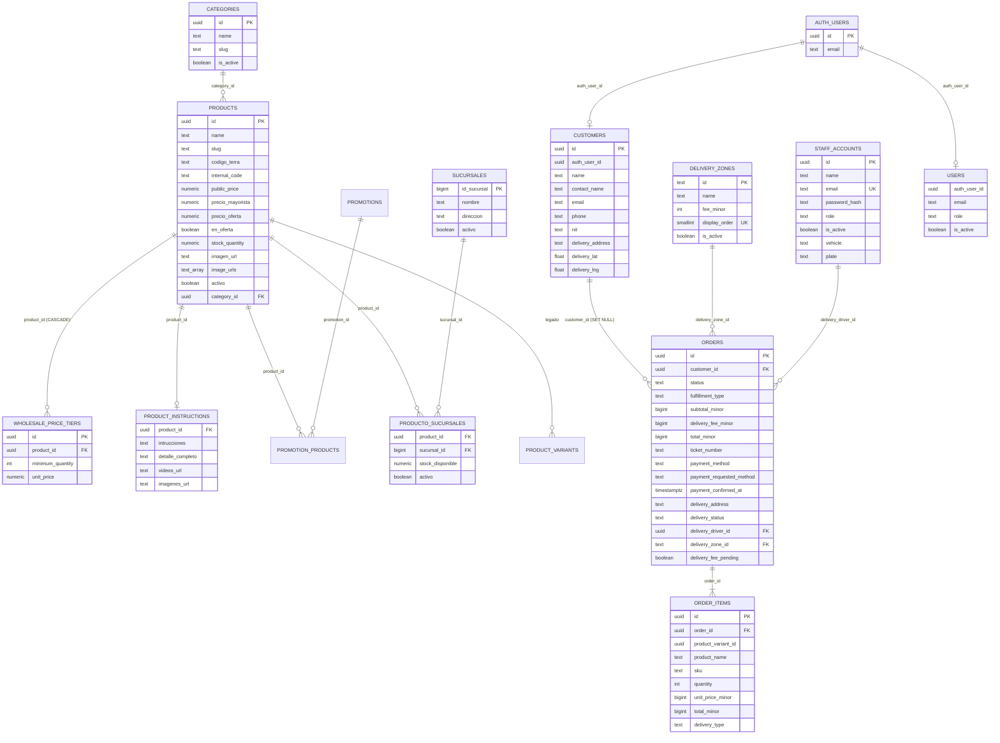
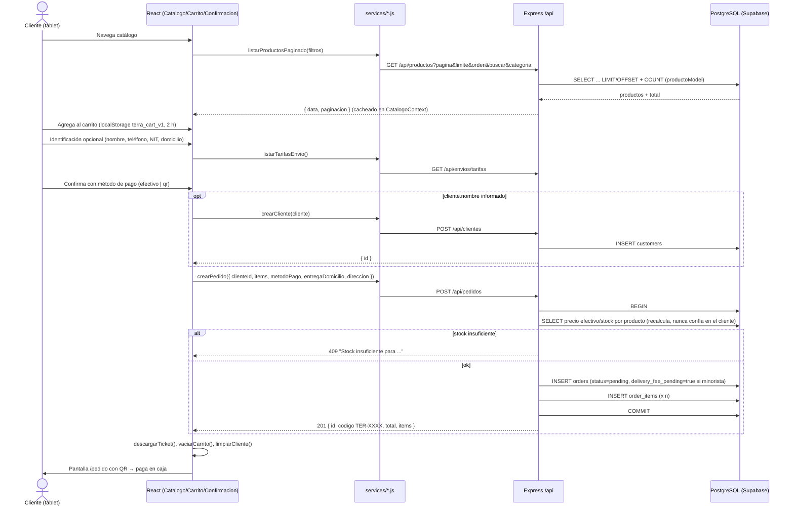
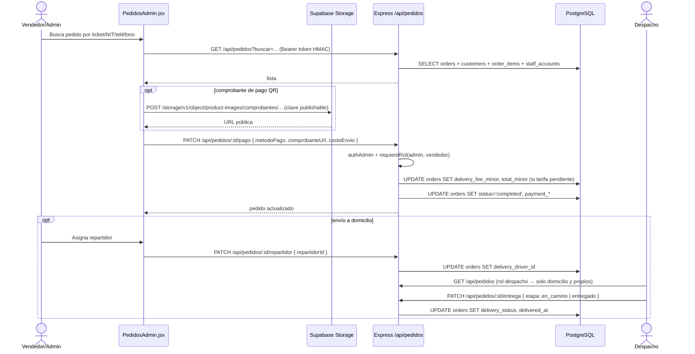
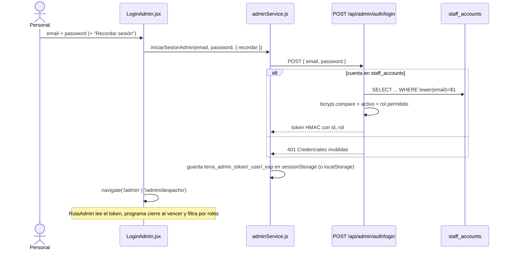
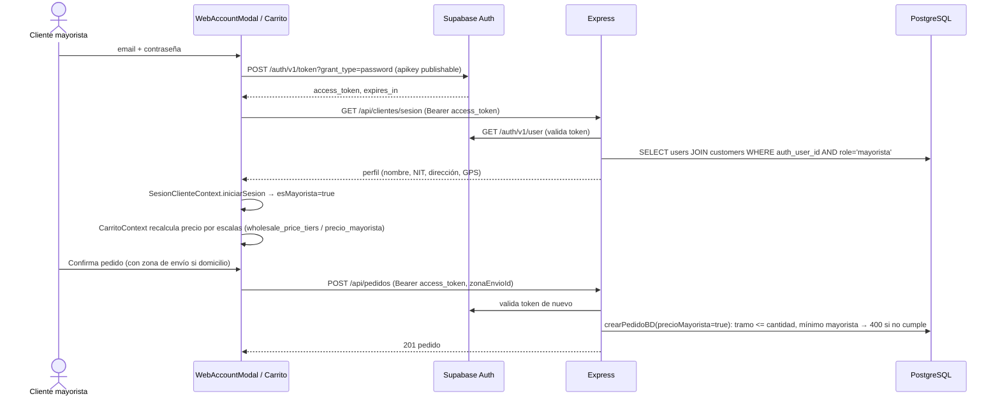
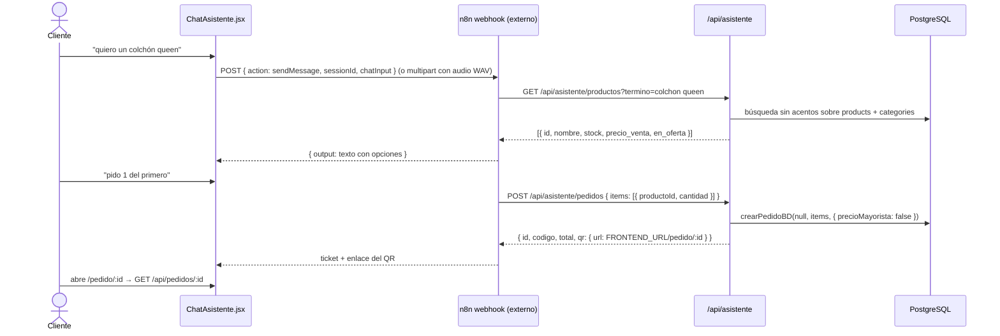

# ANÁLISIS TÉCNICO DEL PROYECTO — TERRA Autoservicio (terratabletv2.0)

> [!warning] Foto del 28/10/2026, antes de los cambios del mismo día
> Este análisis describe el código en el commit `3a617a1`. Después se integró el ERP, se eliminó Supabase y el login pasó a validarse solo contra la base, así que varias secciones (Supabase, credenciales del `.env`, comprobantes) ya no aplican. Estado actual: [[00-roadmap]] · [[01-arquitectura]] · [[erp-terra]] · [[pendientes-terceros]].

> Documento generado a partir de la lectura del código fuente del repositorio (rama `jhonatan`, commit `3a617a1`).
> Se ignoraron `node_modules`, `dist`, `.vite`, `.npm-cache-*`, `.git`, archivos de lock y binarios.
> Cuando algo no se puede afirmar con el código disponible se marca como **No determinado** y se indica qué archivo o recurso lo resolvería.
> Convención de rutas: todas son relativas a la raíz del repo.

---

## 1. RESUMEN

### 1.1 Qué hace el sistema

TERRA Autoservicio es una plataforma de venta para la tienda de colchones, muebles y descanso **TERRA** (Santa Cruz, Bolivia; sucursal Equipetrol). Su núcleo es un **kiosco táctil de autoservicio** (tablet en tienda) donde el cliente recorre el catálogo, arma un carrito, se identifica opcionalmente y genera un **pedido con ticket/código QR** que luego paga en caja. Sobre ese mismo backend se montan un **backoffice** (administrador, vendedor y despacho) para gestionar productos, stock, pedidos, cobros, repartidores y reportes, un **portal mayorista** con precios B2B y sesión vía Supabase Auth, un **asistente de chat** (n8n) que puede buscar productos y crear pedidos, y una tercera app estática (`frontend-global/`) pensada como sitio web público. Resuelve el problema de descongestionar la atención en tienda: el cliente autogestiona la compra y el personal solo cobra, prepara y despacha. Los datos viven en PostgreSQL alojado en Supabase (`backend/src/config/database.js`).

### 1.2 Funcionalidades principales detectadas

| Área | Funcionalidad | Evidencia |
|---|---|---|
| Kiosco cliente | Catálogo paginado con búsqueda sin acentos, filtros por categoría, orden y ofertas | `backend/src/models/productoModel.js`, `frontend/src/context/CatalogoContext.jsx` |
| Kiosco cliente | Detalle de producto con galería, video, colores, escalas mayoristas, sucursales con stock | `frontend/src/pages/DetalleProducto.jsx`, campo `sucursales` en `productoModel.js` |
| Kiosco cliente | Carrito con persistencia temporal (2 h) en `localStorage`, importación desde borrador QR | `frontend/src/context/CarritoContext.jsx`, `frontend/src/services/qrCartService.js` |
| Kiosco cliente | Compra por QR con cámara (`@zxing/browser`) y ficha estática `detalle-qr.html` | `frontend/public/detalle-qr.html`, `frontend/src/routes/AppRoutes.jsx` (`/catalogo?abrirQr=1`) |
| Kiosco cliente | Identificación opcional (nombre, teléfono, NIT), entrega a domicilio con zonas tarifadas, pago efectivo o QR | `frontend/src/pages/Identificacion.jsx`, `Confirmacion.jsx`, `backend/src/models/envioModel.js` |
| Kiosco cliente | Ticket descargable/imprimible con código `TER-XXXXXXXX` | `frontend/src/utils/descargarTicket.js`, `backend/src/models/pedidoModel.js:83` |
| Accesibilidad | Modo accesible (escala de texto, contraste, fuente), navegación por voz, lector de voz, teclado táctil, tema claro/oscuro, vigilante de inactividad, tutorial guiado (`driver.js`) | `frontend/src/accesibilidad/`, `frontend/src/navegacion/`, `frontend/src/tutorial/`, `frontend/src/components/ui/TecladoTactil.jsx` |
| Mayorista | Login con Supabase Auth, perfil con dirección GPS (mapa Leaflet), historial de pedidos, precios por escalas | `frontend/src/services/sesionClienteService.js`, `backend/src/services/sesionMayorista.js`, `frontend/src/pages/PanelMayorista.jsx` |
| Backoffice | Login staff (superadmin por `.env` + tabla `staff_accounts` con bcrypt), roles `admin`/`vendedor`/`despacho`, token HMAC 8 h | `backend/src/controllers/adminController.js`, `backend/src/middlewares/authAdmin.js` |
| Backoffice | CRUD de productos con subida de imágenes a Supabase Storage, categorías, almacén (ingresos de stock), escalas mayoristas, instrucciones de armado | `frontend/src/pages/admin/ProductosAdmin.jsx`, `frontend/src/services/storageService.js`, `backend/src/models/productoModel.js` |
| Backoffice | Gestión de pedidos: cobro manual (efectivo/tarjeta) con comprobante, edición de ítems, anulación, asignación de repartidor, etapas de entrega | `backend/src/controllers/pedidoController.js`, `frontend/src/pages/admin/PedidosAdmin.jsx`, `DespachoAdmin.jsx` |
| Backoffice | Ventas directas en caja, clientes (alta de cuentas mayoristas), personal, tarifas de envío, reportes (analítica horaria, comparativa de períodos) | `pedidoRoutes.js`, `clienteRoutes.js`, `personalRoutes.js`, `envioRoutes.js`, `frontend/src/pages/admin/ReportesAdmin.jsx` |
| Backoffice | Timbre sonoro de pedidos nuevos y mapa de ruta de despacho (Leaflet + OSRM) | `frontend/src/components/admin/TimbrePedidos.jsx`, `MapaRutaDespacho.jsx` |
| Chatbot | Endpoints para el asistente n8n: búsqueda de productos, instrucciones, creación de pedido con QR | `backend/src/routes/asistenteRoutes.js`, `frontend/src/components/chat/ChatAsistente.jsx` |
| Infra | Geocodificación inversa vía Nominatim con caché en memoria | `backend/src/controllers/geocodificacionController.js` |
| Infra | Documentación OpenAPI parcial + Swagger UI en `/docs` | `backend/src/app.js:46-139` |

---

## 2. STACK TECNOLÓGICO

### 2.1 Frontend (`frontend/`)

| Aspecto | Tecnología | Evidencia |
|---|---|---|
| Framework | React 19 (instalado 19.3.0) | `frontend/package.json` |
| Bundler | Vite 8 (instalado 8.3.4) con `@vitejs/plugin-react` | `frontend/vite.config.js` |
| Estilos | Tailwind CSS v4 vía `@tailwindcss/vite` (sin `tailwind.config`), más ~60 archivos CSS por componente/pantalla y variables CSS para tema oscuro y alto contraste | `frontend/vite.config.js`, `frontend/src/theme-dark.css`, `frontend/src/accesibilidad/accesibilidad.css` |
| Routing | `react-router-dom` 7 (`BrowserRouter`, rutas anidadas, `React.lazy` para backoffice y mayorista) | `frontend/src/routes/AppRoutes.jsx` |
| Estado | React Context API (7 providers) + `useReducer` estilo redux en el catálogo. **No** se usa Redux, Zustand ni React Query | `frontend/src/App.jsx`, `frontend/src/context/CatalogoContext.jsx` |
| HTTP | `fetch` nativo envuelto en `apiRequest` (sin interceptores; el token lo adjunta cada servicio) | `frontend/src/services/api.js` |
| Formularios | Sin librería: `useState` + `FormData` nativo | `frontend/src/components/WebAccountModal.jsx:10` |
| Iconos | `lucide-react` + fuente Material Symbols (Google Fonts) | `frontend/index.html`, `AppRoutes.jsx` |
| Alertas | `sweetalert2` | `frontend/src/utils/alertas.js` |
| Mapas | `leaflet` (sin react-leaflet) | `frontend/src/components/mayorista/MapaEntregaMayorista.jsx`, `admin/MapaRutaDespacho.jsx` |
| QR | `react-qr-code` (generar), `@zxing/browser` (leer con cámara) | `frontend/package.json` |
| Otros | `html-to-image` (ticket a imagen), `driver.js` (tutorial guiado) | `frontend/src/utils/descargarTicket.js`, `frontend/src/tutorial/useTutorialGuiado.js` |
| Lint | `oxlint` con plugins `react`, `oxc`, `jsx-a11y` | `frontend/.oxlintrc.json` |
| Tests | `vitest` + `@testing-library/react` + `jest-axe` (solo tests `*.a11y.test.jsx`) y `node --test` para la navegación por voz | `frontend/vite.config.js`, `frontend/package.json` (`test:nav`, `test:a11y`) |
| Auditoría dev | `@axe-core/react` solo en `import.meta.env.DEV` | `frontend/src/main.jsx` |

### 2.2 Backend (`backend/`)

| Aspecto | Tecnología | Evidencia |
|---|---|---|
| Lenguaje / runtime | JavaScript ESM (`"type": "module"`), Node 24 en la máquina de desarrollo (`node --version`), usa `import.meta.dirname` (requiere Node ≥ 20.11) | `backend/package.json`, `backend/server.js` |
| Framework | Express 5.3 | `backend/package.json` |
| ORM | **Ninguno.** SQL manual con `pg` (`Pool`) y consultas parametrizadas | `backend/src/config/database.js`, todos los `models/*.js` |
| Autenticación staff | Token propio `payload_base64url.firma_HMAC-SHA256`, 8 h, roles `admin`/`vendedor`/`despacho`; contraseñas con `bcryptjs` | `backend/src/middlewares/authAdmin.js`, `controllers/adminController.js` |
| Autenticación mayorista | Supabase Auth (token JWT validado contra `SUPABASE_URL/auth/v1/user`) | `backend/src/services/sesionMayorista.js` |
| Alta de usuarios Auth | API admin de Supabase si hay `SUPABASE_SERVICE_ROLE_KEY`; si no, `signup` público; como último respaldo INSERT directo en `auth.users`/`auth.identities` | `backend/src/services/supabaseAuth.js`, `authUsuariosBD.js` |
| CORS | `cors()` sin opciones (todos los orígenes) | `backend/src/app.js:30` |
| Config | `dotenv` (cargado tres veces: `server.js`, `app.js`, `database.js`) | ídem |
| Despliegue | Vercel serverless: `backend/vercel.json` reescribe todo a `api/index.js`, que exporta la app Express | `backend/api/index.js` |
| Tests | No hay (`npm test` termina con 1 a propósito); hay un script de carga HTTP propio | `backend/package.json`, `backend/scripts/test_carga.js` |

### 2.3 Base de datos

| Aspecto | Detalle | Evidencia |
|---|---|---|
| Motor | PostgreSQL alojado en Supabase (TLS forzado si la URL contiene `supabase` o `pooler`; `rejectUnauthorized: false`) | `backend/src/config/database.js:14-19` |
| Conexión | `pg.Pool` con `DATABASE_URL`, `max` = `DATABASE_POOL_MAX` o 20, timeouts de 10 s / 30 s | `database.js:22-29` |
| Migraciones formales | **No existen.** El esquema real (tablas en inglés: `products`, `orders`, `customers`, `users`, …) se creó fuera del repo. **No determinado** el DDL completo: lo resolvería un `pg_dump --schema-only` de Supabase | — |
| Migraciones en tiempo de ejecución | Cada modelo ejecuta `CREATE TABLE IF NOT EXISTS` / `ALTER TABLE ... ADD COLUMN IF NOT EXISTS` de forma perezosa en la primera consulta (orders, order_items, customers, categories, staff_accounts, wholesale_price_tiers, delivery_zones) | `pedidoModel.js:9-42`, `clienteModel.js:3-15`, `personalModel.js:6-33`, `productoModel.js:46-66`, `envioModel.js:29-50`, `categoriaController.js:385-393` |
| Esquema legado (español) | `frontend/database/schema.sql` y `backend/src/config/migrate_seed.js` crean `clientes`, `productos`, `pedidos`, `pedido_detalles`. La aplicación **no** los usa; `migrate_seed.js` hace `TRUNCATE` y se expone en `GET|POST /api/productos/seed` (solo admin) | `frontend/database/schema.sql`, `backend/src/config/migrate_seed.js:73-75`, `productoRoutes.js:16-17` |
| Seeds | `envioModel.js` inserta 21 zonas de envío iniciales (`ON CONFLICT DO NOTHING`); `migrate_seed.js` siembra el catálogo legado; scripts `scripts/*.mjs` importan desde Excel y reclasifican categorías | `envioModel.js:4-27`, `scripts/importar-excel-supabase.mjs` |
| Storage | Supabase Storage, bucket `product-images` (imágenes de producto y comprobantes de pago), escrito **desde el navegador** con la clave publishable | `frontend/src/services/storageService.js` |

### 2.4 Tabla de dependencias

Versiones declaradas en `package.json`; entre paréntesis la instalada en `node_modules` cuando se pudo resolver.

**frontend/**

| Dependencia | Versión | Para qué se usa |
|---|---|---|
| react / react-dom | ^19.2.8 (19.3.0) | UI |
| react-router-dom | ^7.18.4 (7.18.4) | Rutas, rutas anidadas, lazy |
| tailwindcss / @tailwindcss/vite | ^4.3.3 | Utilidades CSS |
| lucide-react | ^1.56.0 | Iconos SVG |
| leaflet | ^1.9.4 | Mapas de entrega y ruta de despacho |
| react-qr-code | ^2.2.0 | Generar QR del ticket / ficha de producto |
| @zxing/browser | ^0.2.1 | Leer QR con la cámara del kiosco |
| sweetalert2 | ^11.26.25 | Diálogos y toasts |
| html-to-image | ^1.11.13 | Convertir el ticket a imagen descargable |
| driver.js | ^1.10.2 | Tutorial guiado paso a paso |
| vite / @vitejs/plugin-react | ^8.3.0 / ^6.1.1 | Build y HMR |
| oxlint | ^1.81.0 (1.88.0) | Lint |
| vitest, jsdom, @testing-library/react, @testing-library/jest-dom, jest-axe, @axe-core/react | ver `package.json` | Tests de accesibilidad y auditoría axe en dev |
| @types/react, @types/react-dom | ^19.2.x | Tipos para el editor (el proyecto es JS) |

**backend/**

| Dependencia | Versión | Para qué se usa |
|---|---|---|
| express | ^5.3.0 (5.3.0) | Servidor HTTP y rutas |
| pg | ^8.23.1 (8.23.1) | Cliente PostgreSQL |
| cors | ^2.8.6 (2.8.6) | CORS abierto |
| dotenv | ^18.0.7 (18.0.7) | Carga de `.env` |
| bcryptjs | ^3.0.3 | Hash de contraseñas de `staff_accounts` |

**raíz (`package.json`)** — solo herramientas: `playwright` 1.56, `docx`, `pdf-lib`, `pdfjs-dist`, `marked`, `@napi-rs/canvas`. Ningún script del repo las importa hoy (el script `scripts/capturas-guia.mjs` que menciona `AGENTS.md` **no existe**).

**frontend-global/** — `react`, `react-dom`, `lucide-react`, `vite`, `@vitejs/plugin-react` (sin router, sin Tailwind).

---

## 3. ESTRUCTURA DE CARPETAS

### 3.1 Árbol (3-4 niveles)

```
terratabletv2.0/
├── AGENTS.md                    # Guía de trabajo del repo (reglas de negocio, CSS, comandos)
├── README.md                    # Solo el título
├── actualizar-vercel.cmd        # git add -A + commit + push (dispara deploy en Vercel)
├── k6_test.js                   # Script de carga k6 (ver hallazgos)
├── package.json                 # Herramientas del repo (playwright, docx, pdf-lib...)
├── scripts/                     # Scripts de datos contra PostgreSQL
│   ├── asignar-productos-central.mjs
│   ├── importar-excel-supabase.mjs
│   └── reclasificar-categorias.mjs
├── backend/
│   ├── server.js                # Entry point local (verifica BD y hace listen)
│   ├── api/index.js             # Entry point Vercel (exporta la app Express)
│   ├── vercel.json
│   ├── .env.example
│   ├── scripts/test_carga.js    # Prueba de carga HTTP propia
│   ├── test-crear-mayorista.mjs # Script manual de prueba (ruta absoluta de otro PC)
│   └── src/
│       ├── app.js               # Express: cors, json 12mb, /, /openapi, /docs, /api/health, routers
│       ├── config/
│       │   ├── database.js      # Pool pg + resolución de SSL
│       │   ├── migrate_seed.js  # Esquema legado español + TRUNCATE + seed
│       │   └── limpiar_descripciones.js
│       ├── controllers/         # 10 controladores (validación + respuesta HTTP)
│       ├── middlewares/
│       │   ├── authAdmin.js     # Token HMAC, authAdmin, requiereRol
│       │   └── errorHandler.js  # 404 y mapeo de errores pg → HTTP
│       ├── models/              # 8 modelos: SQL con pg + DDL perezoso
│       ├── routes/              # 10 routers montados en /api/*
│       └── services/
│           ├── authUsuariosBD.js   # Escritura directa en auth.users (respaldo)
│           ├── sesionMayorista.js  # Valida token Supabase y carga perfil
│           └── supabaseAuth.js     # Alta/baja de usuarios en Supabase Auth
├── frontend/
│   ├── index.html               # Carga /config.js (runtime) y fuentes de Google
│   ├── vite.config.js           # react + tailwind + config vitest
│   ├── vercel.json              # SPA rewrite
│   ├── .env.example
│   ├── .oxlintrc.json
│   ├── AGENTS.md                # Guía antigua (desactualizada)
│   ├── TAREAS-RESPONSIVE.md     # Checklist de responsive
│   ├── database/schema.sql      # Esquema legado español (no usado)
│   ├── public/
│   │   ├── config.js            # window.TERRA_CONFIG (API_URL, N8N_CHAT_URL, WhatsApp)
│   │   ├── detalle-qr.html      # Ficha de producto estática para el QR impreso
│   │   ├── preview-mobile.html
│   │   └── images/              # Logos, QR de pago, fotos de portada
│   └── src/
│       ├── main.jsx → App.jsx → routes/AppRoutes.jsx
│       ├── accesibilidad/       # Modo accesible, saltar contenido, inactividad
│       ├── components/
│       │   ├── accesibilidad/   # BotonesVoz, LectorVoz
│       │   ├── admin/           # AdminLayout, AdminHeader, RutaAdmin, TimbrePedidos, MapaRutaDespacho
│       │   ├── analytics/       # AnaliticaHoraria, ComparativaPeriodos
│       │   ├── cart/            # CarritoFlotante
│       │   ├── chat/            # ChatAsistente, MensajeMarkdown
│       │   ├── mayorista/       # MapaEntregaMayorista
│       │   ├── ui/              # BotonTema, ImagenPerezosa, ModalQrPago, SelectorCategorias, TecladoTactil
│       │   ├── vendedor/        # VendedorLayout, ReportePedidosVendedor
│       │   └── WebAccountModal.jsx
│       ├── context/             # Carrito, Catalogo, Cliente, SesionCliente, Tema, Accesibilidad, Tutorial
│       ├── data/categorias.js
│       ├── hooks/useCarrito.js
│       ├── navegacion/          # Navegación por voz: registro de rutas e intérprete de intenciones
│       ├── pages/               # Pantallas cliente y mayorista
│       │   ├── admin/           # 13 pantallas de backoffice
│       │   └── vendedor/        # Dashboard y login vendedor
│       ├── routes/              # AppRoutes.jsx + CSS de layout
│       ├── services/            # 11 servicios HTTP (único lugar con fetch, salvo 2 excepciones)
│       ├── styles/, theme-dark.css, theme-dark-admin.css, index.css, Responsive.css
│       ├── test/                # setup vitest, renderCon
│       ├── tutorial/            # driver.js: pasos, almacenamiento, hook
│       └── utils/               # Formato moneda, tickets, validaciones, video embed, etc.
└── frontend-global/             # Tercera app React (sitio público) — ver sección 6.5
    ├── index.html, vite.config.js, public/config.js
    └── src/{main.jsx, pages/, components/, context/, data/, hooks/, services/}
```

### 3.2 Propósito de cada carpeta relevante

Descrito en el árbol anterior. Puntos a destacar:

- `backend/src/{routes,controllers,models}`: las rutas definen método y middleware, los controladores validan entrada y forman la respuesta `{ success, mensaje, data }`, los modelos ejecutan SQL. Excepciones: `categoriaController.js` y parte de `pedidoController.js` (`crearVentaDirecta`) consultan `pool` directamente sin modelo.
- `frontend/src/pages`: hoy contiene todas las pantallas; `AGENTS.md` prescribe migrar a `src/features/<funcionalidad>/` solo cuando se refactorice una pantalla (no existe aún ninguna carpeta `features/`).
- `frontend/src/context`: estado global. `ClienteContext` guarda datos personales **solo en memoria** (tablet compartida).
- `frontend/public/config.js`: configuración en tiempo de ejecución (prioridad sobre `VITE_API_URL`), editable tras el deploy sin recompilar.

### 3.3 Patrón de arquitectura

- **Backend:** MVC sin vistas, en capas *routes → controllers → models*, con `services/` para integraciones externas (Supabase Auth). Sin capa de validación independiente (validación manual en cada controlador) y sin capa de repositorio/ORM.
- **Frontend:** SPA React organizada **por tipo de archivo** (`pages/`, `components/`, `services/`, `context/`), no por funcionalidad. Estado con Context API; el catálogo usa un patrón *store/reducer* (`CatalogoContext.jsx`). División de código por rol con `React.lazy` para que el kiosco no descargue el backoffice (`AppRoutes.jsx:24-46`).
- **Despliegue:** monorepo con tres proyectos Vercel independientes (backend serverless, frontend SPA, frontend-global SPA).

---

## 4. BACKEND

### 4.1 Entry point y flujo de arranque

1. `backend/server.js` carga `backend/.env` con `dotenv` (ruta resuelta con `import.meta.dirname`), importa `src/app.js` y `pool`.
2. Ejecuta `SELECT 1`; si falla, imprime el error, cierra el pool y termina con código 1 (`server.js:11-24`).
3. Si responde, `app.listen(PORT || 3001, '0.0.0.0')`.
4. `src/app.js` (también usado por Vercel vía `api/index.js`): `cors()` → `express.json({ limit: '12mb' })` → rutas `/`, `/openapi`, `/docs`, `/api/health` → 10 routers bajo `/api/*` → `rutaNoEncontrada` (404) → `errorHandler`.
5. `src/config/database.js` lanza excepción al importarse si falta `DATABASE_URL` (`database.js:9-11`).
6. No hay migraciones al arrancar: el DDL se aplica de forma perezosa en la primera llamada a cada modelo (ver §2.3). En Vercel esto ocurre en cada *cold start*.

### 4.2 Tabla de endpoints

Leyenda de **Auth**: `—` público · `staff` = `authAdmin` (cualquier rol admin/vendedor/despacho) · `admin` = `authAdmin + requiereRol('admin')` · `supabase` = token Bearer de Supabase validado por `obtenerMayoristaDesdeToken` (solo usuarios con `users.role = 'mayorista'`).

| Método | Ruta | Controlador (`backend/src/...`) | Descripción | Auth |
|---|---|---|---|---|
| GET | `/` | `app.js` (inline) | Estado del servicio y lista de endpoints | — |
| GET | `/openapi` | `app.js` | Especificación OpenAPI 3.0 **parcial** (solo productos, sucursales, pedidos POST, clientes POST, health) | — |
| GET | `/docs` | `app.js` | Swagger UI cargado desde `unpkg.com` | — |
| GET | `/api/health` | `app.js` → `verificarConexion` | `SELECT NOW(), current_database()` | — |
| GET/POST | `/api/productos/seed` | `productoController.seedProductos` → `migrateAndSeed` | Crea esquema legado español y hace `TRUNCATE` de `productos/pedidos/pedido_detalles` | admin |
| GET | `/api/productos/categorias` | `categoriaController.listarCategorias` | Igual que `/api/categorias` | — |
| GET | `/api/productos` | `productoController.listarProductos` | Catálogo paginado: `buscar`, `categoria`, `pagina`, `limite`, `orden`, `todos`, `promos`, `ofertas`, `precioMin`, `precioMax`. Devuelve `paginacion` | — |
| GET | `/api/productos/:id` | `obtenerProducto` | Por UUID, `slug`, `codigo_terra` o `internal_code` | — |
| POST | `/api/productos` | `crearProducto` | Alta con detección de duplicados (nombre+medida+color), escalas mayoristas e instrucciones | admin |
| PUT | `/api/productos/:id` | `actualizarProducto` | Actualización parcial (COALESCE) | admin |
| PATCH | `/api/productos/:id/stock` | `actualizarStock` | `{ showroom: n }` fija o `{ agregar: n }` suma atómicamente | admin |
| PATCH | `/api/productos/:id/visibilidad` | `cambiarVisibilidadProducto` | `activo`/`is_active` | admin |
| PATCH | `/api/productos/:id` | `cambiarVisibilidadProducto` | Alias del anterior | admin |
| DELETE | `/api/productos/:id` | `eliminarProducto` | **Borrado físico** (limpia `inventory`, `cart_items`, cascada) | admin |
| GET | `/api/categorias` | `categoriaController.listarCategorias` | Categorías activas con total de productos, ventas e icono/emoji inferido por nombre. `?todas=1` incluye vacías | — |
| GET | `/api/categorias/todas` | `listarCategoriasCrudo` | `SELECT * FROM categories` | — |
| POST | `/api/categorias` | `crearCategoria` | Alta (slug + timestamp) | **—** |
| PUT | `/api/categorias/:id` | `actualizarCategoria` | Renombrar | **—** |
| DELETE | `/api/categorias/:id` | `eliminarCategoria` | Borra si no tiene productos | **—** |
| POST | `/api/pedidos` | `pedidoController.crearPedido` | Pedido del kiosco/mayorista. Precios y totales se recalculan en BD dentro de transacción; stock insuficiente → 409; mínimo mayorista → 400. **No descuenta stock** | — (Bearer Supabase opcional) |
| POST | `/api/pedidos/venta-directa` | `crearVentaDirecta` | Crea el pedido y lo marca cobrado en un paso (caja) | staff |
| GET | `/api/pedidos` | `listarPedidos` | Listado con búsqueda por ticket/nombre/NIT/teléfono/número; rol `despacho` solo ve domicilio asignados a sí mismo | staff |
| GET | `/api/pedidos/analitica-horaria` | `obtenerAnaliticaHoraria` | Ventas por hora y top 8 productos (zona `America/La_Paz`) | staff |
| GET | `/api/pedidos/comparativa` | `obtenerComparativaPeriodos` | `dia`/`semana`/`mes`/`personalizado` vs período anterior | staff |
| GET | `/api/pedidos/resumen` | `obtenerResumenPeriodo` | KPIs de un rango | staff |
| PUT | `/api/pedidos/:id/items` | `actualizarItemsPedido` | Reemplaza ítems y recalcula totales (no si `completed`/`cancelled`) | staff |
| PATCH | `/api/pedidos/:id/estado` | `actualizarEstadoPedido` | Estados `pending…cancelled`; no anula cobrados/entregados | admin, vendedor |
| PATCH | `/api/pedidos/:id/entrega` | `actualizarEntregaPedido` | Etapa `pendiente`/`en_camino`/`entregado` (solo `home_delivery`) | admin, vendedor, despacho |
| PATCH | `/api/pedidos/:id/repartidor` | `asignarRepartidorPedido` | Asigna/quita `staff_accounts` rol despacho | admin, vendedor |
| PATCH | `/api/pedidos/:id/pago` | `registrarPagoPedido` | Cobro manual `efectivo`/`tarjeta`, comprobante https, costo de envío si estaba pendiente → `status='completed'` | admin, vendedor |
| GET | `/api/pedidos/:id` | `obtenerPedido` | Por UUID o `ticket_number`; incluye nombre, teléfono y NIT del cliente | — |
| POST | `/api/clientes` | `clienteController.crearCliente` | Alta rápida (nombre, teléfono, email, NIT) | — |
| POST | `/api/clientes/mayoristas` | `crearUsuarioMayorista` | Crea usuario en Supabase Auth + `customers` + `users(role='mayorista')` con compensación | staff |
| GET | `/api/clientes/sesion` | `obtenerSesionCliente` | Perfil mayorista del token | supabase |
| PUT/PATCH | `/api/clientes/perfil` | `actualizarPerfilMayorista` | Razón social, titular, NIT, dirección, GPS | supabase |
| GET | `/api/clientes/mis-pedidos` | `listarMisPedidosMayorista` | Historial propio | supabase |
| GET | `/api/clientes/mis-pedidos/:id` | `obtenerMiPedidoMayorista` | Verifica `cliente_id` | supabase |
| GET | `/api/clientes` | `listarClientes` | Lista con teléfono, email, NIT, dirección, compras y gasto | **—** |
| GET | `/api/clientes/:id` | `obtenerCliente` | Perfil completo | **—** |
| DELETE | `/api/clientes/:id` | `eliminarCliente` | Borra cliente (pedidos quedan sin cliente) | **—** |
| POST | `/api/admin/auth/login` | `adminController.iniciarSesionAdmin` | Superadmin por `.env` o `staff_accounts` (bcrypt) → token HMAC 8 h | — |
| GET | `/api/admin/auth/me` | `perfilAdmin` | Datos del token | staff |
| GET/POST | `/api/asistente/productos` | `asistenteController.buscarProductosChat` | Búsqueda difusa para el chatbot (`termino`, `ofertas`) | — |
| GET/POST | `/api/asistente/instrucciones` | `buscarInstruccionesChat` | Instrucciones de armado tolerantes a errores de tipeo | — |
| POST | `/api/asistente/pedidos` | `crearPedidoChat` | Pedido sin cliente; devuelve `qr.url = FRONTEND_URL/pedido/:id` | — |
| GET | `/api/personal` | `personalController.listarPersonal` | Cuentas del equipo | admin |
| GET | `/api/personal/repartidores` | `listarRepartidores` | Rol despacho | admin |
| POST | `/api/personal` | `crearPersonal` | Alta con rol, contraseña (bcrypt 10), vehículo/placa | admin |
| PATCH | `/api/personal/:id` | `actualizarPersonal` | Nombre, vehículo, placa, activo, reset de contraseña | admin |
| DELETE | `/api/personal/:id` | `eliminarPersonal` | Borra y libera envíos asignados | admin |
| GET | `/api/geocodificacion/reverse` | `geocodificacionController.geocodificarDireccion` | Proxy a Nominatim con caché 10 min / 250 entradas | — |
| GET | `/api/envios/tarifas` | `envioController.listarTarifasEnvio` | Zonas activas | — |
| GET | `/api/envios/tarifas/admin` | `listarTodasTarifasEnvio` | Todas las zonas | admin |
| POST/PUT/DELETE | `/api/envios/tarifas[/:id]` | `crear/actualizar/eliminarTarifaEnvio` | CRUD de zonas (costo 0–10 000 Bs) | admin |
| GET | `/api/sucursales` | `sucursalController.listarSucursalesConDisponibilidad` | Sucursales activas con stock agregado | — |

### 4.3 Middlewares, validaciones y manejo de errores

- **Globales** (`app.js`): `cors()` sin restricción de origen; `express.json({ limit: '12mb' })` (justificado en comentario por fotos base64 del admin).
- **`authAdmin`** (`middlewares/authAdmin.js`): extrae `Bearer`, separa `payload.firma`, recalcula HMAC-SHA256 con `ADMIN_TOKEN_SECRET` (obligatorio, `config/secretos.js`), compara con `timingSafeEqual`, exige `id` y `exp` vigente y relee la cuenta en `staff_accounts` (activa y con rol válido) en cada petición. Guarda `req.admin` con el rol de la base.
- **`requiereRol(...roles)`**: 403 si `req.admin.rol` no está en la lista.
- **Validación**: manual en cada controlador (longitudes, regex de email/NIT/UUID, enums de estado, rangos numéricos). No hay esquema compartido (zod/joi) ni sanitización central.
- **`errorHandler`** (`middlewares/errorHandler.js`): usa `err.statusCode`; mapea códigos pg `23505`→409, `23503`→400, `23514`→400, JSON malformado→400; cualquier ≥500 se registra en consola y se responde con mensaje genérico. `rutaNoEncontrada` responde 404 JSON.
- **Errores de negocio con código**: `crearPedidoBD` lanza `errorPedido(409|400, …)` (`pedidoModel.js:46,74-75`); el controlador del chatbot traduce mensajes por regex (`asistenteController.js:762-764`).
- **Transacciones**: `crearPedidoBD`, `actualizarItemsPedidoBD`, `eliminarProductoBD`, `reemplazarEscalasMayoristas`, `crearPerfilMayoristaBD`, `eliminarPersonalBD` usan `BEGIN/COMMIT/ROLLBACK` con `pool.connect()`.
- **Sin**: rate limiting, helmet, logging estructurado, validación de `Content-Type`, límites por IP.

### 4.4 Autenticación, autorización y roles

| Actor | Mecanismo | Dónde vive el token | Alcance |
|---|---|---|---|
| Superadministrador por `.env` | **Eliminado el 28/10/2026**: el login ya no acepta credenciales de variables de entorno ni valores por defecto; solo `staff_accounts` | — | — |
| Personal | `staff_accounts` con `password_hash` bcrypt y `role` | ídem | `admin`, `vendedor`, `despacho` |
| Cliente mayorista | Supabase Auth (`/auth/v1/token?grant_type=password` llamado **desde el navegador**, `sesionClienteService.js:8`); el backend valida en `/auth/v1/user` y exige `users.role='mayorista'` y `is_active` | Memoria React; `localStorage` `terra_sesion_mayorista` solo con "Recordar mi sesión" (`SesionClienteContext.jsx`) | precios B2B, perfil, mis pedidos |
| Cliente anónimo del kiosco | Ninguno | `ClienteContext` solo en memoria | catálogo, carrito, crear pedido/cliente |

Matriz de rutas del frontend por rol en `AppRoutes.jsx:255-275` (`RutaAdmin roles={[...]}`) y menú lateral en `AdminLayout.jsx:17-30`. El rol `despacho` es redirigido a `/admin/despacho` (`RutaAdmin.jsx:25`).

---

## 5. MODELO DE DATOS

### 5.1 Entidades

El DDL completo no está en el repo (ver §2.3); los campos listados provienen de las consultas SQL y de los `ALTER TABLE` en tiempo de ejecución. **No determinado**: tipos exactos, índices y constraints de las tablas base (`products`, `categories`, `orders`, `order_items`, `customers`, `users`, `promotions`, `promotion_products`, `product_variants`, `inventory`, `cart_items`, `sucursales`, `product_instructions`).

| Tabla | Campos principales detectados | Fuente |
|---|---|---|
| `products` | `id uuid`, `name`, `slug`, `description`, `codigo_terra`, `internal_code`, `product_group`, `public_price`, `precio_mayorista`, `precio_fabrica`, `precio_oferta`, `en_oferta`, `stock_quantity`, `size`, `color`, `colors[]`, `imagen_url`, `image_urls[]`, `video_url`, `marca`, `activo`, `is_active`, `category_id`, `created_at`, `updated_at` | `productoModel.js` (mezcla columnas en inglés y español) |
| `categories` | `id`, `name`, `slug`, `is_active`, `updated_at` (añadida en runtime por un trigger `set_updated_at` preexistente) | `categoriaController.js:382-393` |
| `wholesale_price_tiers` | `id uuid`, `product_id → products ON DELETE CASCADE`, `minimum_quantity`, `unit_price`, `created_at`, `UNIQUE(product_id, minimum_quantity)` | `productoModel.js:46-58` (DDL completo en código) |
| `product_instructions` | `product_id`, `intrucciones` (sic), `detalle_completo`, `colores`, `videos_url`, `imagenes_url` | `productoModel.js:186-213` |
| `promotions` / `promotion_products` | `pr.id`, `is_active`, `starts_at`, `ends_at`; `pp.product_id`, `pp.promotion_id` (solo lectura) | `productoModel.js:96-104` |
| `orders` | `id uuid`, `customer_id → customers (ON DELETE SET NULL según comentario)`, `status`, `fulfillment_type` (`store_pickup`/`home_delivery`), `subtotal_minor`, `discount_minor`, `delivery_fee_minor`, `total_minor`, `currency='BOB'`, `ticket_number`, `created_at`, `updated_at` + runtime: `payment_receipt_url`, `payment_method`, `payment_requested_method`, `payment_confirmation_source`, `payment_confirmed_at`, `delivery_address`, `delivery_reference`, `delivery_lat/lng`, `delivery_status`, `delivery_started_at`, `delivered_at`, `delivery_driver_id → staff_accounts`, `delivery_assigned_at`, `delivery_zone_id`, `delivery_zone_name`, `delivery_fee_pending` | `pedidoModel.js:9-42, 85-104` |
| `order_items` | `id`, `order_id → orders`, `product_variant_id` (nullable, no se usa), `product_name`, `sku`, `quantity`, `unit_price_minor`, `discount_minor`, `total_minor`, `currency`, `delivery_type` (runtime), `created_at` | `pedidoModel.js:106` |
| `customers` | `id uuid`, `auth_user_id`, `name`, `email`, `phone`, `nit`, `contact_name`, `delivery_address`, `delivery_reference`, `delivery_lat`, `delivery_lng`, `created_at` | `clienteModel.js:3-15` |
| `users` | `auth_user_id`, `name`, `email`, `role` (`'mayorista'`), `is_active` | `mayoristaModel.js:26-29`, `sesionMayorista.js` |
| `staff_accounts` | `id uuid`, `auth_user_id` (legado), `name`, `email UNIQUE`, `password_hash`, `role CHECK (admin|vendedor|despacho)`, `is_active`, `vehicle`, `plate`, `created_at` | `personalModel.js:9-27` (DDL completo) |
| `delivery_zones` | `id text`, `name`, `fee_minor`, `display_order UNIQUE`, `is_active`, `created_at`, `updated_at` + 21 filas seed | `envioModel.js:29-50` (DDL completo) |
| `sucursales` / `producto_sucursales` | `id_sucursal`, `nombre`, `direccion`, `activo` / `product_id`, `sucursal_id`, `stock_disponible`, `activo` | `sucursalModel.js`, `scripts/asignar-productos-central.mjs` |
| `product_variants`, `inventory`, `cart_items` | Solo referenciadas al borrar producto (legado del esquema Supabase original) | `productoModel.js:395-402` |
| `auth.users`, `auth.identities` | Esquema de Supabase Auth, escrito directamente como respaldo | `services/authUsuariosBD.js` |
| Legado (no usado por la app) | `clientes`, `productos`, `pedidos`, `pedido_detalles` | `frontend/database/schema.sql`, `migrate_seed.js` |

Convenciones: importes en centavos (`*_minor`, `BIGINT`) convertidos con `/100`; el número correlativo de pedido (`numero`) se calcula con `ROW_NUMBER() OVER (ORDER BY created_at)` en cada consulta (`pedidoModel.js:120`), no se persiste.

### 5.2 Diagrama ER (Mermaid)



---

## 6. FRONTEND

### 6.1 Rutas / páginas

Fuente: `frontend/src/routes/AppRoutes.jsx`. "Protegida" indica el guard `RutaAdmin` y los roles permitidos; las rutas del cliente no tienen guard (las de `/mi-cuenta/*` muestran contenido según `SesionClienteContext`).

| Ruta | Componente | Qué muestra | Protegida | Carga |
|---|---|---|---|---|
| `/` | `pages/Bienvenida.jsx` | Portada del kiosco con accesos al catálogo | No | eager |
| `/categorias` | `pages/Categorias.jsx` | Líneas y categorías con conteo e imagen | No | eager |
| `/catalogo` | `pages/Catalogo.jsx` | Catálogo paginado, filtros, orden, QR con cámara (`?abrirQr=1`) | No | eager |
| `/productos/:id` | `pages/DetalleProducto.jsx` | Ficha completa, galería, video, colores, sucursales, relacionados | No | eager |
| `/carrito` | `pages/CarritoPage.jsx` | Líneas del carrito, cantidades, importación de borrador QR (`?confirmarQr=1`) | No | eager |
| `/identificacion` | `pages/Identificacion.jsx` | Datos del cliente opcionales, entrega a domicilio, teclado táctil | No | eager |
| `/confirmacion` | `pages/Confirmacion.jsx` | Resumen, zona de envío, método de pago (efectivo/QR), genera el pedido | No | eager |
| `/pedido`, `/pedido/:id` | `pages/PedidoGenerado.jsx` | Ticket con QR; `?imprimir` lanza `window.print()` | No | eager |
| `/mi-cuenta` | `pages/InicioMayorista.jsx` | Inicio del panel mayorista | No (requiere sesión mayorista en memoria) | lazy |
| `/mi-cuenta/perfil` | `pages/PanelMayorista.jsx` | Perfil, dirección con mapa Leaflet, geocodificación | ídem | lazy |
| `/mi-cuenta/pedidos` | `pages/PedidosMayorista.jsx` | Historial de pedidos del mayorista | ídem | lazy |
| `*` | `NoEncontrado` (en `AppRoutes.jsx`) | 404 | No | — |
| `/admin/login` | `pages/admin/LoginAdmin.jsx` | Login staff (también se abre con 5 toques en el logo, `AppRoutes.jsx:81-88`) | No | lazy |
| `/vendedor/login` | `pages/vendedor/LoginVendedor.jsx` | Reutiliza `LoginAdmin` con variante vendedor | No | lazy |
| `/admin` | `AdminLayout` + `DashboardAdmin.jsx` | KPIs, comparativa de períodos, analítica horaria | admin, vendedor | lazy |
| `/admin/despacho` | `DespachoAdmin.jsx` | Envíos a domicilio, etapas, mapa de ruta | admin, despacho | lazy |
| `/admin/repartidores` | `RepartidoresAdmin.jsx` | Cuentas rol despacho con vehículo/placa | admin | lazy |
| `/admin/productos` | `ProductosAdmin.jsx` | CRUD de productos, imágenes, escalas, QR imprimible | admin | lazy |
| `/admin/ventas-directas` | `VentasDirectasAdmin.jsx` | Venta en caja (pedido + cobro) | admin, vendedor | lazy |
| `/admin/categorias` | `CategoriasAdmin.jsx` | CRUD de categorías | admin | lazy |
| `/admin/almacen` | `AlmacenAdmin.jsx` | Ingresos de stock (`agregar`) | admin | lazy |
| `/admin/pedidos` | `PedidosAdmin.jsx` | Listado, cobro, comprobante, edición de ítems, anulación, repartidor | admin, vendedor | lazy |
| `/admin/clientes` | `ClientesAdmin.jsx` | Clientes, alta de cuenta mayorista | admin, vendedor | lazy |
| `/admin/personal` | `PersonalAdmin.jsx` | Cuentas del equipo y roles | admin | lazy |
| `/admin/reportes` | `ReportesAdmin.jsx` | Reportes de ventas | admin | lazy |
| `/admin/tarifas-envio` | `TarifasEnvioAdmin.jsx` | Zonas y costos de envío | admin | lazy |
| `/vendedor` | `VendedorLayout` + `DashboardVendedor.jsx` | Panel simplificado del vendedor | vendedor, admin | lazy |
| `/vendedor/ventas`, `/pedidos`, `/clientes` | reutilizan `VentasDirectasAdmin`, `PedidosAdmin`, `ClientesAdmin` | ídem admin | vendedor, admin (heredado del layout) | lazy |

Detalle por página (servicios que invoca y librerías externas):

| Archivo (`frontend/src/pages/`) | Servicios de `src/services` que invoca | Librerías externas | Líneas |
|---|---|---|---|
| `Bienvenida.jsx` | Ninguno (carrusel con `setInterval`) | lucide-react | 86 |
| `Categorias.jsx` | `productoService.listarCategorias` | lucide-react | 152 |
| `Catalogo.jsx` | `productoService.obtenerProducto`; listado vía `useCatalogoPaginado` (`CatalogoContext`) | `@zxing/browser` (import dinámico, l.547 y 607), `driver.js` (vía `useTutorialGuiado`) | 1275 |
| `DetalleProducto.jsx` | `productoService.obtenerProducto`, `listarProductos` (4 relacionados de la misma categoría) | lucide-react; video YouTube embebido (`utils/videoEmbed.js`) | 714 |
| `CarritoPage.jsx` | `qrCartService.leerCarritoQr`, `limpiarCarritoQr` | lucide-react | 275 |
| `Identificacion.jsx` | Ninguno directo (guarda en `ClienteContext`, navega a `/confirmacion`) | lucide-react; `TecladoTactil` | 374 |
| `Confirmacion.jsx` | `clienteService.crearCliente`, `pedidoService.crearPedido`, `envioService.listarTarifasEnvio` | `html-to-image` (vía `utils/descargarTicket.js`) | 316 |
| `PedidoGenerado.jsx` | `pedidoService.obtenerPedido`; `WHATSAPP_COMPROBANTES` | lucide-react | 250 |
| `InicioMayorista.jsx` | `sesionClienteService.listarMisPedidosMayorista`, `productoService.listarProductos` | lucide-react | 35 (JSX compactado) |
| `PanelMayorista.jsx` | `sesionClienteService.actualizarPerfilMayorista`, `apiRequest('/geocodificacion/reverse')`; además `fetch` directo a Nominatim (l.120) | leaflet (vía `MapaEntregaMayorista`), geolocalización del navegador | 523 |
| `PedidosMayorista.jsx` | `sesionClienteService.listarMisPedidosMayorista`, `obtenerMiPedidoMayorista` | `html-to-image` | 794 |
| `admin/LoginAdmin.jsx` | `adminService.iniciarSesionAdmin`; redirige por rol o al destino pendiente de voz/chat (l.23-25) | — (imagen hardcodeada de `lh3.googleusercontent.com`, l.48) | 313 |
| `admin/DashboardAdmin.jsx` | `pedidoService.listarPedidos`, `obtenerResumenPedidos`; `productoService.listarProductos`; `clienteService.listarClientes` | lucide-react | 91 |
| `admin/ProductosAdmin.jsx` | `productoService.*` (CRUD, stock, visibilidad, categorías), `storageService.subirImagenProducto`; QR imprimible con `document.write` (l.483); exporta HTML/Excel (l.609); `localStorage` `terra_qr_base` | `react-qr-code`, sweetalert2 | 1645 |
| `admin/VentasDirectasAdmin.jsx` | `productoService` (categorías, paginado, obtener), `clienteService.listarClientes`, `pedidoService.crearVentaDirecta`, `adminService.getAdminUser` | `@zxing/browser` (dinámico, l.322) | 775 |
| `admin/PedidosAdmin.jsx` | `pedidoService` (items, estado, listar, obtener, pago), `productoService.listarProductos`, `storageService.subirComprobantePago`, `adminService.getAdminUser` | `html-to-image` | 1022 |
| `admin/DespachoAdmin.jsx` | `pedidoService.actualizarEntregaPedido`, `listarPedidos`; `adminService.getAdminUser`; enlaces `wa.me` y Google Maps | leaflet (vía `MapaRutaDespacho`) | 390 |
| `admin/RepartidoresAdmin.jsx` | `personalService.listarRepartidores`, `actualizarPersonal`; `pedidoService.asignarRepartidorPedido`, `listarPedidos` | lucide-react | 414 |
| `admin/ClientesAdmin.jsx` | `clienteService.listarClientes`, `eliminarCliente`, `crearUsuarioMayorista` (modal con `createPortal`) | sweetalert2 | 276 |
| `admin/PersonalAdmin.jsx` | `personalService.*` | lucide-react | 301 |
| `admin/CategoriasAdmin.jsx` | `productoService.listarCategorias`, `crearCategoria`, `actualizarCategoria`, `eliminarCategoria`, `listarProductos` | sweetalert2 | 109 |
| `admin/AlmacenAdmin.jsx` | `productoService.agregarStock`, `listarCategorias`, `listarProductosPaginado`, `obtenerProducto` | `@zxing/browser` (dinámico, l.100), sweetalert2 | 396 |
| `admin/ReportesAdmin.jsx` | `pedidoService.listarPedidos`, `productoService.listarProductos`, `clienteService.listarClientes`; gráficos propios; exporta CSV/Excel (l.585-597) | — | 1598 |
| `admin/TarifasEnvioAdmin.jsx` | `envioService.*` | sweetalert2 | 594 |
| `vendedor/DashboardVendedor.jsx` | `pedidoService.listarPedidos`, `obtenerResumenPedidos`; `clienteService.listarClientes` | lucide-react | 232 |
| `vendedor/LoginVendedor.jsx` | `adminService.iniciarSesionAdmin` (rechaza roles distintos de vendedor) | lucide-react | 13 |

Observación: `ReportesAdmin.jsx` y `DashboardAdmin.jsx` calculan métricas en el navegador a partir de `GET /api/pedidos?limite=…` (máximo 200 pedidos por la validación del backend), mientras que existen endpoints agregados (`/resumen`, `/comparativa`, `/analitica-horaria`). Los reportes históricos quedan truncados a los últimos 200 pedidos.

### 6.2 Componentes principales y reutilizables

| Componente | Responsabilidad | Servicios / APIs externas |
|---|---|---|
| `routes/AppRoutes.jsx` → `Layout` | Shell del kiosco: header, nav móvil inferior, menú de cuenta mayorista, botón QR flotante, chat, carrito flotante, lector de voz, accesibilidad. Acceso oculto al admin con 5 toques en el logo | `WHATSAPP_COMPROBANTES` |
| `components/admin/AdminLayout.jsx`, `AdminHeader.jsx` | Shell del backoffice con menú lateral filtrado por rol y drawer móvil; importa `theme-dark-admin.css` | `adminService.getAdminUser`, `cerrarSesionAdmin` |
| `components/admin/RutaAdmin.jsx` | Guard de rutas: exige token, filtra por `roles`, programa el cierre al vencer | `adminService` |
| `components/vendedor/VendedorLayout.jsx`, `ReportePedidosVendedor.jsx` | Shell y reporte del portal vendedor | `pedidoService` |
| `components/WebAccountModal.jsx` | Modal de login mayorista con "Recordar mi sesión" y enlace a WhatsApp | `sesionClienteService.iniciarSesionCliente` |
| `components/chat/ChatAsistente.jsx` (366 l.), `MensajeMarkdown.jsx` | Chat por texto y audio (`MediaRecorder` → WAV con `utils/audioWav.js`); si la respuesta trae un destino de `CLAVES_CHAT`, navega con `ejecutarIntencion` | `chatService` → webhook n8n |
| `components/admin/TimbrePedidos.jsx` | Sondea pedidos `pending` cada 15 s y avisa con WebAudio y vibración | `pedidoService.listarPedidos` |
| `components/admin/MapaRutaDespacho.jsx` | Mapa Leaflet con ruta desde la tienda (coordenadas fijas, l.7-11) al cliente | Tiles OSM; `fetch` directo a `router.project-osrm.org` (l.70) |
| `components/mayorista/MapaEntregaMayorista.jsx` | Mapa Leaflet para fijar el punto de entrega (`onGpsChange`, `onObtenerGps`) | Tiles OSM |
| `components/cart/CarritoFlotante.jsx` | Resumen flotante del carrito | `useCarrito` |
| `components/ui/ModalQrPago.jsx` | Modal con la imagen QR estática `/images/QRPAGO.jpeg` y glosa copiable | — |
| `components/ui/TecladoTactil.jsx` | Teclado en pantalla (letras con ñ, números, borrar, pegar) | — |
| `components/ui/SelectorCategorias.jsx`, `ImagenPerezosa.jsx`, `BotonTema.jsx` | Chips de categoría, `` con carga diferida, conmutador claro/oscuro | — |
| `components/accesibilidad/BotonesVoz.jsx`, `LectorVoz.jsx` | Botones de altavoz/micrófono con panel de comandos por pantalla y rol; anuncia cambios de página, lee elementos e interpreta comandos | `apiRequest('/asistente/instrucciones')` (LectorVoz l.120) |
| `components/analytics/AnaliticaHoraria.jsx`, `ComparativaPeriodos.jsx` | Gráficos del dashboard | datos por props |
| `accesibilidad/ModoAccesibleContext.jsx`, `BotonAccesibilidad.jsx`, `SaltarContenido.jsx`, `VigilanteInactividad.jsx` | Modo accesible (contraste, botones 48 px, foco, fuente Atkinson inyectada, texto 125/150 %), enlace "saltar al contenido", reinicio tras 5 min de inactividad (10 con "más tiempo") avisando 30 s antes | `localStorage` `terra_a11y` |
| `navegacion/registroNavegacion.js`, `NavegacionContext.jsx`, `interpretarIntencion.js` | Navegación por voz: `DESTINOS` con alias y nivel de acceso (público, mayorista, roles), `CLAVES_CHAT` (subconjunto que puede disparar el chatbot), destino pendiente tras login en `sessionStorage`, confirmación por voz antes de cerrar sesión | — |
| `tutorial/useTutorialGuiado.js`, `pasosTutorial.js`, `BotonTutorial.jsx`, `TutorialInvitacion.jsx` | Tutorial guiado con `driver.js` cargado dinámicamente; pasos distintos en móvil y para mayoristas; marca visto en `terra_tutorial_v1` | — |
| `public/detalle-qr.html` (estático, sin React) | Ficha de producto para el QR impreso: toma el id de `?id`/`?producto`/`?p`/`#`, llama a `GET <base>/productos/:id` probando `?api`, `window.TERRA_CONFIG.API_URL`, `location.origin/api` y `localhost:3001/api`; arma un borrador de compra en `terra_qr_cart_v1` (2 h) que se confirma en `/carrito?confirmarQr=1`; aplica `terra_tema` | `fetch` directo (l.363) |
| `utils/` | `formatoMoneda`, `validaciones`, `descargarTicket`/`imprimirTicket*` (html-to-image), `videoEmbed` (YouTube-nocookie, Vimeo, archivo), `audioWav`, `quitarFondo`, `nombreAccesible`, `alertas` (sweetalert2) | — |

Reglas de `AGENTS.md` incumplidas detectadas por el inventario: `style={{...}}` en línea en ~90 ocurrencias (p. ej. `ProductosAdmin.jsx` 21 usos, `PanelMayorista.jsx` 14, `PedidosMayorista.jsx` 14, `DetalleProducto.jsx` 5); `fetch` directo fuera de `services/` en `PanelMayorista.jsx:120` y `MapaRutaDespacho.jsx:70`; `localStorage` directo desde una página en `ProductosAdmin.jsx:406,450`; 17 archivos de componente por encima de ~300 líneas (lista en §9.1).

### 6.3 Manejo de estado

| Contexto (`frontend/src/context/`) | Qué guarda | Persistencia |
|---|---|---|
| `CarritoContext.jsx` | Líneas del carrito (`lineaId = id::color`), precio por cantidad según escalas mayoristas, `entregaDomicilio` | `localStorage` `terra_cart_v1` con TTL 2 h (solo productos, nunca datos personales) |
| `CatalogoContext.jsx` | Store tipo redux (`useReducer`): páginas cacheadas por clave de filtros, estados de carga, categorías; deduplica peticiones en vuelo | Memoria |
| `ClienteContext.jsx` | Nombre, teléfono, NIT, dirección, zona de envío del cliente del kiosco | **Solo memoria** (tablet compartida) |
| `SesionClienteContext.jsx` | Perfil mayorista + token Supabase + `expira`; temporizador que cierra la sesión al vencer | Memoria; `localStorage` `terra_sesion_mayorista` solo con "Recordar mi sesión" |
| `TemaContext.jsx` | Tema claro/oscuro | `localStorage` `terra_tema` (también leído en `index.html` antes de React) |
| `AccesibilidadContext.jsx`, `accesibilidad/ModoAccesibleContext.jsx` | Lector de voz activo; escala de texto, contraste, fuente | `localStorage` |
| `TutorialContext.jsx`, `tutorial/almacenamiento.js` | Solicitud de tutorial; marca "ya visto" | `localStorage` |
| `navegacion/NavegacionContext.jsx` | Navegación por voz, apertura del login mayorista | `sessionStorage` para destino pendiente tras login |
| Sesión staff (`services/adminService.js`) | Token HMAC, usuario, expiración | `sessionStorage` o `localStorage` (`terra_admin_*`) |

Nota: `AGENTS.md` afirma que "el carrito vive solo en memoria", pero `CarritoContext.jsx:85-96` lo persiste en `localStorage` 2 h. La documentación está desactualizada en este punto.

### 6.4 Consumo de API

- **URL base**: `frontend/src/services/api.js:1-7` → prioridad `window.TERRA_CONFIG.API_URL` (de `public/config.js`, que en `localhost` apunta a `http://localhost:3001/api` y en producción a `https://terratabletv2-0.vercel.app/api`) > `VITE_API_URL` > `http://localhost:3001/api`.
- **Wrapper**: `apiRequest(ruta, { method, body, signal, headers, raw })` hace `fetch`, parsea JSON, lanza `Error(mensaje)` si `!ok` o `success === false`, y devuelve `data` (o el sobre completo con `raw: true` para la paginación). **No hay interceptores**: cada servicio adjunta `Authorization: Bearer <token>` manualmente (`getAdminToken()` en `productoService.js`, `pedidoService.js`, etc.; token Supabase en `sesionClienteService.js`).
- **Modo demo**: `MODO_DEMO = VITE_MODO_DEMO === 'true'`; los servicios lanzan error si está activo (`exigirConexionReal`). No existe dataset demo: el modo solo bloquea.
- **Servicios** (`frontend/src/services/`): `adminService` (login/token), `productoService` (catálogo, CRUD, categorías, `normalizarProducto`), `pedidoService`, `clienteService`, `sesionClienteService` (Supabase Auth + perfil), `envioService`, `personalService`, `chatService` (webhook n8n, texto y audio WAV), `storageService` (subida directa a Supabase Storage), `qrCartService` (borrador QR en `localStorage`).
- **Llamadas externas directas desde el navegador**: Supabase Auth y Storage (`sesionClienteService.js`, `storageService.js`), n8n (`chatService.js`), Nominatim (`pages/PanelMayorista.jsx:120`) y OSRM (`components/admin/MapaRutaDespacho.jsx:70`). Las dos últimas violan la regla de `AGENTS.md` de que solo `services/` llama a `fetch`.

### 6.5 `frontend-global/` (sitio público)

Tercera aplicación React 19 + Vite 8 (≈ 8 500 líneas en `src/`) pensada como **sitio web público** de TERRA ("Autoservicio Santa Cruz", `frontend-global/index.html:7`). Su `README.md:3-5` dice que "no depende del kiosco, del backoffice ni del backend", pero el código sí llama al backend y el propio README pide `VITE_API_URL` (`README.md:18-20`).

| Aspecto | Detalle | Evidencia |
|---|---|---|
| Navegación | **Sin react-router**: estado `paginaActual` (`inicio`, `catalogo`, `detalle`, `carrito`, `checkout`) y función `navegarA`; la URL nunca cambia (sin deep-linking ni botón atrás) | `src/main.jsx:49,136-143,287-353` |
| Estilos | Tailwind por **CDN en tiempo de ejecución** (`cdn.tailwindcss.com`) + `InicioCliente.css` | `index.html:22` |
| URL base | `window.TERRA_CONFIG.API_URL` > `VITE_API_URL` > `http://localhost:3001/api`; `public/config.js` apunta a `https://terratabletv2-0.vercel.app/api` en producción | `src/services/api.js:1-5`, `public/config.js:5-7` |
| Endpoints que consume | `GET /productos?limite=24&orden=recomendados`, `GET /productos?{buscar,categoria,orden,pagina,limite,promos,ofertas,precioMin,precioMax}`, `GET /productos/:id`, `GET /categorias`, `POST /pedidos`, `POST /clientes` | `src/services/productoService.js:117,152,165,177`, `pedidoService.js:32`, `clienteService.js:5` |
| Datos estáticos | `data/catalogoData.js`: 9 productos y 8 categorías usados como **respaldo si la API falla**; `data/sucursalesData.js`: 3 sucursales hardcodeadas (no consulta `/api/sucursales`) e inventa stock (14/9/7) si no hay datos; `data/sucursales.js` (5 sucursales distintas) y `data/portada.js`: **código muerto**; arreglos adicionales dentro de `InicioPage`, `DetalleProductoPage`, `CarritoPage` | `productoService.js:124-194`, `sucursalesData.js:1-44,121-148` |
| Voz | `context/VozContext.jsx` (410 l.): `speechSynthesis` + `SpeechRecognition`, parser de comandos propio, preferencia en `localStorage` `terra_voz_guia_global` | `VozContext.jsx:3-8` |
| Persistencia | `localStorage` `terra_theme`; carrito y "sesión" solo en memoria. Login/registro de cliente **simulado** (valida campos vacíos; el registro ignora el resultado de `POST /clientes`) | `main.jsx:70-83`, `components/Modals.jsx:32-57` |
| Duplicación con `frontend/` | `services/api.js` casi idéntico; `productoService.js`, `pedidoService.js`, `clienteService.js` comparten núcleo pero divergen; `public/config.js` casi copia (mismo webhook n8n y WhatsApp); `formatBs` copiado 5 veces dentro del propio global | `frontend-global/src/services/*`, `CatalogoPage.jsx:6`, `CheckoutPage.jsx:3`, `DetalleProductoPage.jsx:98`, `InicioPage.jsx:187`, `CartDrawer.jsx:1` |
| Código muerto | `components/SucursalesSection.jsx` (importa `listarSucursales`, que `api.js` no exporta), `hooks/useProductosDestacados.js`, `data/portada.js`, `data/sucursales.js`; `INITIAL_CART` anulado con `.slice(0,0)` | `SucursalesSection.jsx:4`, `main.jsx:20-37,57` |

**Defectos funcionales de integración** (verificados en código):

- El carrito asigna `id: Date.now()` a cada línea (`main.jsx:189`) y `pedidoService.js:24` envía ese valor como `productoId`: el backend recibe un timestamp, no el UUID del producto, por lo que `POST /pedidos` falla con "Producto no encontrado" o error de formato UUID.
- Si `POST /pedidos` falla, `pedidoService.js:40-53` devuelve `{ success: true, simulado: true }` con un código aleatorio, y `main.jsx:343-348` muestra "¡Compra registrada con éxito!" sin mirar `simulado`. **Ningún pedido del sitio público llega hoy a la base de datos** y el usuario cree que sí.
- Los métodos `card` y `transfer` se mapean a `'qr'` (`pedidoService.js:15`); el checkout no envía `direccion`/`referencia` (`CheckoutPage.jsx:1052-1058`).
- Lógica comercial inventada: descuento fijo de 120 Bs si el subtotal supera 100 o hay cupón, cualquier cupón no vacío se acepta, temporizador de QR de 888 s, tarjeta precargada `08/28` / CVV `894`, código por defecto `TERRA-SCZ-84920` (`main.jsx:155,205-213,343`, `CheckoutPage.jsx:38,56,852,862`).
- Tres números de WhatsApp distintos entre `public/config.js:9`, `Header.jsx:57`/`Modals.jsx:400` y `CheckoutPage.jsx:1130`.
- Decenas de imágenes servidas desde `lh3.googleusercontent.com/aida-public/...` (URLs temporales de un generador de prototipos), también en `frontend/src/pages/admin/LoginAdmin.jsx:48`, `migrate_seed.js` y `catalogoData.js`.

---

## 7. FLUJOS PRINCIPALES

### 7.1 Compra en el kiosco (cliente minorista)

Archivos: `Catalogo.jsx` → `CarritoContext.jsx` → `Identificacion.jsx` (`ClienteContext`) → `Confirmacion.jsx:85-137` → `pedidoService.crearPedido` → `POST /api/pedidos` → `pedidoModel.crearPedidoBD` → `PedidoGenerado.jsx`.



### 7.2 Cobro en caja y despacho (backoffice)

Archivos: `pages/admin/PedidosAdmin.jsx:495-496`, `services/pedidoService.js:registrarPagoPedido`, `storageService.subirComprobantePago`, `pedidoController.registrarPagoPedido`, `pedidoModel.registrarPagoPedidoBD`; despacho en `DespachoAdmin.jsx:139` → `PATCH /:id/entrega`.



### 7.3 Inicio de sesión del personal

Archivos: `pages/admin/LoginAdmin.jsx` → `adminService.iniciarSesionAdmin` → `POST /api/admin/auth/login` (`adminController.js`) → `authAdmin.crearTokenAdmin` → `RutaAdmin.jsx`.



### 7.4 Sesión mayorista y pedido con precio B2B

Archivos: `components/WebAccountModal.jsx` → `services/sesionClienteService.js` → Supabase Auth → `GET /api/clientes/sesion` (`services/sesionMayorista.js`) → `SesionClienteContext` → `CarritoContext.precioParaCantidad` → `POST /api/pedidos` con Bearer.



### 7.5 Pedido desde el asistente de chat (n8n)

Archivos: `components/chat/ChatAsistente.jsx` → `services/chatService.js` (`N8N_CHAT_URL` de `public/config.js`) → workflow n8n (fuera del repo) → `routes/asistenteRoutes.js`. **No determinado** el contenido del workflow n8n; lo resolvería la exportación JSON del flujo.



---

## 8. CONFIGURACIÓN Y EJECUCIÓN

### 8.1 Variables de entorno (sin valores)

**`backend/.env`** (plantilla `backend/.env.example`):

| Variable | Obligatoria | Uso |
|---|---|---|
| `DATABASE_URL` | Sí (lanza error al importar `database.js`) | Conexión PostgreSQL |
| `DB_SSL` (alias `DATABASE_SSL`) | No | `true`/`false` fuerza TLS; si falta se deduce del host |
| `DATABASE_POOL_MAX` | No | Tamaño del pool (20) |
| `PORT` | No | Puerto HTTP (3001) |
| `FRONTEND_URL` | No | Solo para el enlace del QR del chatbot (`asistenteController.js:718`). **No** se usa en CORS pese a lo que dice `AGENTS.md` |
| `ADMIN_TOKEN_SECRET`, `CLIENTE_TOKEN_SECRET` | Sí (desde el 28/10/2026 el servidor no arranca sin ellas; `ADMIN_EMAIL`/`ADMIN_PASSWORD` ya no existen) | Firma HMAC de sesiones |
| `SUPABASE_URL` | Sí para mayoristas | Validar tokens y crear usuarios |
| `SUPABASE_ANON_KEY` / `SUPABASE_PUBLISHABLE_KEY` | Una de las dos | Validación de token y `signup` |
| `SUPABASE_SERVICE_ROLE_KEY` (alias `SUPABASE_SERVICE_KEY`) | No | Alta/baja administrativa de usuarios |
| `TERRA_ERP_API_USER`, `TERRA_ERP_API_PASSWORD`, `SUPABASE_STORAGE_BUCKET` | Declaradas en `.env.example` pero **no referenciadas en ningún archivo del backend** | — |

**`frontend/.env`** (plantilla `frontend/.env.example`): `VITE_API_URL`, `VITE_MODO_DEMO`, `VITE_SUPABASE_URL`, `VITE_SUPABASE_PUBLISHABLE_KEY` (o `VITE_SUPABASE_ANON_KEY`), `VITE_SUPABASE_STORAGE_BUCKET`.

**`frontend/public/config.js`** (runtime, versionado): `API_URL`, `N8N_CHAT_URL`, `WHATSAPP_COMPROBANTES`, `VOZ_DICTADO_CREDENCIALES`.

**`frontend-global/`**: `VITE_API_URL` y `public/config.js` equivalente.

### 8.2 Comandos

```bash
# Backend
cd backend && npm install
npm run dev          # node --watch server.js  → http://localhost:3001
npm start            # node server.js
npm run test:carga   # prueba de carga HTTP (scripts/test_carga.js)
curl http://localhost:3001/api/health

# Frontend kiosco/backoffice
cd frontend && npm install
npm run dev          # http://localhost:5173 (acepta hosts *.trycloudflare.com)
npm run build        # dist/
npm run preview
npm run lint         # oxlint
npm test             # node --test (navegación) + vitest run (a11y)

# Sitio público
cd frontend-global && npm install && npm run dev   # http://localhost:5174, proxy /api → :3001

# Scripts de datos (solo contra Postgres LOCAL salvo aprobación explícita)
node --env-file=backend/.env scripts/importar-excel-supabase.mjs            # dry-run
node --env-file=backend/.env scripts/importar-excel-supabase.mjs --aplicar
cd backend && node src/config/limpiar_descripciones.js [--aplicar]
```

### 8.3 Despliegue

- **Vercel, tres proyectos**: `backend/` (serverless, `vercel.json` reescribe `/(.*)` a `api/index.js`), `frontend/` (SPA, rewrite a `index.html`), `frontend-global/` (Root Directory `frontend-global`, según su README).
- `actualizar-vercel.cmd` (raíz) hace `git add -A`, `git commit --allow-empty` y `git push origin HEAD`; el deploy lo dispara la integración Git de Vercel.
- **No determinado**: configuración de dominios, variables en Vercel y región. Lo resolvería el panel de Vercel o un `vercel.json` con `env`.

### 8.4 Puertos y dependencias externas

| Recurso | Dónde | Uso |
|---|---|---|
| `:3001` | backend local | API |
| `:5173` | frontend | Vite dev |
| `:5174` | frontend-global | Vite dev con proxy `/api` |
| Supabase PostgreSQL | `DATABASE_URL` | Datos |
| Supabase Auth | `SUPABASE_URL/auth/v1` | Login mayorista (desde navegador y backend) |
| Supabase Storage | bucket `product-images` | Imágenes y comprobantes (desde navegador) |
| n8n (webhook) | `N8N_CHAT_URL` en `public/config.js` (actualmente un túnel `*.trycloudflare.com`) | Chatbot |
| Nominatim (OSM) | backend `geocodificacionController.js` y navegador `PanelMayorista.jsx` | Geocodificación inversa |
| OSRM público | navegador `MapaRutaDespacho.jsx` | Ruta de despacho |
| Google Fonts | `index.html` | Manrope, Fraunces, Material Symbols |
| unpkg.com | `/docs` del backend | Swagger UI |
| WhatsApp (`wa.me`) | `WHATSAPP_COMPROBANTES` | Soporte y comprobantes |

---

## 9. HALLAZGOS

### 9.1 Código muerto, duplicado o archivos que no deberían estar versionados

| Hallazgo | Evidencia |
|---|---|
| Artefactos de caché versionados: `frontend/.vite/deps/_metadata.json`, `frontend/.vite/deps/package.json` y un blob de `frontend/.npm-cache-terra/_cacache/...` | `git ls-files` (3 archivos); `.gitignore` no excluye `.vite/` ni `.npm-cache-*` |
| Esquema legado en español sin uso por la app: `frontend/database/schema.sql`, `backend/src/config/migrate_seed.js` (328 líneas, `TRUNCATE`), expuesto en `/api/productos/seed` | `productoRoutes.js:16-17` |
| `backend/test-crear-mayorista.mjs`: script manual con ruta absoluta de otra máquina (`C:/Users/valde/AppData/Local/Temp/opencode/...`) | `test-crear-mayorista.mjs:38` |
| `frontend/README.md` es la plantilla de Vite con texto basura ("asdasd", "# terratablet" duplicado) | `frontend/README.md` |
| `frontend/AGENTS.md` desactualizado: habla de `.env` en la raíz, CORS por `FRONTEND_URL`, `SELECT ... FOR SHARE` y `database/schema.sql` como setup; nada de eso coincide con el código actual | `frontend/AGENTS.md:19-24` vs `app.js:30`, `pedidoModel.js` |
| `AGENTS.md` (raíz) referencia `docs/GUIA_USUARIO_TERRA_AUTOSERVICIO.md`, `docs/img/`, `scripts/capturas-guia.mjs` y `scripts/capturas-seed.sql`: **ninguno existe** en el repo. Las devDependencies de la raíz (`playwright`, `docx`, `pdf-lib`, `pdfjs-dist`, `marked`, `@napi-rs/canvas`) no tienen consumidor | `AGENTS.md:7,13`, `package.json` raíz |
| `scripts/importar-excel-supabase.mjs` depende de `docs/TODOS.xls` (no existe) | `importar-excel-supabase.mjs:16` |
| Archivos CSS "fix/override/reference" que `AGENTS.md` prohíbe y que apilan diseños: `AdminContentFix.css`, `AdminSidebarFix.css`, `AdminViewsColorFix.css`, `ProductosModalReference.css`, `NavigationFix.css`, `HeaderOptionsHidden.css`, `AdminNavigationHidden.css`, `BienvenidaFeaturedHidden.css`, `LoginAdminTheme.css`, `ColorAssistant.css`, `ProductosCreateMedium.css`, `ProductosCreateProfessional.css`, `ProductosDb.css`, `ProductosDelete.css`, `DetalleProductoBack/Palette/Related/Specs.css`, `ClientesAdminDelivery.css` | `frontend/src/components/admin/`, `frontend/src/pages/admin/`, `frontend/src/routes/` |
| Rutas duplicadas: `PATCH /api/productos/:id` = `/:id/visibilidad`; `GET /api/productos/categorias` = `GET /api/categorias`; `PUT` y `PATCH /api/clientes/perfil` al mismo handler | `productoRoutes.js:19,24-25`, `clienteRoutes.js:22-23` |
| `dotenv.config` se ejecuta tres veces (`server.js`, `app.js`, `database.js`) | ídem |
| Parámetros aceptados pero ignorados: `stock=true` del frontend (`conStock = false` fijo); `color` de cada ítem del pedido se envía y el backend lo descarta | `productoController.js:64`, `pedidoService.js:21`, `pedidoController.js` |
| `console.log("cargadas", ...)` de depuración en producción; imports de `React`/`ReactDOM` solo para axe | `frontend/src/main.jsx:21-25` |
| Columna con error ortográfico persistido en BD: `product_instructions.intrucciones` | `productoModel.js:189` |
| `frontend-global/` duplica `services/api.js`, `productoService.js`, `pedidoService.js`, `clienteService.js` del kiosco (ver §6.5) | `frontend-global/src/services/` |
| `k6_test.js` usa `API_URL` sin declararla (`ReferenceError` al ejecutar) y apunta a `${BASE_URL}/catalogo` esperando HTML desde la URL de la API | `k6_test.js:19,34` |
| Componentes muy grandes (regla ≤ ~300 líneas): `ProductosAdmin.jsx` 1645, `ReportesAdmin.jsx` 1598, `Catalogo.jsx` 1275, `PedidosAdmin.jsx` 1022, `PedidosMayorista.jsx` 794, `VentasDirectasAdmin.jsx` 775, `DetalleProducto.jsx` 714, `TarifasEnvioAdmin.jsx` 594, `PanelMayorista.jsx` 523 | `wc -l` |

### 9.2 Riesgos de seguridad

| # | Riesgo | Severidad | Evidencia |
|---|---|---|---|
| S1 | **Resuelto el 28/10/2026.** Había credenciales de superadmin y un secreto HMAC con valores por defecto en el código; el login ahora valida solo contra `staff_accounts` y los secretos son obligatorios sin fallback | Cerrado | `adminController.js`, `authAdmin.js`, `config/secretos.js` |
| S2 | **`backend/.env` estuvo versionado** (commits `f4abdeb`, `1fd96f0`, `aeac0b6`, `8f370f3`; eliminado en `0a8ee7e` y `90356ff`) con `DATABASE_URL`, `DIRECT_URL`, `SUPABASE_ANON_KEY`, `SUPABASE_PUBLISHABLE_KEY`, `ADMIN_PASSWORD`, `ADMIN_TOKEN_SECRET`. Sigue en el historial del remoto | **Alta** | `git log --all -- backend/.env` |
| S3 | **Endpoints de datos personales sin autenticación**: `GET /api/clientes` (nombre, teléfono, email, NIT, dirección, gasto), `GET /api/clientes/:id`, `DELETE /api/clientes/:id`; `GET /api/pedidos/:id` expone nombre, teléfono y NIT por UUID o por ticket `TER-` + 8 hex | **Alta** | `clienteRoutes.js:28-30`, `pedidoRoutes.js:33`, `pedidoModel.js:144-146` |
| S4 | **CRUD de categorías sin autenticación** (`POST/PUT/DELETE /api/categorias`, `GET /api/categorias/todas`). El comentario del código lo reconoce ("sin protección por ahora") | **Alta** | `categoriaRoutes.js:6-10`, `categoriaController.js:497` |
| S5 | `asegurarColumnasEntrega` ejecuta `CREATE SCHEMA IF NOT EXISTS auth; CREATE OR REPLACE FUNCTION auth.uid() RETURNS uuid AS $$ SELECT null::uuid $$`. En Supabase **sobrescribe la función `auth.uid()`** de la que dependen las políticas RLS; además el backend escribe directamente en `auth.users`/`auth.identities` | **Alta** | `pedidoModel.js:39`, `services/authUsuariosBD.js` |
| S6 | **CORS abierto a cualquier origen** (`cors()` sin `origin`), en contra de lo documentado en `AGENTS.md` | Media | `app.js:30` |
| S7 | **Sin rate limiting** en `POST /api/pedidos`, `POST /api/asistente/pedidos`, `POST /api/clientes` ni en el login: permite crear pedidos/clientes masivamente y fuerza bruta de contraseñas | Media | `app.js` (no hay middleware) |
| S8 | Autorización insuficiente por rol: `PUT /api/pedidos/:id/items`, `POST /api/pedidos/venta-directa`, `GET /api/pedidos/analitica-horaria|comparativa|resumen` y `POST /api/clientes/mayoristas` solo usan `authAdmin` → el rol `despacho` puede editar ítems, registrar ventas, ver reportes y crear cuentas mayoristas | Media | `pedidoRoutes.js:21-27`, `clienteRoutes.js:21` |
| S9 | **Escritura en Supabase Storage desde el navegador con la clave publishable** (`x-upsert`, bucket público): cualquiera con la clave (visible en el bundle) puede subir archivos arbitrarios al bucket | Media | `storageService.js:17-25,71` |
| S10 | TLS con `rejectUnauthorized: false` (sin verificar certificado) | Media | `database.js:17-19` |
| S11 | `express.json({ limit: '12mb' })` en todas las rutas (facilita agotamiento de memoria en serverless) | Baja | `app.js:33` |
| S12 | Endpoint destructivo `GET /api/productos/seed` (TRUNCATE) accesible con rol admin por simple GET | Media | `productoRoutes.js:16` |
| S13 | `DELETE /api/productos/:id` es borrado físico con limpieza de `inventory`/`cart_items` | Media | `productoModel.js:378-417` |
| S14 | Swagger UI cargado desde `unpkg.com` (CDN externo sin integridad) y `User-Agent` con dominio hardcodeado | Baja | `app.js:118-130`, `geocodificacionController.js:79` |
| S15 | Interpolación directa de un número en SQL (`p.numero_pedido = ${parseInt(...)}`); está validado por regex, no es inyectable hoy, pero rompe la convención de parámetros | Baja | `pedidoModel.js:207-210` |
| S16 | Secretos de operación en archivos versionados: `public/config.js` contiene un webhook de n8n en un túnel efímero `trycloudflare.com` y el número de WhatsApp | Baja | `frontend/public/config.js:17`, `frontend-global/public/config.js:8` |

### 9.3 Deuda técnica y mejoras recomendadas (priorizadas)

**Alta**

1. **Rotar todos los secretos expuestos en el historial** (S2) y eliminar los valores por defecto de `ADMIN_*`/`ADMIN_TOKEN_SECRET`: fallar al arrancar si faltan (S1).
2. **Proteger endpoints**: `authAdmin + requiereRol` en clientes y categorías; `GET /api/pedidos/:id` debería exigir token staff o devolver solo datos no personales al kiosco (S3, S4); añadir `requiereRol` donde falta (S8).
3. **Eliminar la redefinición de `auth.uid()`** y toda escritura directa en el esquema `auth` (S5); usar únicamente la API admin de Supabase con `SERVICE_ROLE_KEY`.
4. **Migraciones reales** (p. ej. `node-pg-migrate` o SQL versionado en `backend/migrations/`) en lugar de `ALTER TABLE` perezosos en cada cold start; exportar y versionar el DDL actual de Supabase.
5. **Mover la subida a Storage al backend** (firmar URLs o subir con service role) y cerrar el bucket a escritura anónima (S9).
6. **Restringir CORS** a `FRONTEND_URL` (y al dominio de `frontend-global`) y añadir `express-rate-limit` en login, pedidos y clientes (S6, S7).
7. **Corregir o retirar el checkout de `frontend-global/`**: hoy envía un timestamp como `productoId` y, ante el error, muestra "compra registrada" sin que exista pedido (§6.5). Si el sitio está publicado, los clientes creen haber comprado.
8. **Dejar de versionar `frontend/.vite/` y `frontend/.npm-cache-terra/`** y revisar qué más arrastra `actualizar-vercel.cmd` con `git add -A`.

**Media**

7. Hacer que `ReportesAdmin` y `DashboardAdmin` usen los endpoints agregados (`/resumen`, `/comparativa`, `/analitica-horaria`) en lugar de calcular en el navegador sobre `GET /api/pedidos?limite=200`: hoy los reportes históricos se truncan a 200 pedidos.
8. Retirar el esquema legado (`schema.sql`, `migrate_seed.js`, endpoint `/seed`) o moverlo a una carpeta `legacy/` claramente marcada.
9. Dividir los componentes gigantes (`ProductosAdmin`, `ReportesAdmin`, `Catalogo`, `PedidosAdmin`) siguiendo la estructura `features/` que ya prescribe `AGENTS.md`; mover los `fetch` a Nominatim/OSRM a `services/` (o proxy en backend, que ya existe para Nominatim).
10. Consolidar los CSS "fix/override" en los archivos originales y migrar colores fijos a variables `--terra-*` (deuda que el propio `AGENTS.md` reconoce).
11. Introducir validación con esquema (zod) compartida entre controladores; centralizar el adjuntado del token en `apiRequest`.
12. Añadir tests al backend (supertest contra Postgres local) para `crearPedidoBD`, `authAdmin` y los endpoints protegidos; ampliar los tests del frontend más allá de accesibilidad.
13. Persistir el número correlativo de pedido (`numero`) en una columna/secuencia en vez de `ROW_NUMBER()` sobre toda la tabla en cada consulta.
14. Unificar `frontend-global/` con el kiosco (paquete compartido de `services/`) o documentar por qué es una app aparte; corregir `k6_test.js`.
15. Reconciliar la documentación: `AGENTS.md` (docs inexistentes, carrito "solo memoria", CORS), `frontend/AGENTS.md`, `frontend/README.md`.

**Baja**

16. Completar `/openapi` con todos los endpoints (hoy cubre 6 rutas de ~60) o generarlo desde un esquema.
17. Eliminar `console.log` de `main.jsx`, parámetros ignorados (`stock`, `color`), rutas duplicadas y la triple carga de `dotenv`.
18. Corregir el nombre de columna `intrucciones` con una migración.
19. Reemplazar el `User-Agent` con dominio hardcodeado por `FRONTEND_URL`; servir Swagger UI desde `node_modules` o quitar `/docs` en producción.
20. Hacer que `MODO_DEMO` sirva datos simulados o eliminarlo (hoy solo lanza errores).

### 9.4 Scripts sueltos: riesgo operativo

| Script | ¿Destructivo? | Base / destino | `--aplicar` o dry-run | Dependencias faltantes / problemas |
|---|---|---|---|---|
| `scripts/asignar-productos-central.mjs` | No (INSERT masivo con `ON CONFLICT DO NOTHING`; crea `producto_sucursales` y la sucursal "TERRA Central") | Solo `DATABASE_URL` del entorno; requiere `backend/node_modules/pg` | No | — |
| `scripts/importar-excel-supabase.mjs` | No (solo INSERT en lotes de 100) | Entorno o `backend/.env` (lo parsea con regex) | **Sí** (dry-run por defecto) | Necesita `docs/TODOS.xls`; la carpeta `docs/` no existe. Cuenta como "insertados" los conflictos ignorados (l.264) |
| `scripts/reclasificar-categorias.mjs` | **Sí: UPDATE masivo** de `products.category_id` por prefijo de `codigo_terra` | Entorno o `backend/.env` | **No** (aplica directo) | 5 reglas dependen de categorías que el script no crea (solo warning) |
| `backend/scripts/test_carga.js` | No (solo GET), pero por defecto 1000 usuarios / 2500 peticiones | `--url` o `API_TEST_URL`, por defecto localhost | — | Pasa `agent` a `fetch` nativo (**No determinado** si surte efecto) |
| `backend/src/config/migrate_seed.js` | **Sí: `TRUNCATE` ×3 + `ALTER`**; seed de 6 productos hardcodeados y copia de `products` a `productos` | `.env` del directorio actual; también por HTTP `GET|POST /api/productos/seed` (rol admin) | No | Esquema legado; imágenes `googleusercontent` |
| `backend/src/config/limpiar_descripciones.js` | UPDATE filtrado a `NULL` | `.env` del directorio actual | **Sí** | — |
| `backend/test-crear-mayorista.mjs` | Crea cliente + usuario Auth de prueba y no los limpia; guarda la contraseña en texto plano | API `localhost:3001` + `.env` | No | Ruta absoluta `C:/Users/valde/...` (l.37) |
| `k6_test.js` | No | `__ENV.BASE_URL` (por defecto `…/api`) | — | `API_URL` sin declarar (`ReferenceError`); pide `${BASE_URL}/catalogo` esperando HTML, ruta que el backend no monta |
| `actualizar-vercel.cmd` | `git add -A` + `commit --allow-empty` + `push origin HEAD` sin revisión | Repo / Vercel | No | Puede versionar archivos no ignorados por accidente (como ya ocurrió con `.vite/` y `.npm-cache-terra/`) |

Recomendación común: mover todos los scripts de datos a `backend/scripts/`, exigir `--aplicar` y una confirmación explícita del host de destino (rechazar hosts `supabase`/`pooler` salvo flag `--produccion`), y eliminar `test-crear-mayorista.mjs` o parametrizar su ruta de salida.

---

## Anexo: inventario de archivos leídos

Backend: los 45 archivos versionados (`server.js`, `api/index.js`, `src/app.js`, `config/*`, `controllers/*`, `middlewares/*`, `models/*`, `routes/*`, `services/*`, `scripts/test_carga.js`, `test-crear-mayorista.mjs`, `vercel.json`, `.env.example`, `package.json`).
Frontend: `package.json`, `vite.config.js`, `.env.example`, `.oxlintrc.json`, `index.html`, `public/config.js`, `public/detalle-qr.html`, `vercel.json`, `src/main.jsx`, `App.jsx`, `routes/AppRoutes.jsx`, los 11 `services/*.js`, los 7 `context/*.jsx`, `hooks/useCarrito.js`, `components/admin/{RutaAdmin,AdminLayout}.jsx`, `test/setup.js`, y lectura dirigida (imports, servicios, almacenamiento, encabezados) de todas las páginas y componentes listados en §6. `database/schema.sql`, `AGENTS.md`, `README.md`, `TAREAS-RESPONSIVE.md`.
frontend-global: `package.json`, `vite.config.js`, `index.html`, `public/config.js`, `README.md`, `src/main.jsx`, `services/*`, `data/*`, `context/VozContext.jsx`, `hooks/*`, `pages/*`, `components/*`.
Raíz: `package.json`, `.gitignore`, `AGENTS.md`, `README.md`, `actualizar-vercel.cmd`, `k6_test.js`, `scripts/*.mjs`; historial git (`git log`, `git ls-files`, `git show` solo para nombres de variables del `.env` histórico).
